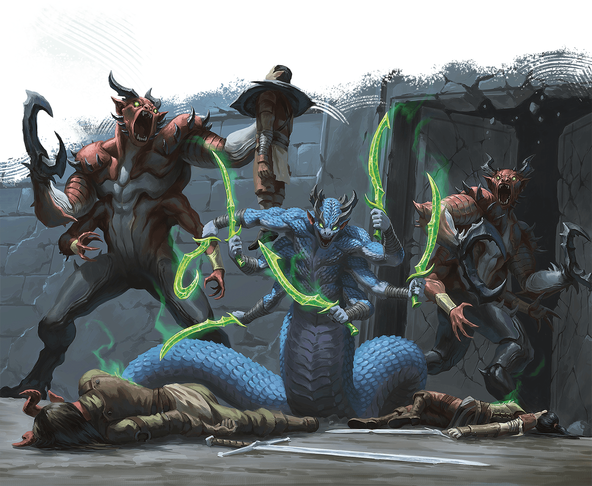

<!-- Notes MJ : contenu fourni par l’utilisateur, non destiné au partage public. -->

#### S1: Courtyard

Two enormous, red-skinned fiends with two arms resembling a human’s and two more ending in massive claws are battling three soldiers. A six-armed, serpentine monster slavers nearby.

The monsters are two [Glabrezus](https://www.dndbeyond.com/monsters/5195041-glabrezu), which each have 100 HP remaining, and a [Marilith](https://www.dndbeyond.com/monsters/5195117-marilith), which has 150 HP remaining. If the characters intervene, the demons leave the soldiers alone and focus on fighting the characters. In this case, the soldiers (Medium [Warrior Veterans](https://www.dndbeyond.com/monsters/5195260-warrior-veteran)), are reduced to 49 HP and retreat down the trail. The stone doors to the station’s main chamber (area S2) are open.

***Development.*** The soldiers are Kellen Tol and Merias, both humans, and Serafina, a tiefling. If they survive the fight, they thank the characters and frantically beg them to help the militia members trapped inside the keep.

BRIAN VALEZA

If the characters don’t act quickly, demons murder the inhabitants of the tax station.
