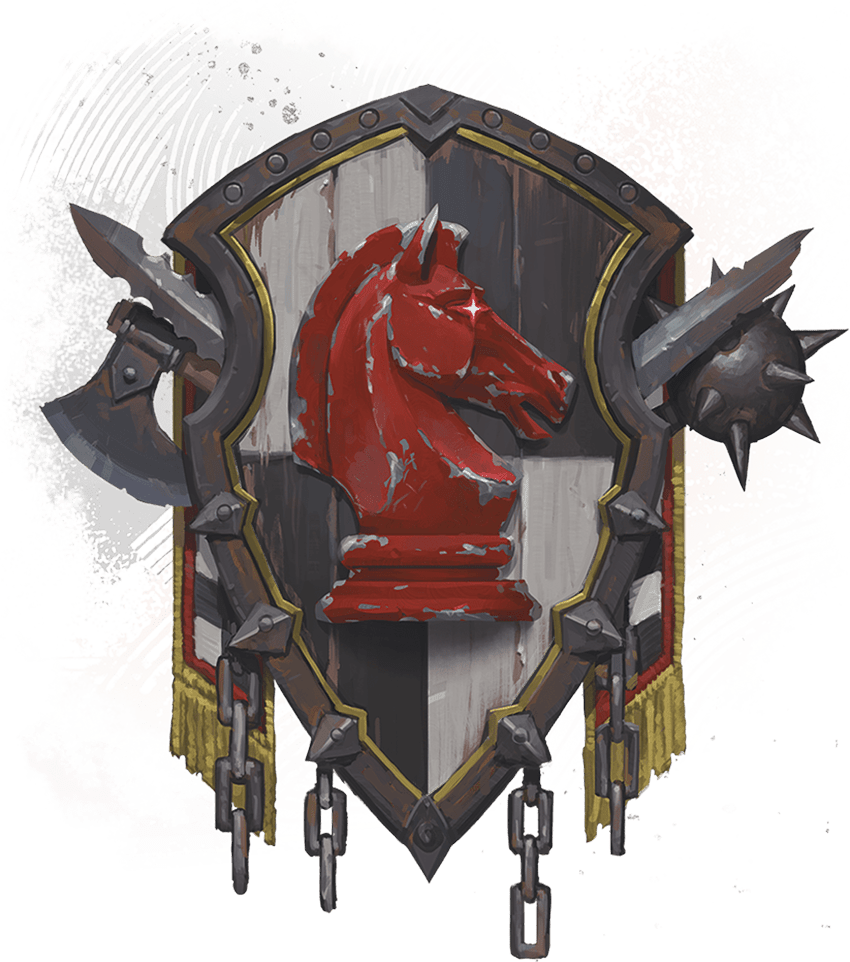
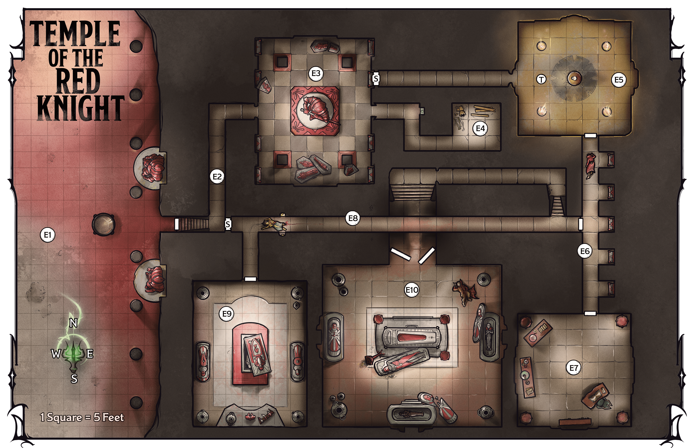
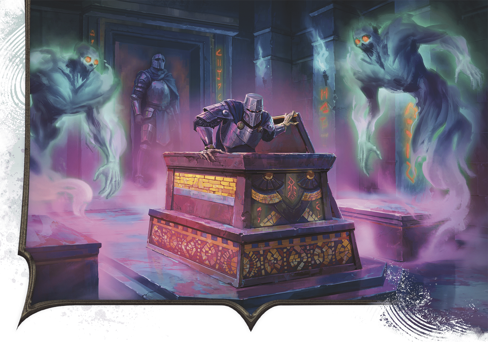
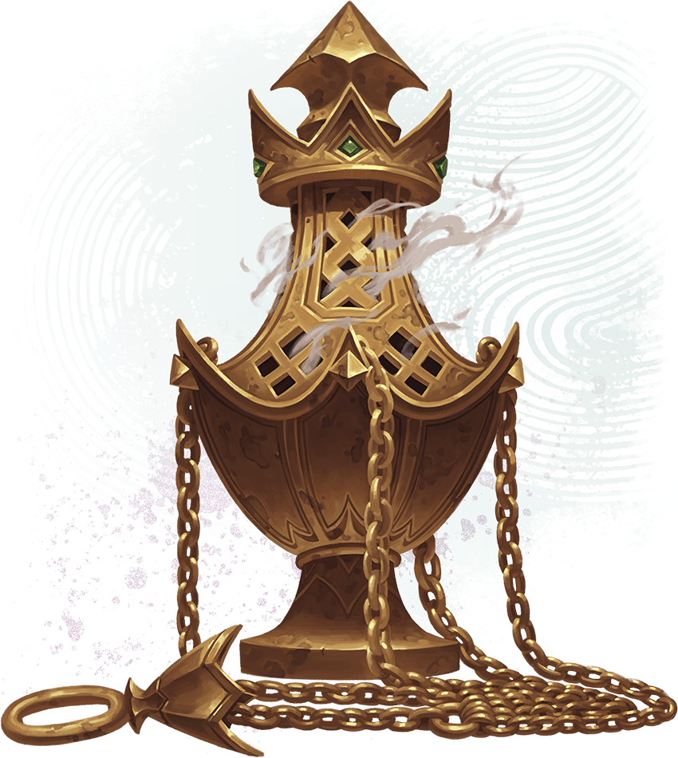

<!-- Notes MJ : contenu fourni par l’utilisateur, non destiné au partage public. -->

## Temple of the Red Knight

The Temple of the Red Knight in Pyarados is built into a sheer limestone cliff at the foot of the Sunrise Mountains.

### Lost Research Team

Although the outside of the temple suggests it’s abandoned, an eccentric Red Wizard archaeologist named Nazemm, a human from the city of Pyarados, recently entered the complex with a team of spellcasting academics to learn about this ancient group of Red Knight worshippers. The team decoded the temple’s entry requirements (see [area E1](../chapter.md#E1TempleEntrance)) and ventured inside, bypassing the building’s traps and locked doors.

Unfortunately for the academics, Nazemm accidentally invoked an ancient inscription meant to protect Khamune’s tomb ([area E10](../chapter.md#E10TombCommander)) from Mulhorandi robbers. The invocation awakened several undead within the complex, including Khamune.

Swatches Studio

The Red Knight’s Holy Symbol

These undead slew Nazemm and most of his team members. Their bodies lie scattered about the temple. The sole survivor, Valzaa, hides in a sarcophagus in Khamune’s tomb, desperately hoping to escape.

### Temple Features

The temple has the following features.

#### Ceilings

Interior ceilings in rooms are 30 feet high. Hallway ceilings (including areas [E2](../chapter.md#E2EntryTunnel), [E6](../chapter.md#E6EasternHallway), and [E8](../chapter.md#E8CentralHallway)) are 15 feet high.

#### Doors

The temple’s doors are made of stone. The door to the temple is locked (see [area E1](../chapter.md#E1TempleEntrance)). Interior doors are unlocked except for the door in the worship chamber ([area E5](../chapter.md#E5WorshipChamber)) that leads to the eastern hallway ([area E6](../chapter.md#E6EasternHallway)). (See “Doors” in the [Dungeon Master’s Guide](https://www.dndbeyond.com/sources/dnd/dmg-2024/dms-toolbox#Doors).)

***Secret Doors.*** Unless otherwise noted, secret doors (marked with an *S* on the map; DC 18 to notice) blend with the surrounding walls.

#### Lighting

The entire temple is in [Darkness](https://www.dndbeyond.com/sources/dnd/free-rules/rules-glossary#Darkness), except the worship chamber ([area E5](../chapter.md#E5WorshipChamber)), where torches shed [Dim Light](https://www.dndbeyond.com/sources/dnd/free-rules/rules-glossary#DimLight). Descriptions assume characters have a way to see in the dark.

#### Mummy Lord’s Lair

The Temple of the Red Knight is the lair of Khamune, who has risen as a mummy lord. The temple has the features of a mummy lord lair described in the [Monster Manual](https://www.dndbeyond.com/sources/dnd/mm-2024/monsters-m#MummyLordLairs).

### Temple Locations

Gerralt Landman

Map 4.3: Temple of the Red Knight [View Player Version](https://media-stg.dndbeyond.com/compendium-images/aud/aqZhSuV5QislqWyN/map-04-03.temple-of-the-red-knight-player.png)

The following locations are keyed to map 4.3.

#### E1: Temple Entrance

A five-foot-wide copper bowl on a marble base sits before this imposing temple facade, which consists of limestone pillars supporting a rock overhang extending from the sheer cliff. Beneath the overhang, a small door is recessed into the cliff. Flanking the bowl are two red granite statues of knights, their hands touching sheathed swords. Strange writing is carved into every inch of the pillars.

The temple’s entrance once welcomed the Red Knight’s faithful.

***Door.*** The door to the temple is locked from the outside. The lock is Complex (1 minute to pick) and of Superior quality (DC 20).

***Statues.*** The statues near the bowl are golems. One uses the [Iron Golem](https://www.dndbeyond.com/monsters/5195090-iron-golem) stat block, and the other uses the [Stone Golem](https://www.dndbeyond.com/monsters/4904850-stone-golem) stat block. The statues fight the characters if they try to open the door without performing the rite described below.

***Copper Bowl.*** The empty bowl’s marble base is carved with ancient writing meant to keep the temple sealed. Khamune’s people built a workaround into the seal, however, in case their descendants ever returned to reclaim the temple.

The writing’s language is similar to ancient Mulhorandi. A character who speaks Mulhorandi can translate the writing by taking the [Study](https://www.dndbeyond.com/sources/dnd/free-rules/rules-glossary#StudyAction) action and succeeding on a DC 18 Intelligence ([Investigation](https://www.dndbeyond.com/sources/dnd/free-rules/playing-the-game#Skills)) check.

The writing says, “Though we have failed, through strategy we may yet succeed. When you return, O children, offer the Crimson General a gift. Speak these words and pour any magical or sacred elixir into the bowl to achieve victory.”

***Performing the Rite.*** Anyone who learns the translation realizes it means that one must pour any magic potion or a flask of [Holy Water](https://www.dndbeyond.com/equipment/507-holy-water) into the bowl while speaking the translation aloud in any language. A character can do so as an action.

If a character performs the rite, the temple door unlocks and remains unlocked for 5 minutes. The door isn’t locked from the inside.

***The Pillars’ Writing.*** Consisting of unique arcane runes, the writing covering the pillars is magical and dates to the tomb’s construction. As a [Study](https://www.dndbeyond.com/sources/dnd/free-rules/rules-glossary#StudyAction) action, a character can examine the writing and make a DC 15 Intelligence ([Arcana](https://www.dndbeyond.com/sources/dnd/free-rules/playing-the-game#Skills) or [History](https://www.dndbeyond.com/sources/dnd/free-rules/playing-the-game#Skills)) check. On a success, the character determines that the writing invokes the temple’s ancient magic, which has prevented Szass Tam’s experiments from transforming the temple’s dead occupants into malefites.

#### E2: Entry Tunnel

Steep steps in this cramped tunnel lead downward, then the hall turns north.

This hallway leads deeper into the complex.

***Secret Door.*** A secret door at the first bend in the tunnel leads to the temple’s central hallway ([area E8](../chapter.md#E8CentralHallway)). See “[Temple Features](../chapter.md#TempleFeatures)” for details. Should the characters pass this secret door after exploring [area E3](../chapter.md#E3EntryChamber) and not finding the secret door there, they have [Advantage](https://www.dndbeyond.com/sources/dnd/free-rules/rules-glossary#Advantage) on finding the secret door in this hall.

#### E3: Entry Chamber

This chamber’s four pillars are covered in ancient writing, and murals adorn the walls. Eight upright sarcophagi stand against the walls, their lids scattered around the room. Within each sarcophagus is a motionless, desiccated body. On a central dais, a fifteen-foot-tall, red stone statue of a knight drawing her sword overlooks the area.

When a character steps onto the center dais, the eight [Ghast Gravecallers](https://www.dndbeyond.com/monsters/5195006-ghast-gravecaller) in the sarcophagi animate and fight the characters. These are lieutenants of Khamune who rose in undeath to defend the temple when the academics invoked the protective inscription in Khamune’s tomb ([area E10](../chapter.md#E10TombCommander)).

***Hidden Compartment.*** The base of the central statue contains a hidden compartment (DC 20 to notice). The compartment is locked. A character can take the [Utilize](https://www.dndbeyond.com/sources/dnd/free-rules/rules-glossary#UtilizeAction) action to try to pick the lock using [Thieves’ Tools](https://www.dndbeyond.com/equipment/495-thieves-tools), doing so with a successful DC 18 Dexterity ([Sleight of Hand](https://www.dndbeyond.com/sources/dnd/free-rules/playing-the-game#Skills)) check. The compartment contains a [Potion of Speed](https://www.dndbeyond.com/magic-items/9228939-potion-of-speed).

***Murals.*** The murals all show images of a knight in red armor standing tall above a force of smaller warriors. The knight leads a valiant charge against unarmored warriors led by a tall man in pharaonic garb.

***Pillars.*** A character who speaks Mulhorandi can translate the writing on the pillars by taking the [Study](https://www.dndbeyond.com/sources/dnd/free-rules/rules-glossary#StudyAction) action and succeeding on a DC 18 Intelligence ([History](https://www.dndbeyond.com/sources/dnd/free-rules/playing-the-game#Skills)) check.

The writing tells the story of the followers of “Khamune, the sacred high commander.” Characters who read the story learn the information about Khamune’s people in “[An Ancient Temple](../chapter.md#AnAncientTemple)” earlier in this chapter.

***Secret Door.*** A secret door in the northeastern wall behind a sarcophagus leads to the temple’s worship chamber (area [E5](../chapter.md#E5WorshipChamber)); see “[Temple Features](../chapter.md#TempleFeaturesDoors)” for details.

#### E4: Storage Chamber

This small chamber holds only shreds of rotted cloth and wood and other refuse.

This room once held sacks of grain and other supplies, but anything of interest here has rotted away.

#### E5: Worship Chamber

Murals of supplicants praying to a red-armored knight adorn these walls and the south door. Four pedestals hold lit torches, while a pedestal with a skull resting atop it is in the room’s center.

This was once a room where the Red Knight’s faithful meditated on battle strategies. When they sealed the temple, they installed a trap here to prevent intruders from moving farther inside.

***Dart Trap.*** There’s a pressure plate on this room’s floor, which is denoted by a *T* on the map. The pressure plate triggers a poisoned darts trap, as described in the [Dungeon Master’s Guide](https://www.dndbeyond.com/sources/dnd/dmg-2024/dms-toolbox#PoisonedDarts), except the Dexterity saving throw DC is 15, and each dart deals 14 (4d6) Poison damage.

***Locked Door Puzzle.*** The door to the hallway to the south ([area E6](../chapter.md#E6EasternHallway)) is locked. The lock is Complex (1 minute to pick) and of Superior quality (DC 20).

A character who takes the [Study](https://www.dndbeyond.com/sources/dnd/free-rules/rules-glossary#StudyAction) action to examine the door realizes the mural shows a magical way to unlock it. The mural depicts supplicants raising their hands in praise to the Red Knight. The supplicants stand in a line, and each but the one on the westernmost edge holds a torch.

If the characters take the torches from the nearby pedestals and stand in a formation that matches the mural, the door unlocks.

***Pedestals with Torches.*** Each pedestal holds a torch lit with a [Continual Flame](https://www.dndbeyond.com/spells/2619065-continual-flame) spell. A character can remove a torch easily (no action required).

***Secret Door.*** In the tunnel to the east, the door to [area E3](../chapter.md#E3EntryChamber) is plainly visible.

***Treasure.*** The skull on the central pedestal obscures a receptacle containing the following:

500 GP

[Elixir of Health](https://www.dndbeyond.com/magic-items/5351-elixir-of-health)

[Potion of Clairvoyance](https://www.dndbeyond.com/magic-items/4701-potion-of-clairvoyance)

[Potion of Longevity](https://www.dndbeyond.com/magic-items/5359-potion-of-longevity)

#### E6: Eastern Hallway

This long hallway runs from north to south. Five alcoves that hold sarcophagi punctuate the east side of the wall. Down the hall, the desiccated body of a robed figure lies slumped on the ground.

This hallway holds the sarcophagi of Khamune’s lieutenants. These lieutenants were not raised from the dead when Nazemm invoked the inscription in Khamune’s tomb ([area E10](../chapter.md#E10TombCommander)).

***Corpse.*** This hall holds the body of Ralpheen, a human apprentice of Nazemm. A character can take the [Search](https://www.dndbeyond.com/sources/dnd/free-rules/rules-glossary#SearchAction) action to examine Ralpheen’s wounds and make a DC 15 Wisdom ([Medicine](https://www.dndbeyond.com/sources/dnd/free-rules/playing-the-game#Skills)) check. On a success, the character determines that Necrotic damage killed him recently. (The undead mage in area E7 slew him.) If the characters can speak to Ralpheen, he tells them everything in “[Lost Research Team](../chapter.md#LostResearchTeam)” earlier in this chapter, except he doesn’t know Valzaa is still alive.

#### E7: Tomb of the Resting Wizard

This chamber appears to be a magical workshop. Two tables covered in rotting books, flaking scrolls, and strange implements stand along the west wall. A heavy desk sits in the southeast corner, and unlit braziers dot the room’s corners. A thick layer of dust covers everything.

A mage named Teketh who once served Khamune died here. Her skeleton was disturbed by Ralpheen, Nazemm’s apprentice (Ralpheen’s body lies in [area E6](../chapter.md#E6EasternHallway)). The skeleton crumbled to dust save for its skull, which animated (use the stat block of a [Demilich](https://www.dndbeyond.com/monsters/5194967-demilich), except Teketh has no lair and lacks the Undead Restoration trait). Teketh killed Ralpheen, then retreated here and now rests underneath the desk.

***Disturbing Teketh.*** If any character searches the desk in the room’s southeast corner, Teketh fights the characters, following them into other areas of the temple if necessary.

***Treasure.*** The following magic items lie scattered atop the tables in this room:

[Dark Shard Amulet](https://www.dndbeyond.com/magic-items/9228417-dark-shard-amulet)

[Figurine of Wondrous Power (silver raven)](https://www.dndbeyond.com/magic-items/9228621-figurine-of-wondrous-power)

[Ring of Spell Turning](https://www.dndbeyond.com/magic-items/9228969-ring-of-spell-turning)

[Spell Scroll](https://www.dndbeyond.com/magic-items/9229085-spell-scroll) *of* [Aura of Vitality](https://www.dndbeyond.com/spells/2618891-aura-of-vitality)

[Spell Scroll](https://www.dndbeyond.com/magic-items/9229085-spell-scroll) *of* [Magic Circle](https://www.dndbeyond.com/spells/2619018-magic-circle)

[Wand of Secrets](https://www.dndbeyond.com/magic-items/9229193-wand-of-secrets)

#### E8: Central Hallway

This long hallway stretches the length of the temple, east to west. A corridor near the east end leads north, while one near the west end leads south; just past it, the hallway ends at a door. A robed body lies crumpled near the west corridor.

This hallway runs east to west through the center of the temple. The eastern corridor leads to the tomb of the high commander ([area E10](../chapter.md#E10TombCommander)).

***Corpse.*** The central hall holds the body of Nadia, a human apprentice of Nazemm. A character can take the [Search](https://www.dndbeyond.com/sources/dnd/free-rules/rules-glossary#SearchAction) action to examine Nadia’s wounds and make a DC 15 Wisdom ([Medicine](https://www.dndbeyond.com/sources/dnd/free-rules/playing-the-game#Skills)) check. On a success, the character determines Nadia died recently after taking Slashing and Necrotic damage from a Melee weapon. (The undead general in [area E9](../chapter.md#E9GeneralsTomb) slew her.) If the characters can speak to Nadia, she tells them everything in “[Lost Research Team](../chapter.md#LostResearchTeam)” earlier in this chapter, except she doesn’t know Valzaa is still alive.

***Secret Door.*** The secret door to the entry tunnel ([area E2](../chapter.md#E2EntryTunnel)) is plainly visible from this side.

#### E9: General’s Tomb

SYLVAIN SARRAILH

An ancient general rises as a death knight to fight the characters.

Lines of ancient writing cover this chamber’s walls. On the far side of the room stands a suit of armor and a weapon rack holding two swords and a mace. A stone sarcophagus stands at the center of the chamber atop a five-foot-high platform; its lid has been pushed aside. Additional closed sarcophagi lie to the east and west.

This is the burial chamber of Khamune’s general, Mekuni. Now a [Death Knight](https://www.dndbeyond.com/monsters/5194963-death-knight), Mekuni lies in the central sarcophagus while her two loyal strategists lie in the flanking tombs. Mekuni killed Nadia, the apprentice in the central hallway ([area E8](../chapter.md#E8CentralHallway)), after the apprentice disturbed her rest; the general then returned to her sarcophagus.

When a creature moves more than 5 feet into the room, Mekuni rises to fight the characters, along with two [Wraiths](https://www.dndbeyond.com/monsters/5174960-wraith) that rise from the sarcophagi on either side of the room.

***Writing.*** A character who speaks Mulhorandi can translate the ancient writing on the wall by taking the [Study](https://www.dndbeyond.com/sources/dnd/free-rules/rules-glossary#StudyAction) action and succeeding on a DC 18 Intelligence ([History](https://www.dndbeyond.com/sources/dnd/free-rules/playing-the-game#Skills)) check.

The writing tells of the loyalty of a general named Mekuni, Khamune’s second in command. Mekuni and her strategists, Dalni and Hamsu, died defending Khamune from Mulhorandi assassins.

***Treasure.*** In each of this chamber’s corners sits an ivory jar emblazoned with the Red Knight’s symbol and worth 500 GP.

The following armor and weapons sit on the far side of the room:

[Adamantine Plate Mail](https://www.dndbeyond.com/magic-items/4852-adamantine-plate)

[Dancing Sword (Scimitar)](https://www.dndbeyond.com/magic-items/4867-dancing-scimitar)

[Flame Tongue (Longsword)](https://www.dndbeyond.com/magic-items/11854137-flame-tongue-longsword)

[Mace of Terror](https://www.dndbeyond.com/magic-items/9228835-mace-of-terror)

#### E10: Tomb of the High Commander

The tomb’s heavy stone doors hang open, revealing a large central sarcophagus on a raised dais. The sarcophagus’s lid, covered in ancient writing, has been pushed to the ground. Two open sarcophagi lie to the south and east, while a closed sarcophagus rests to the west. Murals and ancient script adorn the walls.

Lording over a slumped, red-robed body is a tiefling mummy with glowing red eyes and wearing ceremonial armor. Two desiccated warriors stand at attention next to the mummy.

The mummy is Khamune ([Mummy Lord](https://www.dndbeyond.com/monsters/5195134-mummy-lord)), the high commander of the Red Knight, who was interred here. The two warriors were Khamune’s personal guards. They each use the stat block of a [Berserker Commander](https://www.dndbeyond.com/monsters/5194924-berserker-commander), except their creature type is Undead. The creatures fight the characters on sight, following them into other parts of the temple if necessary.

***Corpse.*** The body is Nazemm, the Red Wizard and archaeologist who led the ill-fated expedition into the temple. Nazemm read aloud the writing inscribed on Khamune’s sarcophagus lid, which awakened many of the dead interred in the temple. If the characters can speak to Nazemm, he tells them everything in “[Lost Research Team](../chapter.md#LostResearchTeam)” earlier in this chapter, except he doesn’t know Valzaa is still alive.

***Hiding Apprentice.*** If the characters stand within 5 feet of the closed sarcophagus to the west, they hear whimpering. Inside the sarcophagus hides the only survivor of Nazemm’s research team: a human apprentice named Valzaa (Medium, Chaotic Good [Mage Apprentice](https://www.dndbeyond.com/monsters/5195109-mage-apprentice)). If the characters remove the lid, they find Valzaa hiding beside a dead guard who didn’t animate with the rest. Once she realizes the characters aren’t enemies, Valzaa begs them to escort her back to the city of Pyarados. She can tell the characters everything in “[Lost Research Team](../chapter.md#LostResearchTeam)” earlier in this chapter.

***Lid Inscription.*** The magic in the sarcophagus’s lid inscription is gone now that Nazemm accidentally activated it. A character who speaks Mulhorandi can translate the ancient inscription on the lid by taking the [Study](https://www.dndbeyond.com/sources/dnd/free-rules/rules-glossary#StudyAction) action and succeeding on a DC 18 Intelligence ([History](https://www.dndbeyond.com/sources/dnd/free-rules/playing-the-game#Skills)) check.

The inscription says, “Our high commander remains vigilant in death. The Red Knight shall visit horrors on those who disturb his peace.”

Alejandro Pacheco

Spirit-Binding Censer

***Murals and Writing.*** The chamber’s walls are covered in murals of a tiefling man wearing red armor, as well as lines of ancient writing. A character who speaks Mulhorandi can translate the writing on the wall by taking the Study action and succeeding on a DC 18 Intelligence ([History](https://www.dndbeyond.com/sources/dnd/free-rules/playing-the-game#Skills)) check.

The writing tells how Khamune served his people and the Red Knight and fought the Mulhorandi. He won numerous skirmishes before the empire crushed the uprising; each time, Khamune gave the spoils of these battles to his soldiers, never keeping any riches for himself.

***Treasure.*** In each of this chamber’s corners stands an ivory jar emblazoned with the Red Knight’s symbol and worth 500 GP.

Inside Khamune’s sarcophagus lies the [Spirit-Binding Censer](https://www.dndbeyond.com/magic-items/11914557-spirit-binding-censer) (see [appendix A](../../appendix-a-magic-item/chapter.md#SpiritBindingCenser)), the Artifact the characters seek.
