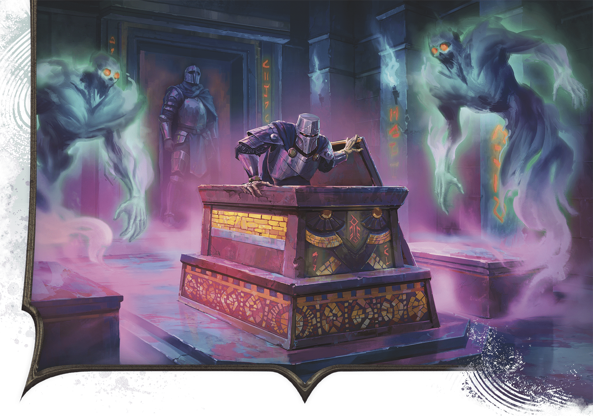

<!-- Notes MJ : contenu fourni par l’utilisateur, non destiné au partage public. -->

#### E9: General’s Tomb

SYLVAIN SARRAILH

An ancient general rises as a death knight to fight the characters.

Lines of ancient writing cover this chamber’s walls. On the far side of the room stands a suit of armor and a weapon rack holding two swords and a mace. A stone sarcophagus stands at the center of the chamber atop a five-foot-high platform; its lid has been pushed aside. Additional closed sarcophagi lie to the east and west.

This is the burial chamber of Khamune’s general, Mekuni. Now a [Death Knight](https://www.dndbeyond.com/monsters/5194963-death-knight), Mekuni lies in the central sarcophagus while her two loyal strategists lie in the flanking tombs. Mekuni killed Nadia, the apprentice in the central hallway ([area E8](../chapter.md#E8CentralHallway)), after the apprentice disturbed her rest; the general then returned to her sarcophagus.

When a creature moves more than 5 feet into the room, Mekuni rises to fight the characters, along with two [Wraiths](https://www.dndbeyond.com/monsters/5174960-wraith) that rise from the sarcophagi on either side of the room.

***Writing.*** A character who speaks Mulhorandi can translate the ancient writing on the wall by taking the [Study](https://www.dndbeyond.com/sources/dnd/free-rules/rules-glossary#StudyAction) action and succeeding on a DC 18 Intelligence ([History](https://www.dndbeyond.com/sources/dnd/free-rules/playing-the-game#Skills)) check.

The writing tells of the loyalty of a general named Mekuni, Khamune’s second in command. Mekuni and her strategists, Dalni and Hamsu, died defending Khamune from Mulhorandi assassins.

***Treasure.*** In each of this chamber’s corners sits an ivory jar emblazoned with the Red Knight’s symbol and worth 500 GP.

The following armor and weapons sit on the far side of the room:

[Adamantine Plate Mail](https://www.dndbeyond.com/magic-items/4852-adamantine-plate)

[Dancing Sword (Scimitar)](https://www.dndbeyond.com/magic-items/4867-dancing-scimitar)

[Flame Tongue (Longsword)](https://www.dndbeyond.com/magic-items/11854137-flame-tongue-longsword)

[Mace of Terror](https://www.dndbeyond.com/magic-items/9228835-mace-of-terror)
