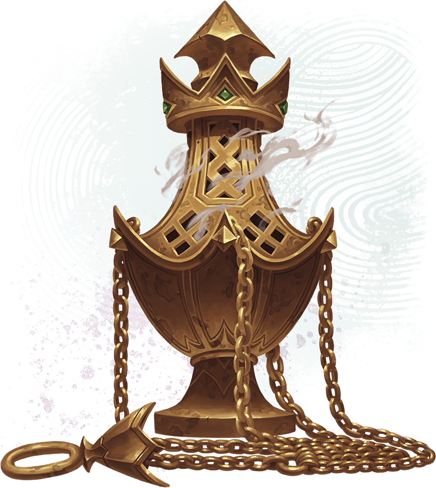

<!-- Notes MJ : contenu fourni par l’utilisateur, non destiné au partage public. -->

#### E10: Tomb of the High Commander

The tomb’s heavy stone doors hang open, revealing a large central sarcophagus on a raised dais. The sarcophagus’s lid, covered in ancient writing, has been pushed to the ground. Two open sarcophagi lie to the south and east, while a closed sarcophagus rests to the west. Murals and ancient script adorn the walls.

Lording over a slumped, red-robed body is a tiefling mummy with glowing red eyes and wearing ceremonial armor. Two desiccated warriors stand at attention next to the mummy.

The mummy is Khamune ([Mummy Lord](https://www.dndbeyond.com/monsters/5195134-mummy-lord)), the high commander of the Red Knight, who was interred here. The two warriors were Khamune’s personal guards. They each use the stat block of a [Berserker Commander](https://www.dndbeyond.com/monsters/5194924-berserker-commander), except their creature type is Undead. The creatures fight the characters on sight, following them into other parts of the temple if necessary.

***Corpse.*** The body is Nazemm, the Red Wizard and archaeologist who led the ill-fated expedition into the temple. Nazemm read aloud the writing inscribed on Khamune’s sarcophagus lid, which awakened many of the dead interred in the temple. If the characters can speak to Nazemm, he tells them everything in “[Lost Research Team](../chapter.md#LostResearchTeam)” earlier in this chapter, except he doesn’t know Valzaa is still alive.

***Hiding Apprentice.*** If the characters stand within 5 feet of the closed sarcophagus to the west, they hear whimpering. Inside the sarcophagus hides the only survivor of Nazemm’s research team: a human apprentice named Valzaa (Medium, Chaotic Good [Mage Apprentice](https://www.dndbeyond.com/monsters/5195109-mage-apprentice)). If the characters remove the lid, they find Valzaa hiding beside a dead guard who didn’t animate with the rest. Once she realizes the characters aren’t enemies, Valzaa begs them to escort her back to the city of Pyarados. She can tell the characters everything in “[Lost Research Team](../chapter.md#LostResearchTeam)” earlier in this chapter.

***Lid Inscription.*** The magic in the sarcophagus’s lid inscription is gone now that Nazemm accidentally activated it. A character who speaks Mulhorandi can translate the ancient inscription on the lid by taking the [Study](https://www.dndbeyond.com/sources/dnd/free-rules/rules-glossary#StudyAction) action and succeeding on a DC 18 Intelligence ([History](https://www.dndbeyond.com/sources/dnd/free-rules/playing-the-game#Skills)) check.

The inscription says, “Our high commander remains vigilant in death. The Red Knight shall visit horrors on those who disturb his peace.”

Alejandro Pacheco

Spirit-Binding Censer

***Murals and Writing.*** The chamber’s walls are covered in murals of a tiefling man wearing red armor, as well as lines of ancient writing. A character who speaks Mulhorandi can translate the writing on the wall by taking the Study action and succeeding on a DC 18 Intelligence ([History](https://www.dndbeyond.com/sources/dnd/free-rules/playing-the-game#Skills)) check.

The writing tells how Khamune served his people and the Red Knight and fought the Mulhorandi. He won numerous skirmishes before the empire crushed the uprising; each time, Khamune gave the spoils of these battles to his soldiers, never keeping any riches for himself.

***Treasure.*** In each of this chamber’s corners stands an ivory jar emblazoned with the Red Knight’s symbol and worth 500 GP.

Inside Khamune’s sarcophagus lies the [Spirit-Binding Censer](https://www.dndbeyond.com/magic-items/11914557-spirit-binding-censer) (see [appendix A](../../appendix-a-magic-item/chapter.md#SpiritBindingCenser)), the Artifact the characters seek.
