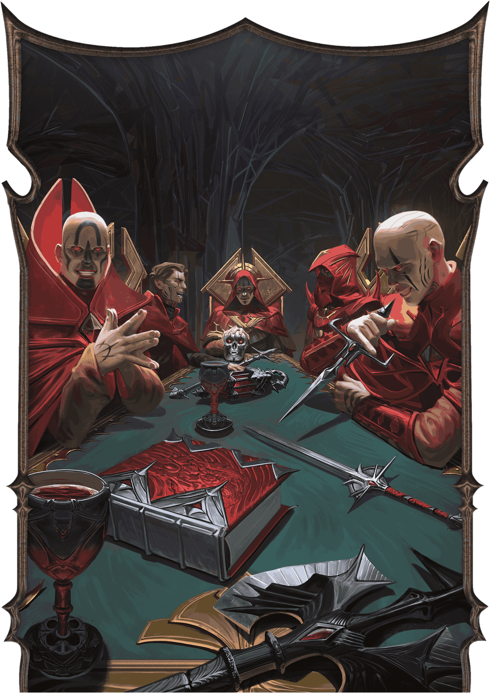
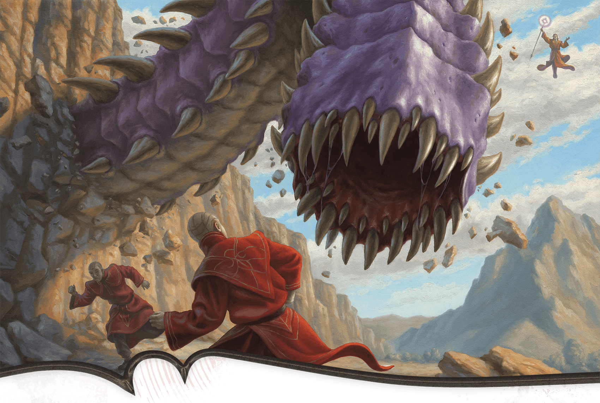
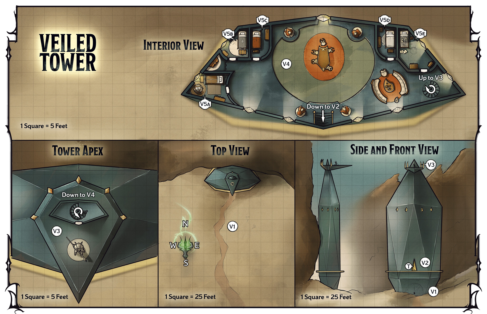
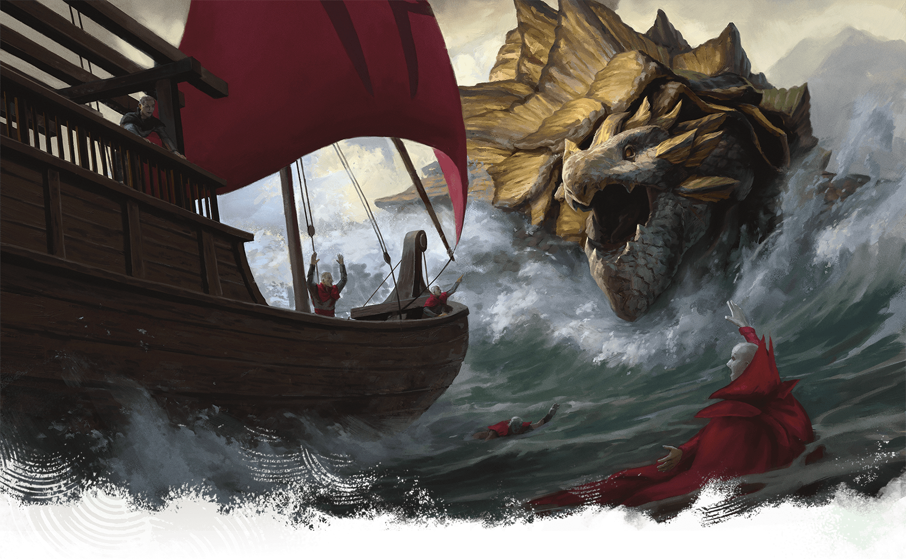
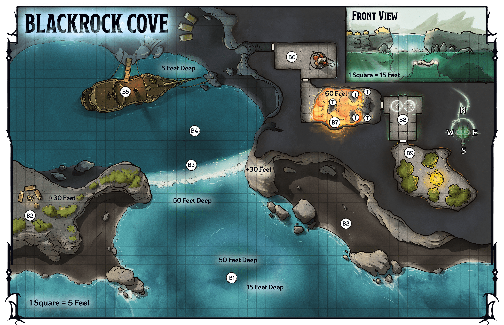

<!-- Notes MJ : contenu fourni par l’utilisateur, non destiné au partage public. -->

# Chapter 5: Rebel Alliances

Chapter 5

# Rebel Alliances

Seek aid from dissident Red Wizards and pirates.

Adventure   
for Level

15

Characters

Sessions

3-4

KEVIN GLINT

From Left to Right: the Red Wizards Abadesh, Darvyn Yev, Iorru, Sabinia Dau, and Zeil

## Key Plot Points

The following information is key to this chapter’s story:

- **Ally with Dissident Red Wizards.** The characters travel to a hidden tower outside Eltabbar to enlist the help of iconoclastic mages in reaching Szass Tam’s ritual area.
- **Recruit the Pirates.** The characters travel to Thay’s island tharch to ask a band of pirates to attack ships carrying foci Szass Tam needs to boost his ritual.

## Preparation

Before running this chapter, prepare as follows:

- **Step 1.** Read the “[Running This Chapter](#RunningThisChapter)” section, including “[Character Advancement](#CharacterAdvancement).” Decide with your players which mission the characters will tackle first or run them in the order presented.
- **Step 2.** Familiarize yourself with the Key NPCs table below.
- **Step 3.** Bookmark the stat blocks below, which appear in the [Monster Manual](https://www.dndbeyond.com/sources/dnd/mm-2024) and on D&D Beyond unless otherwise noted. If a stat block appears in appendix B, an asterisk appears after its name:

- [Archmage](https://www.dndbeyond.com/monsters/5194902-archmage)
- [Death Knight](https://www.dndbeyond.com/monsters/5194963-death-knight)
- [Death Knight Aspirant](https://www.dndbeyond.com/monsters/5194962-death-knight-aspirant)
- [Dragon Turtle](https://www.dndbeyond.com/monsters/5194973-dragon-turtle)
- [Iron Golem](https://www.dndbeyond.com/monsters/5195090-iron-golem)
- [Noble Prodigy](https://www.dndbeyond.com/monsters/5195144-noble-prodigy)
- [Pirate](https://www.dndbeyond.com/monsters/4904830-pirate)

- [Pirate Admiral](https://www.dndbeyond.com/monsters/5195161-pirate-admiral)
- [Pirate Captain](https://www.dndbeyond.com/monsters/4904838-pirate-captain)
- [Purple Worm](https://www.dndbeyond.com/monsters/5195174-purple-worm)
- [Spy Master](https://www.dndbeyond.com/monsters/5195216-spy-master)
- [Stone Golem](https://www.dndbeyond.com/monsters/4904850-stone-golem)
- [Xelnene Thrul](https://www.dndbeyond.com/monsters/6719634-xelnene-thrul)\*

#### Key NPCs

| Name | Role | Stat Block | Location |
| --- | --- | --- | --- |
| Abadesh | Human dissident Red Wizard | [Archmage](https://www.dndbeyond.com/monsters/5194902-archmage) (Medium) | [V4](#V4Lounge) |
| Darvyn Yev | Human dissident Red Wizard and owner of the Veiled Tower | [Archmage](https://www.dndbeyond.com/monsters/5194902-archmage) (Medium) | [V4](#V4Lounge) |
| Iorru | Human dissident Red Wizard | [Archmage](https://www.dndbeyond.com/monsters/5194902-archmage) (Medium) | [V4](#V4Lounge) |
| Sabinia Dau | Tiefling dissident Red Wizard | [Archmage](https://www.dndbeyond.com/monsters/5194902-archmage) (Medium) | [V4](#V4Lounge) |
| Sharlei | Human leader of pirate crew at Blackrock Cove | [Pirate Admiral](https://www.dndbeyond.com/monsters/5195161-pirate-admiral) (Medium) | [B4](#B4HiddenCave) |
| Szass Tam | Lich plotting to conquer Thay and primary target of Operation Deadfall | [See appendix B](../appendix-b-bestiary/chapter.md#SzassTam) | “[Enemy Ambush](#EnemyAmbush)” |
| Wynston Wrynn | Human tailor and Zulkir Thrul’s spy master | [Spy Master](https://www.dndbeyond.com/monsters/5195216-spy-master) (Medium, Neutral Good) | “[Fifth and Sixth Missions](#FifthAndSixthMissions)” |
| Xelnene Thrul | Human zulkir of evocation and Operation Deadfall’s leader | [See appendix B](../appendix-b-bestiary/chapter.md#XelneneThrul) | “[Fifth and Sixth Missions](#FifthAndSixthMissions)” |
| Zeil | Human dissident Red Wizard | [Archmage](https://www.dndbeyond.com/monsters/5194902-archmage) (Medium) | [V4](#V4Lounge) |

## Running This Chapter

This chapter takes place after the characters have completed their missions in Pyarados.

### Character Advancement

The characters should be level 15 when this chapter begins. They should have enough XP to advance to level 16 before they embark on their second mission in this chapter. They should reach level 17 by the end of this chapter. If you’re using a method of level advancement that doesn’t rely on XP, the characters gain levels at those points.

## Returning to the Zulkir

When the characters go to Wrynn’s Bespoke Vestments to meet with Zulkir Thrul, they find Wynston Wrynn thanking a young elf man who’s leaving the shop with his arms piled high with [Fine Clothes](https://www.dndbeyond.com/equipment/539-fine-clothes).

The tailor ushers the characters into the shop’s secret office and whispers into a [Sending Stone](https://www.dndbeyond.com/magic-items/9180147-sending-stones). A few moments later, Zulkir Thrul arrives via the [Teleport](https://www.dndbeyond.com/spells/2619163-teleport) spell, undisguised. She casts the [Demiplane](https://www.dndbeyond.com/spells/2619088-demiplane) spell and escorts the group through the shadowy door that appears on the wall.

## Fifth and Sixth Missions

After the characters tell the zulkir about their previous missions, she gives them details about their next ones. Read or paraphrase the following:

“Operatives, we approach your confrontation with the Hydra,” says Zulkir Thrul. “However, you first must accomplish two tasks.

“You must visit a tower cloaked in illusions, called the Veiled Tower. Within it are five dissident Red Wizards, code-named the Mavericks, who are vocal about their hatred for the Hydra. These Red Wizards seek a magical way to access the area of Thaymount you must infiltrate to stop the Hydra’s ritual. You must convince the Mavericks to share their magical knowledge with you.

“In addition, I want you to travel to Blackrock Cove on the island Alaor Minor. Parlay with the pirates lairing there, code-named the Blades, and ask them to destroy each ship on a list I’ll give you. These ships belong to Red Wizards and carry foci the Hydra needs to empower his ritual; without the foci, he will be easier to defeat.

“You may complete these tasks in any order.”

The zulkir then hands the characters a piece of parchment containing the names of four ships:

- *Crimson Wing*
- *Lightning Bolt*
- *Sea Hag’s Eye*
- *Toothy Shark*

The zulkir explains that the list is cloaked with an [Illusory Script](https://www.dndbeyond.com/spells/2619173-illusory-script) spell. The characters can read it, as can Captain Sharlei, the pirates’ leader, but to anyone else, the writing looks like a list of common spell components.

The zulkir can provide the following information about the dissident Red Wizards:

- **Who Are the Mavericks?** “Their leader is an urbane human man named Darvyn Yev. The others are the humans Zeil, Abadesh, and Iorru, and the tiefling Sabinia Dau, who’s an old friend of mine. These Red Wizards have vocally opposed the Hydra and have correctly deduced he plans to violently regain his regency. They fear he might send assassins, so they’re hiding in the Veiled Tower, which belongs to Darvyn.”
- **What Can You Tell Us About the Mavericks?** “They all hate the Hydra, but they’re not exactly benevolent. They’re interested in self-preservation first and self-aggrandizement second; one might call them cowardly. But if you tell them your plans to stop the Hydra, I suspect they’ll ally with us.”
- **What Magical Technique Are They Developing?** “They’re devising a magical way to travel to a specific location near the Citadel in central Thaymount. Sabinia maintains a fortress near the Citadel; I suspect they hope to teleport near it to ride out the Hydra’s impending attack. This fortress lies close to Castle Thrul, my family’s keep, which holds an old underground passageway into the Citadel. When the time is right, this is how you’ll strike at the Hydra.”
- **Why Can’t We Go to Thaymount Another Way?** “Thaymount is covered in magical effects that prevent teleportation and magical travel. Even flying to Thaymount is dangerous, as the cliffs that surround the plateau are heavily trapped and guarded by the Hydra’s agents. The only safe place to travel to is Szul, but the Hydra knows about every creature that arrives there. The Hydra is unlikely to suspect that foes will teleport to and shelter at his doorstep, though. I believe this is the best way for you to travel to Thaymount.” For more about Thaymount’s magical effects, see “[Magic on Thaymount](../chapter-06-precipice-of-oblivion/chapter.md#MagicOnThaymount)” in chapter 6.

The zulkir can provide the following information about the pirates of Blackrock Cove:

- **How Should We Get to Blackrock Cove?** “The portal will take you to Ala City, where I suggest you hire a boat. If you hire a boat captain, don’t tell them details and don’t bring them into the Blades’ hideout. I don’t recommend you use magic to travel to the cove, since the Blades might assume you’re enemies. You aren’t there to fight the Blades, so make it clear you’re not a threat.”
- **Who Are the Blades?** “Most are disgraced former members of the Thayan navy, led by Captain Sharlei. Rumor claims she went into hiding after killing a Red Wizard.”
- **Why Are the Blades in Blackrock Cove?** “Large ships find Blackrock Cove difficult to navigate, though Captain Sharlei can hide her vessel there easily. Rumor also claims an ocean spirit protects the cove from intruders. It’s hogwash, but Red Wizards have tried and failed to attack the Blades many times. Approach cautiously, operatives.”
- **Will the Blades Destroy These Ships?** “I believe they will, as long as you convince them the ships aim to help the Hydra. Bear in mind the Blades likely will want something from you in return. Do what you must to win them to our cause.”
- **Why Don’t We Destroy These Ships Ourselves?** “I have only the ships’ names, not their locations. But the Blades watch all ships’ movement. They should have no problem hunting these four ships.”
- **What Ritual Foci Do These Ships Carry?** “The ships carry cursed skulls of slain fiends that will empower the Hydra’s ritual. These skulls are hundreds of years old and harbor incredible evil power. Once the skulls reach mainland Thay, the Hydra’s associates will arrange for quick delivery to him via teleportation. That must not happen.”

After Thrul answers questions, she provides directions to the Veiled Tower and Blackrock Cove:

“To reach both destinations, you must first travel thirty miles west of the city, where the River Eltar flows down the cliffs of the Second Escarpment. There, near a waterfall, you’ll find a curious rock formation that looks like a V.

“Near the rock formation stands the Veiled Tower, where the dissident Red Wizards hide. To find the tower, you must pierce the illusions that conceal it.

“To reach Blackrock Cove from the rock formation, travel two miles north along the escarpment’s base. Find a rocky outcropping that looks like a skull, and enter the cave at its base. You’ll find a permanent magical portal there.

“The portal leads to Ala City on the island Alaor Major. There you can hire a boat to take you to the cove, which is on the southeast coast of Alaor Minor.”

When the characters are ready to approach the Mavericks, see “Veiled Tower.” When they’re ready to meet the Blades, see “[Magical Portal](chapter.md#MagicalPortal).”

## Veiled Tower

The Veiled Tower is nestled against a cliff in the Second Escarpment near Eltabbar. Darvyn Yev, a Red Wizard scion of a prestigious family of Red Wizards, owns it. Yev’s ancestors built it centuries ago.

### The Mavericks

The Red Wizards in the Veiled Tower are friends who are convinced that Szass Tam soon will become Thay’s regent—and are angry about it. All five are [Archmages](https://www.dndbeyond.com/monsters/5194902-archmage) who are described below.

#### Abadesh

*Self-Indulgent Survivor*

- **Species:** Human
- **Personal Goal:** Avoid becoming the lich’s servitor

Abadesh was a young man during Szass Tam’s last regency and remembers how readily the lich turned dissenters into undead servants. When Yev extended an invitation to hide in the Veiled Tower, Abadesh happily accepted, knowing his association with Szass Tam’s enemies puts a target on his back.

#### Darvyn Yev

Scott Murphy

The Red Wizard Darvyn Yev has a deadly surprise for unwelcome visitors.

*Egotistical Libertine*

- **Species:** Human
- **Personal Goal:** Protect himself from the lich

Known for his dark, beautifully coiffed hair and elegant facial tattoos, Darvyn Yev is from Eltabbar, where his family commands great prestige. Despite his powerful spellcasting, he has failed to equal his forebears’ magical accomplishments. He compensates for this by cultivating his appearance and indulging in luxuries. He’s vocal about his belief that Szass Tam will strip all beauty and joy from Thay.

#### Iorru

*Bookish Scholar of Necromancy*

- **Species:** Human
- **Personal Goal:** Speak against Szass Tam freely

Iorru believes in studying the forces of life and death, not using them to cow one’s enemies. Iorru earned her red robes from a Red Wizard called Reng, who is Szass Tam’s ally. She recently voiced her dislike of the lich to Reng, who put a bounty on her head. She hides in the Veiled Tower with her friends, whom she trusts to help protect her.

#### Sabinia Dau

*Spirited Social Commenter*

- **Species:** Tiefling
- **Personal Goal:** Stoke dissent against Szass Tam

Sabinia Dau comes from a politically powerful, mostly human family. She is a childhood friend of Zulkir Thrul, though Dau focused more on magical research and less on politics than Thrul did. The two remain friendly and occasionally spend time together in Thaymount. ([The Fortress of Opposition](../chapter-06-precipice-of-oblivion/chapter.md#FortressOfOpposition), Dau’s stronghold in Thaymount, is detailed in chapter 6.) Dau recently published a pamphlet titled “Death to Tyrants” that singled out Szass Tam as Thay’s biggest threat. Dau expects Szass Tam’s loyalists to retaliate, so she hides in the Veiled Tower.

#### Zeil

*Brilliant Business Magnate*

- **Species:** Human
- **Personal Goal:** Avoid Szass Tam’s wrath

Unlike most Red Wizard business owners, Zeil treats her workers with dignity and pays them fairly. She owns a mine in eastern Pyarados, where malefite attacks have raged thanks to Szass Tam’s foul magical experiments. When the area became unsafe, Zeil granted her workers paid leave. Correctly convinced that Szass Tam’s rumored experiments caused the attacks, Zeil tried and failed to obtain help from multiple authorities. In a fit of rage, she attacked a contingent of Szass Tam loyalists she encountered on the High Road, blaming them for her mine’s losses. Zeil barely escaped. Now she hides from the lich, who she’s certain will want revenge.

### Finding the Tower

When Darvyn Yev’s ancestors built the tower, they cloaked it with a permanent effect similar to that of the [Mirage Arcane](https://www.dndbeyond.com/spells/2619040-mirage-arcane) spell. To any creature without [Truesight](https://www.dndbeyond.com/sources/dnd/free-rules/rules-glossary#Truesight), the tower is invisible against the cliffs.

Zulkir Thrul knows and carefully describes the tower’s location, which is about 30 miles west of the city. She gives the characters each a [Spell Scroll](https://www.dndbeyond.com/magic-items/9229085-spell-scroll) *of* [True Seeing](https://www.dndbeyond.com/spells/2619201-true-seeing) and instructs them to use the scrolls when they’re near the *V*-shaped rock formation that signifies the tower’s location.

When the characters approach the tower, having pierced the illusion, read or paraphrase:

Through the shimmer of illusion, you see a tall tower that resembles a gigantic, faceted gemstone abutting the cliffs. Seemingly made of obsidian, the tower glistens in the sun.

### Tower Features

The Veiled Tower, which stands three hundred feet high, is made of magically treated obsidian that has Immunity to all damage. The tower has the following features.

#### Ceilings

The ceilings in interior areas ([V4](#V4Lounge)–[V5](#V5AEBedrooms)) are 60 feet high.

#### Doors

The doors are made of magical obsidian and have Immunity to all damage. They are unlocked, though the exterior doors are well defended (see areas [V2](#V2MiddleTier) and [V3](#V3TowerApex)). See “Doors” in the [Dungeon Master’s Guide](https://www.dndbeyond.com/sources/dnd/dmg-2024/dms-toolbox#Doors).

#### Exterior Areas

Areas [V1](#V1VisitorReception)–[V3](#V3TowerApex) lie outside the tower.

#### Lighting

Interior areas ([V4](#V4Lounge)–[V5](#V5AEBedrooms)) are bathed in [Bright Light](https://www.dndbeyond.com/sources/dnd/free-rules/rules-glossary#BrightLight), thanks to [Continual Flame](https://www.dndbeyond.com/spells/2619065-continual-flame) spells cast on artistic sconces in each chamber.

#### Treasure

The Red Wizards’ bedrooms (areas [V5a–e](#V5AEBedrooms)) contain significant treasure. If the characters are caught stealing from any Red Wizard, the Red Wizards demand their treasures be returned immediately. If a character refuses, the Red Wizards fight the characters to the death.

### Tower Locations

Gerralt Landman

Map 5.1: Veiled Tower [View Player Version](https://media-stg.dndbeyond.com/compendium-images/aud/aqZhSuV5QislqWyN/map-05-01.veiled-tower-player.png)

The following locations are keyed to map 5.1.

#### V1: Visitor Reception

A black door knocker adorns the tower four feet above the ground. The door knocker is shaped like a human’s bald, tattooed head, and around its neck is a torc that functions as a striker. There is no door in the wall.

This is a false entryway. The tower’s interior can be accessed via doors in the middle tier ([area V2](#V2MiddleTier)) and tower apex ([area V3](#V3TowerApex)).

***Door Knocker.*** If a character takes the [Utilize](https://www.dndbeyond.com/sources/dnd/free-rules/rules-glossary#UtilizeAction) action to use the knocker, a human man appears, floating beside them just above eye level.

This is Darvyn Yev. When he appears, read or paraphrase the following:

Resplendent in red robes, a flying human man with luxurious dark hair and swirling facial tattoos addresses you in a demanding tone.

“Who dares approach the Veiled Tower? State your business or be gone!”

A character can take the [Study](https://www.dndbeyond.com/sources/dnd/free-rules/rules-glossary#StudyAction) action to examine Yev’s image and make a DC 18 Intelligence ([Investigation](https://www.dndbeyond.com/sources/dnd/free-rules/playing-the-game#Skills)) check. On a success, the character realizes that the image is an illusion. Yev created it using a [Spell Scroll](https://www.dndbeyond.com/magic-items/9229085-spell-scroll) *of* [Project Image](https://www.dndbeyond.com/spells/2618903-project-image).

***Gaining an Audience.*** The characters must convince Yev they need his group’s help to stop Szass Tam. A character can take the [Influence](https://www.dndbeyond.com/sources/dnd/free-rules/rules-glossary#InfluenceAction) action to plead their case and make a DC 18 Charisma ([Persuasion](https://www.dndbeyond.com/sources/dnd/free-rules/playing-the-game#Skills)) check. On a success, Yev says, “I see; enter the tower through the door above marked with glyphs. Speak soon. Glory to Yev!” His image disappears.

On a failure, Yev’s uproarious laughter echoes off the surrounding cliffs, which begin to rumble. His image sarcastically salutes the characters before it winks out. Two [Purple Worms](https://www.dndbeyond.com/monsters/5195174-purple-worm) burst from the rock near the tower 60 feet away and fight the characters on noticing them.

Yev has used a [Spell Scroll](https://www.dndbeyond.com/magic-items/9229085-spell-scroll) to cast [Shatter](https://www.dndbeyond.com/spells/2619017-shatter) inside the cliff to provoke the lurking worms to emerge. The worms each have 230 HP remaining.

#### V2: Middle Tier

Fifty feet above the ground, a ledge wraps around the tower. In the middle of the tower’s south side stands a door covered in strange glyphs and images of robed wizards dramatically casting spells.

A character can take the [Study](https://www.dndbeyond.com/sources/dnd/free-rules/rules-glossary#StudyAction) action to examine the glyphs and make a DC 18 Intelligence ([Arcana](https://www.dndbeyond.com/sources/dnd/free-rules/playing-the-game#Skills)) check. On a success, the character realizes the glyphs are powerful magical wards that can be disarmed by speaking a passphrase. The character knows the passphrase includes the family name Yev, but no other details. (The characters can learn the complete passphrase, “Glory to Yev,” in area [area V3](#V3TowerApex).)

***Trapped Door.*** If a character says the passphrase in any language, the door (marked with a *T* on the map) is safe to open for 1 minute.

If a creature tries to open the door when no one has said the passphrase, a bolt of electricity shoots from the door. That creature makes a DC 15 Dexterity saving throw, taking 55 (10d10) Lightning damage on a failed save or half as much on a successful one.

Inside, a staircase ascends to a lounge ([area V4](#V4Lounge)).

#### V3: Tower Apex

Three hundred feet up, this platform juts from the tower’s apex, overlooking a spectacular scene of lowlands to the east and cliffs to the west. A statue of a knight stands vigilant on the platform. A door in a small enclosure appears to lead inside the tower.

When a creature comes within 5 feet of the door, read or paraphrase the following:

A commanding voice emanates from the knight statue.

“To whom do you give glory? Answer correctly or be deemed intruders!”

The voice is Yev’s, speaking through a [Magic Mouth](https://www.dndbeyond.com/spells/2619023-magic-mouth) spell he cast on the statue. It triggers when a creature enters this area.

As a [Study](https://www.dndbeyond.com/sources/dnd/free-rules/rules-glossary#StudyAction) action, a character can consider the history of the Veiled Tower as a refuge for the Yev family and make a DC 18 Intelligence ([Investigation](https://www.dndbeyond.com/sources/dnd/free-rules/playing-the-game#Skills)) check. On a success, they deduce the answer: “Glory to Yev,” which is also the passphrase in [area V2](#V2MiddleTier).

If a creature gives the correct answer in any language, the statue remains inert. Should the characters fail to answer correctly within a few seconds, the statue animates and fights them. Use the stat block of an [Iron Golem](https://www.dndbeyond.com/monsters/5195090-iron-golem); the statue fights until destroyed.

Inside the tower, a spiral staircase descends to a lounge (area V4).

#### V4: Lounge

This brightly lit lounge looks comfortable and lavish, with four beautifully carved statues of mages ringing the room. Sitting around an oak table are five red-robed people—four humans and a tiefling. A dark-haired, well-coiffed human man rises to greet you.

When the characters enter the tower’s lounge, each character earns 7,800 XP for gaining access to the mages’ inner sanctum.

***Meeting the Mavericks.*** The dark-haired man is Darvyn Yev, the tower’s owner, and the others are Abadesh, Iorru, Sabinia Dau, and Zeil (Medium [Archmages](https://www.dndbeyond.com/monsters/5194902-archmage); see “[The Mavericks](#TheMavericks)” earlier in this chapter). If the characters didn’t explain their mission to Yev in [area V1](#V1VisitorReception), he demands to know why they’re here.

Should the characters explain their mission, Yev chuckles and begins to speak. See “Impressing the Mavericks” below.

If the characters don’t tell the Mavericks they plan to defeat Szass Tam, the mages fight them. When a mage is [Bloodied](https://www.dndbeyond.com/sources/dnd/free-rules/rules-glossary#Bloodied), the four statues (use the [Stone Golem](https://www.dndbeyond.com/monsters/4904850-stone-golem) stat block) join the fight against the characters.

If the characters belatedly insist they’re allies, the Red Wizards stop fighting when a mage becomes Bloodied, and the statues don’t attack.

***Impressing the Mavericks.*** When the Red Wizards realize the characters intend to defeat Szass Tam, read or paraphrase the following speech from Yev:

“Well, you’ve managed to enter this tower, but let’s see your skills in action. Prove to us you’ve the mettle to face the dread lich!”

The four statues in the room fight the characters (each uses the [Stone Golem](https://www.dndbeyond.com/monsters/4904850-stone-golem) stat block). When the characters destroy one, Yev laughs and shouts, “Guardians, enough!” The other statues cease fighting and return to their original positions.

***Development.*** Once the Mavericks are convinced the characters are strong enough to face Szass Tam, the mages share the following information in conversation.

- **Teleportation Ritual.** The Red Wizards are indeed working on the ritual Zulkir Thrul described. The ritual’s teleportation magic targets a geographical feature in central Thaymount near the Citadel called the Mouth of Despair, which is a deep fissure in the ground.
- **How the Ritual Works.** The Mavericks have discovered that the fissure’s floor is only weakly imbued with the anti-teleportation magic that covers the rest of Thaymount. Their ritual will punch through that area’s wards, ensuring Szass Tam doesn’t know they’ve arrived in the region.
- **Why They’ll Travel to Thaymount.** Although they don’t know details about the lich’s Malefice Mortum ritual, they believe he is about to regain his regency in some horrible way. Should chaos erupt, they would feel more secure hiding in Thaymount, where they will be better equipped to magically conceal themselves. They plan to hide in Dau’s nearby Fortress of Opposition until returning to public life is safe.

The Mavericks agree to take the characters with them to Thaymount via their ritual. However, the ritual isn’t complete; the Mavericks didn’t consider Szass Tam’s threat an urgent one, so they’ve wasted time drinking wine and crowing to each other about their achievements instead of working.

The amount of time the mages tell the characters it will take to complete their ritual depends on when the group wants to travel to Thaymount. If the characters haven’t approached the pirates of Blackrock Cove yet, the mages tell the characters to return in four days. If the characters are ready to go to Thaymount now, the mages tell the characters to return tomorrow.

#### V5a-e: Bedrooms

This comfortable bedroom includes a bed with a plush coverlet, a beautiful chest of drawers, and a nightstand with a marble washing bowl.

These are the Red Wizards’ bedrooms.

***V5a: Abadesh’s Bedroom.*** Abadesh’s chest of drawers contains various coins and gems worth 15,000 GP. An [Elixir of Health](https://www.dndbeyond.com/magic-items/5351-elixir-of-health) and a [Potion of Flying](https://www.dndbeyond.com/magic-items/4704-potion-of-flying) wrapped in oilcloth lie next to a stack of gem-encrusted red robes worth 1,000 GP.

***V5b: Zeil’s Bedroom.*** Zeil’s chest of drawers contains various coins and gems worth 25,000 GP. Three [Potions of Healing (supreme)](https://www.dndbeyond.com/magic-items/8960641-potion-of-healing) are tucked underneath a gem-encrusted red robe lavishly embroidered with gold thread, worth 1,500 GP.

***V5c: Iorru’s Bedroom.*** Stacks of rare tomes about necromancy and alternative magical healing techniques lie atop Iorru’s chest of drawers. The books are worth 15,000 GP total.

***V5d: Dau’s Bedroom.*** Dau’s chest of drawers contains rare perfumes, oils, and coins worth 40,000 GP total. A stack of gem-encrusted satin clothes is worth 8,000 GP. Wrapped in a satin tunic is a [Crystal Ball of Ominous Portent](https://www.dndbeyond.com/magic-items/11914525-crystal-ball-of-ominous-portent) (see appendix A). Tucked behind the clothes are two [Spell Scrolls](https://www.dndbeyond.com/magic-items/9229085-spell-scroll) *of* [Sending](https://www.dndbeyond.com/spells/2619015-sending).

***V5e: Yev’s Bedroom.*** Yev’s bedroom is a mess. Open books, notes, bones with runes etched into them, a toppled wig stand, pouches of colorful dust, and vials of dark liquids lie scattered across the bed.

A character can take the [Study](https://www.dndbeyond.com/sources/dnd/free-rules/rules-glossary#StudyAction) action to examine the items on the bed and make a DC 15 Intelligence ([Arcana](https://www.dndbeyond.com/sources/dnd/free-rules/playing-the-game#Skills)) check. On a success, the character realizes the items constitute the method, incantation, and spell components needed for the mages’ in-progress ritual to travel to Thaymount. (To learn how the characters can use these items, see “[The Mavericks Are Dead](../chapter-06-precipice-of-oblivion/chapter.md#TheMavericksAreDead)” in chapter 6.)

In Yev’s chest of drawers are various coins, gems, and jewelry worth 10,000 GP total. Stacks of gem-encrusted clothes are worth 20,000 GP total. The drawers also contain three [Spell Scrolls](https://www.dndbeyond.com/magic-items/9229085-spell-scroll) of [Project Image](https://www.dndbeyond.com/spells/2618903-project-image) and six [Spell Scrolls](https://www.dndbeyond.com/magic-items/9229085-spell-scroll) of [Shatter](https://www.dndbeyond.com/spells/2619017-shatter).

## Concluding the Mission

If the characters convince the Mavericks to magically transport them to Thaymount, their mission is successful. If the characters kill the Mavericks, their mission is unsuccessful, although they can still use the partially complete ritual (see “[The Mavericks Are Dead](../chapter-06-precipice-of-oblivion/chapter.md#TheMavericksAreDead)” in chapter 6).

### Mission Reward

If the characters’ mission is successful, each character earns 7,800 XP.

#### Development

If this is the first mission the characters have completed this chapter, they receive one magic item from the list in “[Mission Rewards](https://www.dndbeyond.com/sources/dnd/aud/chapter-3-operation-deadfall#OperatonDeadfallRewards)” in chapter 3. Remind the characters to tell Wrynn which item they’ve chosen as their reward.

If this is the second mission the characters have completed, they receive no reply if they try to contact Wrynn via their [Sending Stone](https://www.dndbeyond.com/magic-items/9180147-sending-stones). Any reward they request doesn’t arrive. As the characters learn in “[Enemy Ambush](#EnemyAmbush)” later in this chapter, Szass Tam has discovered Operation Deadfall. Wrynn is dead or scrambling to escape Szass Tam’s minions, as described in “[Wrynn’s Bespoke Vestments](#EnemyAmbush)” in chapter 6.

## Magical Portal

When the characters are ready to parley with the pirates, they can easily locate the magical portal to Ala Harbor that Zulkir Thrul described. The circular portal, built into a shallow cave, is denoted with glowing blue runes carved into the ground.

The portal was created as part of a trade agreement between Eltabbar’s tharchion, Zedivek Mazradash, and the Alaor’s tharchion, Bavak Inkander. The tharchions encourage merchant groups to use the portal to move goods and cargo between the islands and the nation’s capital.

The journey to the magical portal is uneventful, and once there, the characters need only step onto the runes to activate the portal. The portal leads to Ala Harbor, the primary harbor on Alaor Major.

## Ala Harbor

Once the characters step through the magical portal to Ala Harbor, read or paraphrase the following:

This bustling harbor holds a veritable forest of masts, sails, and rigging. Uniformed sailors and merchants in plain clothes bustle across the docks. In the distance, a sign atop a small building says “Gurthay’s Boat Rentals.”

This busy harbor is the Thayan navy’s home. More about Ala Harbor appears in [chapter 1](../chapter-01-thay/chapter.md#TheAlaor).

### Renting a Boat

If the characters decide to rent a boat to reach Blackrock Cove, Gurthay’s Boat Rentals is their best option.

During the day, human proprietor Rensha Voll (Medium [Noble Prodigy](https://www.dndbeyond.com/monsters/5195144-noble-prodigy)) works with customers. A cheerful and dedicated entrepreneur, Voll tells them she has four Keelboats (see the [Player’s Handbook](https://www.dndbeyond.com/sources/dnd/phb-2024/equipment#AirborneandWaterborneVehicles)) that are available to rent for up to five days.

Renting a [Keelboat](https://www.dndbeyond.com/vehicles/keelboat) costs 5 GP per day, or 6 GP per day if the characters also wish to hire a captain to sail the vessel. The characters must pay for the rental before leaving Ala Harbor, but Voll asks no questions about their destination or intentions. She describes the Keelboats and captains listed in the Boat Rentals table.

#### Boat Rentals

| 1d4 | Keelboat | Captain |
| --- | --- | --- |
| 1 | *Basilisk’s Gaze* | Moira ([Pirate Captain](https://www.dndbeyond.com/monsters/4904838-pirate-captain)), a gregarious orc |
| 2 | *Brimstone* | Harvey Dee (Neutral Evil [Pirate](https://www.dndbeyond.com/monsters/4904830-pirate)), a grumpy human |
| 3 | *Gecko’s Tail* | Splinters ([Pirate](https://www.dndbeyond.com/monsters/4904830-pirate)), a gnome raconteur |
| 4 | *Razor Blade* | Manz ([Pirate Captain](https://www.dndbeyond.com/monsters/4904838-pirate-captain)), a jocular tiefling |

Like Voll, the boat captains don’t ask questions and comply with reasonable instructions. The captains all know the way to Blackrock Cove. When the characters ask to sail to the cove, their chosen captain tells them that area is famously uninhabited, though an angry ocean spirit is rumored to menace boats that sail nearby. The captain agrees to sail to the cove only if the characters pay them an additional 150 GP. If the characters ask about pirates in that area, the captain has no knowledge of specific crews, though they know pirates often sail in the area.

Once underway, the captain stays with their ship at all times and doesn’t engage in combat.

## Blackrock Cove

Sam Keiser

A dragon turtle guards Blackrock Cove.

Located on the southeast side of Ala Minor, Blackrock Cove lies about thirty miles east of Ala Harbor. Owing to the island’s rocky terrain and the rumors of hostile spirits near the cove, the region has no permanent settlements. However, centuries ago a Red Wizard created a sanctum there to hold his treasures, and a pirate crew has recently made the cove their secret lair.

### Zultan’s Sanctum

Zultan was a Red Wizard from Eltabbar who created a hidden sanctum in Blackrock Cove over three hundred years ago. He stored his treasures there, periodically visiting to add new acquisitions.

In Zultan’s old age, he realized that with no heirs to inherit his wealth, it would likely be claimed by treasure hunters. He decided to create trials in his sanctum that would allow only clever hunters to earn his treasure. See “[Cove Locations](#CoveLocations)” for more on this sanctum.

### Blackrock Pirates

For the past two years, a crew of pirates has laired in Blackrock Cove. The pirates follow Captain Sharlei, a human former officer in the Thayan navy. A brilliant naval strategist, Sharlei has never lost a sailor in battle or at sea.

Two years ago, several Red Wizards demanded her fealty, but the captain refused to swear allegiance. Enraged, the Red Wizards conspired to kill her, but the captain killed one of them first, then deserted her post. She stole her Thayan naval ship, the *Sharpened Blade*, and took her most loyal sailors with her.

While looking for a place to lie low, Captain Sharlei discovered the permanent illusion Zultan created to obscure Blackrock Cove’s cave. The pirates hide here, occasionally sailing toward Alaor Major to demand tribute from Red Wizards’ ships.

### Reaching the Cove

Read or paraphrase the following when the characters approach the cove:

Near the cove’s entrance, a sandbar is visible below the water’s surface. Waves lap gently against the narrow beach lining the shore. Just past the beach, rocky cliffs topped with thick foliage spike toward the sky. A roaring waterfall rushes down the cliff at the middle of the cove.

### Cove Features

The cove is a natural feature consisting of an inlet connected to a shallow pool inside a cave. Areas [B1–B3](#B1TheCove) are exterior, while areas [B4–B9](#B4HiddenCave) are interior, including Zultan’s sanctum (areas [B6–B9](#B6ZultansEntryChamber)).

The cove has the following features.

#### Cave

A permanent illusion hides the cove’s large, natural cave ([area B4](#B4HiddenCave)). Shallow water covers much of its floor, just enough to allow skilled crews to pilot boats and ships inside. The cave includes a small beach to the east before a sheer rock wall, inside which Zultan built the rooms of his sanctum.

#### Ceilings

The cave ceiling ([area B4](#B4HiddenCave)) is 50 feet tall. Ceilings in Zultan’s sanctum are 20 feet tall.

#### Cliffs

Cliffs with heavy foliage surround the cove and the opening to the cave ([area B4](#B4HiddenCave)). Creatures standing on the cliffs have [Total Cover](https://www.dndbeyond.com/sources/dnd/free-rules/rules-glossary#Cover) from creatures in the cove ([area B1](#B1TheCove)) and vice versa.

#### Doors

Doors in Zultan’s sanctum are made of stone and are unlocked, except for the door to the grove ([area B9](#B9ZultansGrove)). See “Doors” in the [Dungeon Master’s Guide](https://www.dndbeyond.com/sources/dnd/dmg-2024/dms-toolbox#Doors).

#### Illusory Waterfall

A waterfall appears to tumble down the cliff at the cove’s center. This is an illusion resulting from a permanent effect similar to that of a [Mirage Arcane](https://www.dndbeyond.com/spells/2619040-mirage-arcane) spell.

#### Lighting

Exterior areas are in [Bright Light](https://www.dndbeyond.com/sources/dnd/free-rules/rules-glossary#BrightLight) during the day. The cave ([area B4](#B4HiddenCave)) and ship ([area B5](#B5SharpenedBlade)) are in [Dim Light](https://www.dndbeyond.com/sources/dnd/free-rules/rules-glossary#DimLight) during the day. Otherwise, interior areas are in [Darkness](https://www.dndbeyond.com/sources/dnd/free-rules/rules-glossary#Darkness). Descriptions assume the characters have a way to see in the dark.

#### Sanctum

Unless otherwise noted, the walls, floors, and ceilings of Zultan’s sanctum are made of magically treated stone that has Immunity to all damage.

### Cove Locations

Gerralt Landman

Map 5.2: Blackrock Cove [View Player Version](https://media-stg.dndbeyond.com/compendium-images/aud/aqZhSuV5QislqWyN/map-05-02.blackrock-cove-player.png)

The following locations are keyed to map 5.2.

#### B1: The Cove

The rippling water distorts the view of the treacherous sandbar below.

If the characters travel in a boat or are otherwise 10 feet or fewer from the water’s surface, a [Dragon Turtle](https://www.dndbeyond.com/monsters/5194973-dragon-turtle) accosts them, fighting them when they move over the sandbar, where the water is only 15 feet deep. The dragon turtle fights until [Bloodied](https://www.dndbeyond.com/sources/dnd/free-rules/rules-glossary#Bloodied), then retreats.

***Pirates.*** The sounds of the fight attract the three pirate lookouts atop the western cliff ([area B2](#B2PirateLookouts)). The pirates run down the natural stairs on a southern projection of this cliff; they arrive on the west beach at the end of the first round of combat. See area B2 for details about the pirates.

When the pirates see the dragon turtle attacking the characters’ boat, they laugh and egg on the monster, referring to it as “Old Snappy.” The dragon turtle is [Friendly](https://www.dndbeyond.com/sources/dnd/free-rules/rules-glossary#FriendlyAttitude) toward the pirates, who feed it in exchange for its aggression against enemies.

As an [Influence](https://www.dndbeyond.com/sources/dnd/free-rules/rules-glossary#InfluenceAction) action, a character can attempt to communicate to the pirates that they aren’t enemies by making a DC 15 Charisma ([Persuasion](https://www.dndbeyond.com/sources/dnd/free-rules/playing-the-game#Skills)) check. On a success, the lookouts shout, “Stand down!” and the dragon turtle swims back to the sandbar.

***Development.*** If the pirates atop the western cliff ([area B2](#B2PirateLookouts)) notice the characters moving onto the beach, they leave their camp to confront them. They seem impressed if the characters killed the dragon turtle, but unless the characters convince the pirates they’re not enemies (see above), the pirates fight them. If the pirates believe the characters aren’t enemies, they take them through the illusory waterfall ([area B3](#B3Waterfall)) to meet with Captain Sharlei.

#### B2: Pirate Lookouts

A small campsite, consisting of three bedrolls and a cooking fire, sits atop this cliff.

Three pirates are here on lookout duty. These are the humans River and Zander (Medium [Noble Prodigies](https://www.dndbeyond.com/monsters/5195144-noble-prodigy)) and the dragonborn Flameshield (Medium [Pirate Captain](https://www.dndbeyond.com/monsters/4904838-pirate-captain)).

If the pirates notice the characters, they fight them. Characters can convince the pirates to stand down and lead them to [area B4](#B4HiddenCave) as detailed in area [B1](#B1TheCove).

#### B3: Waterfall

A waterfall roars from the cliff above, spraying sea-foam against the rocky wall behind it.

If the lookouts in [area B2](#B2PirateLookouts) lead the characters through the illusory waterfall, they swim through the channel that leads into the cave ([area B4](#B4HiddenCave)).

#### B4: Hidden Cave

Three sailors in shabby clothing stand on a stretch of sand to the east. Near them, two metallic bipedal creatures stand at attention. To the north, a sailing ship sits docked.

If the pirate lookouts from [area B2](#B2PirateLookouts) escort the characters here, each character earns 9,800 XP.

The three sailors are Captain Sharlei (Medium [Pirate Admiral](https://www.dndbeyond.com/monsters/5195161-pirate-admiral)) and two members of her crew: the human Landor (Medium [Pirate](https://www.dndbeyond.com/monsters/4904830-pirate)) and the gnome Bitterstem (Small Pirate).

The pirates stole the two nearby [Iron Golems](https://www.dndbeyond.com/monsters/5195090-iron-golem) and rejiggered them to protect the cave. All creatures here fight any characters not escorted by the pirate lookouts from [area B2](#B2PirateLookouts).

***Meeting the Captain.*** If the pirates escort the characters, read or paraphrase the following:

The tallest sailor, a human woman with a silver streak through her auburn hair, smirks and beckons you to approach. “Visitors? We don’t get many visitors who don’t want to kill us. Captain Sharlei, at your service—maybe. What do you want?”

***The Captain’s Demand.*** If the characters explain their mission and hand Captain Sharlei the list of ships carrying Szass Tam’s ritual foci, the captain looks thoughtful and says:

“If what you say is true, you’re asking us to do important work. If you lie, you’re still asking us to attack Red Wizards’ ships—which I’m always happy to do.

“I couldn’t give a fig’s leaf what’s true, but I’m willing to help if you do something for us. The caves beyond this cove hold rooms built by an ancient Red Wizard named Zultan, who created this waterfall illusion. He supposedly hid a fortune in gold in those rooms, but my crew and I can’t get past the blasted dragon statue that protects it.

“We want the gold Zultan hid here, but more importantly, we want the map to his second sanctum—apparently it’s just outside Ala Harbor. Imagine the damage we could do to Red Wizards’ ships if we could strike near the harbor and immediately disappear.

“Retrieve the gold and map for us, and we’ll sink the ships on your list. We’ll make sure those fiend skulls are destroyed, too.”

Highly educated, Captain Sharlei knows basic details about Zultan. She can share the information from “[Zultan’s Sanctum](#ZultansSanctum)” earlier in this chapter. She also can tell the characters about the deadly dragon statue trap in [area B7](#B7TrialOfWit), although she doesn’t know how to circumvent it.

#### B5: Sharpened Blade

Painted in an elegant script, the words “Sharpened Blade” adorn the sides of this hardy sailing ship. Its mast boasts a plain black flag.

The pirates’ ship has a single deck and a small cargo hold. A Cannon (see the [Dungeon Master’s Guide](https://www.dndbeyond.com/sources/dnd/dmg-2024)) sits atop the deck, and a dozen Cannonballs are stacked beside it.

***Treasure.*** Inside the hold are three chests that contain 10,000 GP total and a large crate that holds 30 days’ worth of [Rations](https://www.dndbeyond.com/equipment/411-rations) for six people.

#### B6: Zultan’s Entry Chamber

A statue of a handsome, bearded human mage occupies this chamber. As you enter, the statue’s mouth speaks.

“Welcome! I am the Red Wizard Zultan. Survive the trials ahead, and vast treasure is yours.”

Zultan cast the [Magic Mouth](https://www.dndbeyond.com/spells/2619023-magic-mouth) spell on the statue. It triggers when a creature enters the room.

The statue depicts Zultan. If the characters haven’t learned about the mage, a character can take the [Study](https://www.dndbeyond.com/sources/dnd/free-rules/rules-glossary#StudyAction) action to examine the statue and make a DC 15 Intelligence ([History](https://www.dndbeyond.com/sources/dnd/free-rules/playing-the-game#Skills)) check. On a success, they know the details from “[Zultan’s Sanctum](#ZultansSanctum)” earlier in this chapter.

#### B7: Trial of Wit

Just past the entrance, a chasm opens in the floor. Lava bubbles in a pool sixty feet below. Above the lava float three black stones, each broad enough for a single human to stand on. Across the chasm, in front of a door, a scowling red dragon statue crouches on the floor of the far side of the room.

Zultan created this challenge to keep all but the cleverest spellcasters from venturing deeper into his sanctum.

***Dragon Statue Trap.*** The dragon statue is magical and acts as a fire-casting statue trap from the [Dungeon Master’s Guide](https://www.dndbeyond.com/sources/dnd/dmg-2024/dms-toolbox#Traps), except the floating stones and the spaces due north and south of the statue are the trap’s pressure plates (all marked with a *T* on the map), and the statue exhales a 60-foot [Cone](https://www.dndbeyond.com/sources/dnd/free-rules/rules-glossary#ConeAreaofEffect) of magical flame and deals 55 (10d10) Fire damage from its fixed position.

If a character disarms the trap, the chasm remains.

***Lava.*** Molten boulders magically shoot from the lava at the bottom of this chamber. The first time a creature flies over the lava, it must make a DC 15 Dexterity saving throw, taking 55 (10d10) Fire damage on a failed save or half as much on a successful one. Additionally, any creature that enters the lava for the first time on a turn or starts its turn in the lava takes 99 (18d10) Fire damage.

A character can take the [Study](https://www.dndbeyond.com/sources/dnd/free-rules/rules-glossary#StudyAction) action to examine the lava and make a DC 18 Intelligence ([Arcana](https://www.dndbeyond.com/sources/dnd/free-rules/playing-the-game#Skills)) check. On a success, the character knows the boulders will stop shooting from the lava if any character casts [Otiluke’s Resilient Sphere](https://www.dndbeyond.com/spells/2619128-otilukes-resilient-sphere) or [Globe of Invulnerability](https://www.dndbeyond.com/spells/2618950-globe-of-invulnerability) in this area.

#### B8: Trial of Magic

Two glyphs glow on this chamber’s floor. An oil portrait of a handsome, bearded mage in red robes adorns the eastern wall.

The man in the portrait speaks, saying, “Step on these glyphs and impress me with a spell—or perish where you stand. You have six seconds.” The painting then falls silent.

A door to the south is covered in a beautiful fresco of a serene grove.

The portrait depicts Zultan. He cast the [Magic Mouth](https://www.dndbeyond.com/spells/2619023-magic-mouth) spell on the portrait; it triggers when a creature enters the room.

***Magical Glyphs.*** The magical glyphs, shown on the map, are part of a dangerous effect. Each glyph is large enough for one creature to stand on. The characters should roll Initiative and proceed with their turns in order. By the end of the first round, a character must have stood on each of the two glyphs and cast any spell. If they do so, the portrait again appears to speak (via another casting of the [Magic Mouth](https://www.dndbeyond.com/spells/2619023-magic-mouth) spell) and says, “You may now unlock my treasure room.”

If the characters don’t follow the mouth’s instructions, poisonous gas fills the chamber. Each creature in the room must succeed on a DC 15 Constitution saving throw, taking 55 (10d10) Poison damage on a failed save or half as much damage on a successful one. The gas dissipates after 1 minute.

#### B9: Zultan’s Grove

The door to this area is locked with the [Arcane Lock](https://www.dndbeyond.com/spells/2618868-arcane-lock) spell. When the characters enter this area, read or paraphrase the following:

A moonbeam illuminates a magnificent pile of treasure in a serene twilight grove. A handsome, bearded man in red robes watches over the hoard. He smiles and says, “Congratulations—my treasures are yours.”

When the characters enter Zultan’s grove, each character earns 9,800 XP.

This is the heart of Zultan’s sanctum. Here the mage stashed significant wealth and some of his prized possessions, including notes for reaching another magical sanctum he created (see “Treasure”). The image of the grove and mage are permanent illusions.

***Treasure.*** Zultan’s treasure includes a small, magically treated parchment with a drawing of Alaor Major; a location near the harbor is marked with an *X*. Instructions on the map explain how to use a command word to enter a sanctum at the marked location. This is the map Captain Sharlei seeks, but the details of this location are beyond the scope of this campaign.

The treasure includes the following; magic items with a dagger (†) after their names are in appendix A:

25,000 GP in various coins

[Potion of Greater Invisibility](https://www.dndbeyond.com/magic-items/9228935-potion-of-invisibility)

[Robe of Thayan Arcana](https://www.dndbeyond.com/magic-items/11914535-robe-of-thayan-arcana)†

[Scarlet Spellbook](https://www.dndbeyond.com/magic-items/11914536-scarlet-spellbook)†

[Spell-Fueling Armor (Half Plate Armor)](https://www.dndbeyond.com/magic-items/11914544-spell-fueling-armor)†

[Staff of Power](https://www.dndbeyond.com/magic-items/9229098-staff-of-power)

[Staff of the Spirit Aegis](https://www.dndbeyond.com/magic-items/11914558-staff-of-the-spirit-aegis)†

[Thayan Sword](https://www.dndbeyond.com/magic-items/11914562-thayan-sword)†

## Concluding the Mission

If the characters return to Captain Sharlei and give her Zultan’s gold and the map, she thanks them and agrees to target the ships on the zulkir’s list. The pirate captain dislikes magic items and lets the characters keep anything else they want from Zultan’s treasure.

If the characters refuse to give Captain Sharlei the map or gold, she flies into a rage. She and the other creatures in the cave ([area B4](#B4HiddenCave)) fight the characters. The pirate lookouts ([area B2](#B2PirateLookouts)) hear the commotion and join the fight at the end of the third round of combat.

If the pirates agree to target the ships on the zulkir’s list, the characters’ mission is successful.

### Mission Reward

If the characters’ mission is successful, each character earns 9,800 XP.

#### Development

If this is the first mission the characters have completed this chapter, they receive one magic item from the list in “Mission Rewards” in [chapter 3](https://www.dndbeyond.com/sources/dnd/aud/chapter-3-operation-deadfall#OperatonDeadfallRewards). Remind the characters to tell Wrynn which item they’ve chosen as their reward.

If this is the second mission the characters have completed, they receive no reply if they try to contact Wrynn via their [Sending Stone](https://www.dndbeyond.com/magic-items/9180147-sending-stones). Any reward they request doesn’t arrive. As the characters learn in “Enemy Ambush” below, Szass Tam has discovered Operation Deadfall. Wrynn is dead or scrambling to escape Szass Tam’s minions, as described in “[Wrynn’s Bespoke Vestments](../chapter-06-precipice-of-oblivion/chapter.md#WrynnsBespokeVestments)” in chapter 6.

## Enemy Ambush

After the characters finish their sixth mission, enemies accost them outside Eltabbar. Read or paraphrase the following:

A shimmering image of a desiccated man in resplendent red robes hovers in the air. Nearby are a crimson-clad human mage and three black-clad knights, whose green eyes glow through heavy helms.

The lich grins evilly; you recognize Szass Tam.

“Puny maggots,” he says. “You think much of yourselves, don’t you? I am amused you dare stand against me. I shall remember your conviction fondly while my lieutenants murder everyone you hold dear, starting with your little zulkir and her spy master. Operation Deadfall, indeed.”

The rotting mage disappears.

Use [map 4.1](../chapter-04-peril-in-pyarados/chapter.md#Map0401EasternPyaradosTrailImg) for this encounter.

The characters recognize the image of Szass Tam was an illusion. The mage (Medium, Neutral Evil [Archmage](https://www.dndbeyond.com/monsters/5194902-archmage)) is allied with Szass Tam; the knights are a [Death Knight](https://www.dndbeyond.com/monsters/5194963-death-knight) and two [Death Knight Aspirants](https://www.dndbeyond.com/monsters/5194962-death-knight-aspirant). If the characters are flying, the mage and death knights use the [Fly](https://www.dndbeyond.com/spells/2618909-fly) spell. The archmage and death knights fight to the death.

***Development.*** Szass Tam’s taunts reveal that he has discovered Operation Deadfall. From this moment on, the lich begins his final casting of his Malefice Mortum ritual. If the characters are within sight of Thaymount, they see a dark cloud over the plateau. Every few seconds, bolts of green lightning pierce the ominous cloud.
