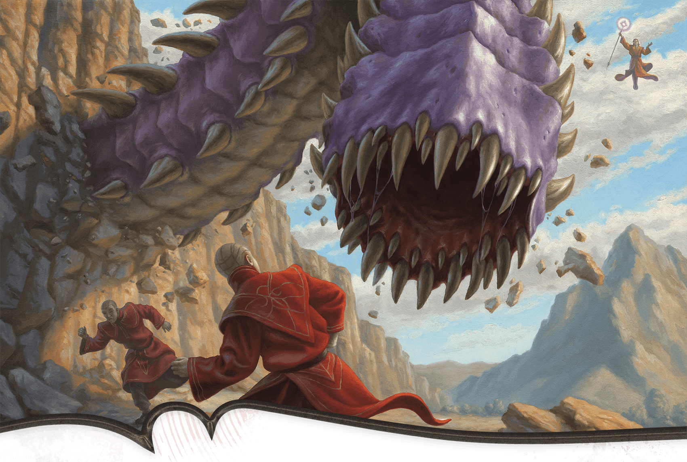

<!-- Notes MJ : contenu fourni par l’utilisateur, non destiné au partage public. -->

### The Mavericks

The Red Wizards in the Veiled Tower are friends who are convinced that Szass Tam soon will become Thay’s regent—and are angry about it. All five are [Archmages](https://www.dndbeyond.com/monsters/5194902-archmage) who are described below.

#### Abadesh

*Self-Indulgent Survivor*

- **Species:** Human
- **Personal Goal:** Avoid becoming the lich’s servitor

Abadesh was a young man during Szass Tam’s last regency and remembers how readily the lich turned dissenters into undead servants. When Yev extended an invitation to hide in the Veiled Tower, Abadesh happily accepted, knowing his association with Szass Tam’s enemies puts a target on his back.

#### Darvyn Yev

Scott Murphy

The Red Wizard Darvyn Yev has a deadly surprise for unwelcome visitors.

*Egotistical Libertine*

- **Species:** Human
- **Personal Goal:** Protect himself from the lich

Known for his dark, beautifully coiffed hair and elegant facial tattoos, Darvyn Yev is from Eltabbar, where his family commands great prestige. Despite his powerful spellcasting, he has failed to equal his forebears’ magical accomplishments. He compensates for this by cultivating his appearance and indulging in luxuries. He’s vocal about his belief that Szass Tam will strip all beauty and joy from Thay.

#### Iorru

*Bookish Scholar of Necromancy*

- **Species:** Human
- **Personal Goal:** Speak against Szass Tam freely

Iorru believes in studying the forces of life and death, not using them to cow one’s enemies. Iorru earned her red robes from a Red Wizard called Reng, who is Szass Tam’s ally. She recently voiced her dislike of the lich to Reng, who put a bounty on her head. She hides in the Veiled Tower with her friends, whom she trusts to help protect her.

#### Sabinia Dau

*Spirited Social Commenter*

- **Species:** Tiefling
- **Personal Goal:** Stoke dissent against Szass Tam

Sabinia Dau comes from a politically powerful, mostly human family. She is a childhood friend of Zulkir Thrul, though Dau focused more on magical research and less on politics than Thrul did. The two remain friendly and occasionally spend time together in Thaymount. ([The Fortress of Opposition](../../chapter-06-precipice-of-oblivion/chapter.md#FortressOfOpposition), Dau’s stronghold in Thaymount, is detailed in chapter 6.) Dau recently published a pamphlet titled “Death to Tyrants” that singled out Szass Tam as Thay’s biggest threat. Dau expects Szass Tam’s loyalists to retaliate, so she hides in the Veiled Tower.

#### Zeil

*Brilliant Business Magnate*

- **Species:** Human
- **Personal Goal:** Avoid Szass Tam’s wrath

Unlike most Red Wizard business owners, Zeil treats her workers with dignity and pays them fairly. She owns a mine in eastern Pyarados, where malefite attacks have raged thanks to Szass Tam’s foul magical experiments. When the area became unsafe, Zeil granted her workers paid leave. Correctly convinced that Szass Tam’s rumored experiments caused the attacks, Zeil tried and failed to obtain help from multiple authorities. In a fit of rage, she attacked a contingent of Szass Tam loyalists she encountered on the High Road, blaming them for her mine’s losses. Zeil barely escaped. Now she hides from the lich, who she’s certain will want revenge.
