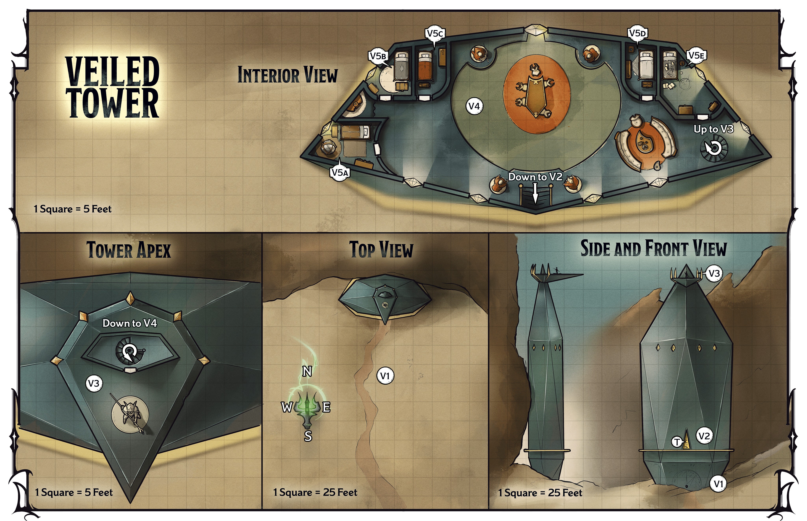

<!-- Notes MJ : contenu fourni par l’utilisateur, non destiné au partage public. -->

### Tower Locations

Gerralt Landman

Map 5.1: Veiled Tower [View Player Version](https://media-stg.dndbeyond.com/compendium-images/aud/aqZhSuV5QislqWyN/map-05-01.veiled-tower-player.png)

The following locations are keyed to map 5.1.

#### V1: Visitor Reception

A black door knocker adorns the tower four feet above the ground. The door knocker is shaped like a human’s bald, tattooed head, and around its neck is a torc that functions as a striker. There is no door in the wall.

This is a false entryway. The tower’s interior can be accessed via doors in the middle tier ([area V2](../chapter.md#V2MiddleTier)) and tower apex ([area V3](../chapter.md#V3TowerApex)).

***Door Knocker.*** If a character takes the [Utilize](https://www.dndbeyond.com/sources/dnd/free-rules/rules-glossary#UtilizeAction) action to use the knocker, a human man appears, floating beside them just above eye level.

This is Darvyn Yev. When he appears, read or paraphrase the following:

Resplendent in red robes, a flying human man with luxurious dark hair and swirling facial tattoos addresses you in a demanding tone.

“Who dares approach the Veiled Tower? State your business or be gone!”

A character can take the [Study](https://www.dndbeyond.com/sources/dnd/free-rules/rules-glossary#StudyAction) action to examine Yev’s image and make a DC 18 Intelligence ([Investigation](https://www.dndbeyond.com/sources/dnd/free-rules/playing-the-game#Skills)) check. On a success, the character realizes that the image is an illusion. Yev created it using a [Spell Scroll](https://www.dndbeyond.com/magic-items/9229085-spell-scroll) *of* [Project Image](https://www.dndbeyond.com/spells/2618903-project-image).

***Gaining an Audience.*** The characters must convince Yev they need his group’s help to stop Szass Tam. A character can take the [Influence](https://www.dndbeyond.com/sources/dnd/free-rules/rules-glossary#InfluenceAction) action to plead their case and make a DC 18 Charisma ([Persuasion](https://www.dndbeyond.com/sources/dnd/free-rules/playing-the-game#Skills)) check. On a success, Yev says, “I see; enter the tower through the door above marked with glyphs. Speak soon. Glory to Yev!” His image disappears.

On a failure, Yev’s uproarious laughter echoes off the surrounding cliffs, which begin to rumble. His image sarcastically salutes the characters before it winks out. Two [Purple Worms](https://www.dndbeyond.com/monsters/5195174-purple-worm) burst from the rock near the tower 60 feet away and fight the characters on noticing them.

Yev has used a [Spell Scroll](https://www.dndbeyond.com/magic-items/9229085-spell-scroll) to cast [Shatter](https://www.dndbeyond.com/spells/2619017-shatter) inside the cliff to provoke the lurking worms to emerge. The worms each have 230 HP remaining.

#### V2: Middle Tier

Fifty feet above the ground, a ledge wraps around the tower. In the middle of the tower’s south side stands a door covered in strange glyphs and images of robed wizards dramatically casting spells.

A character can take the [Study](https://www.dndbeyond.com/sources/dnd/free-rules/rules-glossary#StudyAction) action to examine the glyphs and make a DC 18 Intelligence ([Arcana](https://www.dndbeyond.com/sources/dnd/free-rules/playing-the-game#Skills)) check. On a success, the character realizes the glyphs are powerful magical wards that can be disarmed by speaking a passphrase. The character knows the passphrase includes the family name Yev, but no other details. (The characters can learn the complete passphrase, “Glory to Yev,” in area [area V3](../chapter.md#V3TowerApex).)

***Trapped Door.*** If a character says the passphrase in any language, the door (marked with a *T* on the map) is safe to open for 1 minute.

If a creature tries to open the door when no one has said the passphrase, a bolt of electricity shoots from the door. That creature makes a DC 15 Dexterity saving throw, taking 55 (10d10) Lightning damage on a failed save or half as much on a successful one.

Inside, a staircase ascends to a lounge ([area V4](../chapter.md#V4Lounge)).

#### V3: Tower Apex

Three hundred feet up, this platform juts from the tower’s apex, overlooking a spectacular scene of lowlands to the east and cliffs to the west. A statue of a knight stands vigilant on the platform. A door in a small enclosure appears to lead inside the tower.

When a creature comes within 5 feet of the door, read or paraphrase the following:

A commanding voice emanates from the knight statue.

“To whom do you give glory? Answer correctly or be deemed intruders!”

The voice is Yev’s, speaking through a [Magic Mouth](https://www.dndbeyond.com/spells/2619023-magic-mouth) spell he cast on the statue. It triggers when a creature enters this area.

As a [Study](https://www.dndbeyond.com/sources/dnd/free-rules/rules-glossary#StudyAction) action, a character can consider the history of the Veiled Tower as a refuge for the Yev family and make a DC 18 Intelligence ([Investigation](https://www.dndbeyond.com/sources/dnd/free-rules/playing-the-game#Skills)) check. On a success, they deduce the answer: “Glory to Yev,” which is also the passphrase in [area V2](../chapter.md#V2MiddleTier).

If a creature gives the correct answer in any language, the statue remains inert. Should the characters fail to answer correctly within a few seconds, the statue animates and fights them. Use the stat block of an [Iron Golem](https://www.dndbeyond.com/monsters/5195090-iron-golem); the statue fights until destroyed.

Inside the tower, a spiral staircase descends to a lounge (area V4).

#### V4: Lounge

This brightly lit lounge looks comfortable and lavish, with four beautifully carved statues of mages ringing the room. Sitting around an oak table are five red-robed people—four humans and a tiefling. A dark-haired, well-coiffed human man rises to greet you.

When the characters enter the tower’s lounge, each character earns 7,800 XP for gaining access to the mages’ inner sanctum.

***Meeting the Mavericks.*** The dark-haired man is Darvyn Yev, the tower’s owner, and the others are Abadesh, Iorru, Sabinia Dau, and Zeil (Medium [Archmages](https://www.dndbeyond.com/monsters/5194902-archmage); see “[The Mavericks](../chapter.md#TheMavericks)” earlier in this chapter). If the characters didn’t explain their mission to Yev in [area V1](../chapter.md#V1VisitorReception), he demands to know why they’re here.

Should the characters explain their mission, Yev chuckles and begins to speak. See “Impressing the Mavericks” below.

If the characters don’t tell the Mavericks they plan to defeat Szass Tam, the mages fight them. When a mage is [Bloodied](https://www.dndbeyond.com/sources/dnd/free-rules/rules-glossary#Bloodied), the four statues (use the [Stone Golem](https://www.dndbeyond.com/monsters/4904850-stone-golem) stat block) join the fight against the characters.

If the characters belatedly insist they’re allies, the Red Wizards stop fighting when a mage becomes Bloodied, and the statues don’t attack.

***Impressing the Mavericks.*** When the Red Wizards realize the characters intend to defeat Szass Tam, read or paraphrase the following speech from Yev:

“Well, you’ve managed to enter this tower, but let’s see your skills in action. Prove to us you’ve the mettle to face the dread lich!”

The four statues in the room fight the characters (each uses the [Stone Golem](https://www.dndbeyond.com/monsters/4904850-stone-golem) stat block). When the characters destroy one, Yev laughs and shouts, “Guardians, enough!” The other statues cease fighting and return to their original positions.

***Development.*** Once the Mavericks are convinced the characters are strong enough to face Szass Tam, the mages share the following information in conversation.

- **Teleportation Ritual.** The Red Wizards are indeed working on the ritual Zulkir Thrul described. The ritual’s teleportation magic targets a geographical feature in central Thaymount near the Citadel called the Mouth of Despair, which is a deep fissure in the ground.
- **How the Ritual Works.** The Mavericks have discovered that the fissure’s floor is only weakly imbued with the anti-teleportation magic that covers the rest of Thaymount. Their ritual will punch through that area’s wards, ensuring Szass Tam doesn’t know they’ve arrived in the region.
- **Why They’ll Travel to Thaymount.** Although they don’t know details about the lich’s Malefice Mortum ritual, they believe he is about to regain his regency in some horrible way. Should chaos erupt, they would feel more secure hiding in Thaymount, where they will be better equipped to magically conceal themselves. They plan to hide in Dau’s nearby Fortress of Opposition until returning to public life is safe.

The Mavericks agree to take the characters with them to Thaymount via their ritual. However, the ritual isn’t complete; the Mavericks didn’t consider Szass Tam’s threat an urgent one, so they’ve wasted time drinking wine and crowing to each other about their achievements instead of working.

The amount of time the mages tell the characters it will take to complete their ritual depends on when the group wants to travel to Thaymount. If the characters haven’t approached the pirates of Blackrock Cove yet, the mages tell the characters to return in four days. If the characters are ready to go to Thaymount now, the mages tell the characters to return tomorrow.

#### V5a-e: Bedrooms

This comfortable bedroom includes a bed with a plush coverlet, a beautiful chest of drawers, and a nightstand with a marble washing bowl.

These are the Red Wizards’ bedrooms.

***V5a: Abadesh’s Bedroom.*** Abadesh’s chest of drawers contains various coins and gems worth 15,000 GP. An [Elixir of Health](https://www.dndbeyond.com/magic-items/5351-elixir-of-health) and a [Potion of Flying](https://www.dndbeyond.com/magic-items/4704-potion-of-flying) wrapped in oilcloth lie next to a stack of gem-encrusted red robes worth 1,000 GP.

***V5b: Zeil’s Bedroom.*** Zeil’s chest of drawers contains various coins and gems worth 25,000 GP. Three [Potions of Healing (supreme)](https://www.dndbeyond.com/magic-items/8960641-potion-of-healing) are tucked underneath a gem-encrusted red robe lavishly embroidered with gold thread, worth 1,500 GP.

***V5c: Iorru’s Bedroom.*** Stacks of rare tomes about necromancy and alternative magical healing techniques lie atop Iorru’s chest of drawers. The books are worth 15,000 GP total.

***V5d: Dau’s Bedroom.*** Dau’s chest of drawers contains rare perfumes, oils, and coins worth 40,000 GP total. A stack of gem-encrusted satin clothes is worth 8,000 GP. Wrapped in a satin tunic is a [Crystal Ball of Ominous Portent](https://www.dndbeyond.com/magic-items/11914525-crystal-ball-of-ominous-portent) (see appendix A). Tucked behind the clothes are two [Spell Scrolls](https://www.dndbeyond.com/magic-items/9229085-spell-scroll) *of* [Sending](https://www.dndbeyond.com/spells/2619015-sending).

***V5e: Yev’s Bedroom.*** Yev’s bedroom is a mess. Open books, notes, bones with runes etched into them, a toppled wig stand, pouches of colorful dust, and vials of dark liquids lie scattered across the bed.

A character can take the [Study](https://www.dndbeyond.com/sources/dnd/free-rules/rules-glossary#StudyAction) action to examine the items on the bed and make a DC 15 Intelligence ([Arcana](https://www.dndbeyond.com/sources/dnd/free-rules/playing-the-game#Skills)) check. On a success, the character realizes the items constitute the method, incantation, and spell components needed for the mages’ in-progress ritual to travel to Thaymount. (To learn how the characters can use these items, see “[The Mavericks Are Dead](../../chapter-06-precipice-of-oblivion/chapter.md#TheMavericksAreDead)” in chapter 6.)

In Yev’s chest of drawers are various coins, gems, and jewelry worth 10,000 GP total. Stacks of gem-encrusted clothes are worth 20,000 GP total. The drawers also contain three [Spell Scrolls](https://www.dndbeyond.com/magic-items/9229085-spell-scroll) of [Project Image](https://www.dndbeyond.com/spells/2618903-project-image) and six [Spell Scrolls](https://www.dndbeyond.com/magic-items/9229085-spell-scroll) of [Shatter](https://www.dndbeyond.com/spells/2619017-shatter).
