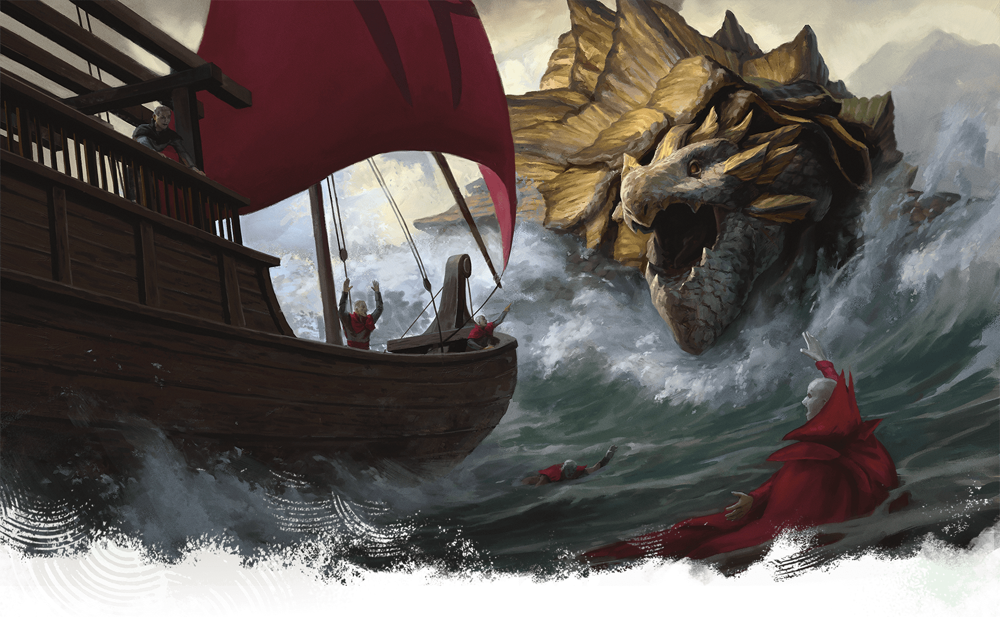
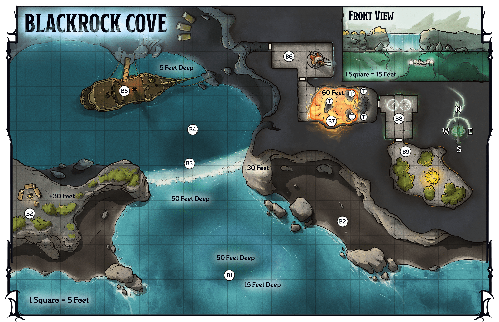

<!-- Notes MJ : contenu fourni par l’utilisateur, non destiné au partage public. -->

## Blackrock Cove

Sam Keiser

A dragon turtle guards Blackrock Cove.

Located on the southeast side of Ala Minor, Blackrock Cove lies about thirty miles east of Ala Harbor. Owing to the island’s rocky terrain and the rumors of hostile spirits near the cove, the region has no permanent settlements. However, centuries ago a Red Wizard created a sanctum there to hold his treasures, and a pirate crew has recently made the cove their secret lair.

### Zultan’s Sanctum

Zultan was a Red Wizard from Eltabbar who created a hidden sanctum in Blackrock Cove over three hundred years ago. He stored his treasures there, periodically visiting to add new acquisitions.

In Zultan’s old age, he realized that with no heirs to inherit his wealth, it would likely be claimed by treasure hunters. He decided to create trials in his sanctum that would allow only clever hunters to earn his treasure. See “[Cove Locations](../chapter.md#CoveLocations)” for more on this sanctum.

### Blackrock Pirates

For the past two years, a crew of pirates has laired in Blackrock Cove. The pirates follow Captain Sharlei, a human former officer in the Thayan navy. A brilliant naval strategist, Sharlei has never lost a sailor in battle or at sea.

Two years ago, several Red Wizards demanded her fealty, but the captain refused to swear allegiance. Enraged, the Red Wizards conspired to kill her, but the captain killed one of them first, then deserted her post. She stole her Thayan naval ship, the *Sharpened Blade*, and took her most loyal sailors with her.

While looking for a place to lie low, Captain Sharlei discovered the permanent illusion Zultan created to obscure Blackrock Cove’s cave. The pirates hide here, occasionally sailing toward Alaor Major to demand tribute from Red Wizards’ ships.

### Reaching the Cove

Read or paraphrase the following when the characters approach the cove:

Near the cove’s entrance, a sandbar is visible below the water’s surface. Waves lap gently against the narrow beach lining the shore. Just past the beach, rocky cliffs topped with thick foliage spike toward the sky. A roaring waterfall rushes down the cliff at the middle of the cove.

### Cove Features

The cove is a natural feature consisting of an inlet connected to a shallow pool inside a cave. Areas [B1–B3](../chapter.md#B1TheCove) are exterior, while areas [B4–B9](../chapter.md#B4HiddenCave) are interior, including Zultan’s sanctum (areas [B6–B9](../chapter.md#B6ZultansEntryChamber)).

The cove has the following features.

#### Cave

A permanent illusion hides the cove’s large, natural cave ([area B4](../chapter.md#B4HiddenCave)). Shallow water covers much of its floor, just enough to allow skilled crews to pilot boats and ships inside. The cave includes a small beach to the east before a sheer rock wall, inside which Zultan built the rooms of his sanctum.

#### Ceilings

The cave ceiling ([area B4](../chapter.md#B4HiddenCave)) is 50 feet tall. Ceilings in Zultan’s sanctum are 20 feet tall.

#### Cliffs

Cliffs with heavy foliage surround the cove and the opening to the cave ([area B4](../chapter.md#B4HiddenCave)). Creatures standing on the cliffs have [Total Cover](https://www.dndbeyond.com/sources/dnd/free-rules/rules-glossary#Cover) from creatures in the cove ([area B1](../chapter.md#B1TheCove)) and vice versa.

#### Doors

Doors in Zultan’s sanctum are made of stone and are unlocked, except for the door to the grove ([area B9](../chapter.md#B9ZultansGrove)). See “Doors” in the [Dungeon Master’s Guide](https://www.dndbeyond.com/sources/dnd/dmg-2024/dms-toolbox#Doors).

#### Illusory Waterfall

A waterfall appears to tumble down the cliff at the cove’s center. This is an illusion resulting from a permanent effect similar to that of a [Mirage Arcane](https://www.dndbeyond.com/spells/2619040-mirage-arcane) spell.

#### Lighting

Exterior areas are in [Bright Light](https://www.dndbeyond.com/sources/dnd/free-rules/rules-glossary#BrightLight) during the day. The cave ([area B4](../chapter.md#B4HiddenCave)) and ship ([area B5](../chapter.md#B5SharpenedBlade)) are in [Dim Light](https://www.dndbeyond.com/sources/dnd/free-rules/rules-glossary#DimLight) during the day. Otherwise, interior areas are in [Darkness](https://www.dndbeyond.com/sources/dnd/free-rules/rules-glossary#Darkness). Descriptions assume the characters have a way to see in the dark.

#### Sanctum

Unless otherwise noted, the walls, floors, and ceilings of Zultan’s sanctum are made of magically treated stone that has Immunity to all damage.

### Cove Locations

Gerralt Landman

Map 5.2: Blackrock Cove [View Player Version](https://media-stg.dndbeyond.com/compendium-images/aud/aqZhSuV5QislqWyN/map-05-02.blackrock-cove-player.png)

The following locations are keyed to map 5.2.

#### B1: The Cove

The rippling water distorts the view of the treacherous sandbar below.

If the characters travel in a boat or are otherwise 10 feet or fewer from the water’s surface, a [Dragon Turtle](https://www.dndbeyond.com/monsters/5194973-dragon-turtle) accosts them, fighting them when they move over the sandbar, where the water is only 15 feet deep. The dragon turtle fights until [Bloodied](https://www.dndbeyond.com/sources/dnd/free-rules/rules-glossary#Bloodied), then retreats.

***Pirates.*** The sounds of the fight attract the three pirate lookouts atop the western cliff ([area B2](../chapter.md#B2PirateLookouts)). The pirates run down the natural stairs on a southern projection of this cliff; they arrive on the west beach at the end of the first round of combat. See area B2 for details about the pirates.

When the pirates see the dragon turtle attacking the characters’ boat, they laugh and egg on the monster, referring to it as “Old Snappy.” The dragon turtle is [Friendly](https://www.dndbeyond.com/sources/dnd/free-rules/rules-glossary#FriendlyAttitude) toward the pirates, who feed it in exchange for its aggression against enemies.

As an [Influence](https://www.dndbeyond.com/sources/dnd/free-rules/rules-glossary#InfluenceAction) action, a character can attempt to communicate to the pirates that they aren’t enemies by making a DC 15 Charisma ([Persuasion](https://www.dndbeyond.com/sources/dnd/free-rules/playing-the-game#Skills)) check. On a success, the lookouts shout, “Stand down!” and the dragon turtle swims back to the sandbar.

***Development.*** If the pirates atop the western cliff ([area B2](../chapter.md#B2PirateLookouts)) notice the characters moving onto the beach, they leave their camp to confront them. They seem impressed if the characters killed the dragon turtle, but unless the characters convince the pirates they’re not enemies (see above), the pirates fight them. If the pirates believe the characters aren’t enemies, they take them through the illusory waterfall ([area B3](../chapter.md#B3Waterfall)) to meet with Captain Sharlei.

#### B2: Pirate Lookouts

A small campsite, consisting of three bedrolls and a cooking fire, sits atop this cliff.

Three pirates are here on lookout duty. These are the humans River and Zander (Medium [Noble Prodigies](https://www.dndbeyond.com/monsters/5195144-noble-prodigy)) and the dragonborn Flameshield (Medium [Pirate Captain](https://www.dndbeyond.com/monsters/4904838-pirate-captain)).

If the pirates notice the characters, they fight them. Characters can convince the pirates to stand down and lead them to [area B4](../chapter.md#B4HiddenCave) as detailed in area [B1](../chapter.md#B1TheCove).

#### B3: Waterfall

A waterfall roars from the cliff above, spraying sea-foam against the rocky wall behind it.

If the lookouts in [area B2](../chapter.md#B2PirateLookouts) lead the characters through the illusory waterfall, they swim through the channel that leads into the cave ([area B4](../chapter.md#B4HiddenCave)).

#### B4: Hidden Cave

Three sailors in shabby clothing stand on a stretch of sand to the east. Near them, two metallic bipedal creatures stand at attention. To the north, a sailing ship sits docked.

If the pirate lookouts from [area B2](../chapter.md#B2PirateLookouts) escort the characters here, each character earns 9,800 XP.

The three sailors are Captain Sharlei (Medium [Pirate Admiral](https://www.dndbeyond.com/monsters/5195161-pirate-admiral)) and two members of her crew: the human Landor (Medium [Pirate](https://www.dndbeyond.com/monsters/4904830-pirate)) and the gnome Bitterstem (Small Pirate).

The pirates stole the two nearby [Iron Golems](https://www.dndbeyond.com/monsters/5195090-iron-golem) and rejiggered them to protect the cave. All creatures here fight any characters not escorted by the pirate lookouts from [area B2](../chapter.md#B2PirateLookouts).

***Meeting the Captain.*** If the pirates escort the characters, read or paraphrase the following:

The tallest sailor, a human woman with a silver streak through her auburn hair, smirks and beckons you to approach. “Visitors? We don’t get many visitors who don’t want to kill us. Captain Sharlei, at your service—maybe. What do you want?”

***The Captain’s Demand.*** If the characters explain their mission and hand Captain Sharlei the list of ships carrying Szass Tam’s ritual foci, the captain looks thoughtful and says:

“If what you say is true, you’re asking us to do important work. If you lie, you’re still asking us to attack Red Wizards’ ships—which I’m always happy to do.

“I couldn’t give a fig’s leaf what’s true, but I’m willing to help if you do something for us. The caves beyond this cove hold rooms built by an ancient Red Wizard named Zultan, who created this waterfall illusion. He supposedly hid a fortune in gold in those rooms, but my crew and I can’t get past the blasted dragon statue that protects it.

“We want the gold Zultan hid here, but more importantly, we want the map to his second sanctum—apparently it’s just outside Ala Harbor. Imagine the damage we could do to Red Wizards’ ships if we could strike near the harbor and immediately disappear.

“Retrieve the gold and map for us, and we’ll sink the ships on your list. We’ll make sure those fiend skulls are destroyed, too.”

Highly educated, Captain Sharlei knows basic details about Zultan. She can share the information from “[Zultan’s Sanctum](../chapter.md#ZultansSanctum)” earlier in this chapter. She also can tell the characters about the deadly dragon statue trap in [area B7](../chapter.md#B7TrialOfWit), although she doesn’t know how to circumvent it.

#### B5: Sharpened Blade

Painted in an elegant script, the words “Sharpened Blade” adorn the sides of this hardy sailing ship. Its mast boasts a plain black flag.

The pirates’ ship has a single deck and a small cargo hold. A Cannon (see the [Dungeon Master’s Guide](https://www.dndbeyond.com/sources/dnd/dmg-2024)) sits atop the deck, and a dozen Cannonballs are stacked beside it.

***Treasure.*** Inside the hold are three chests that contain 10,000 GP total and a large crate that holds 30 days’ worth of [Rations](https://www.dndbeyond.com/equipment/411-rations) for six people.

#### B6: Zultan’s Entry Chamber

A statue of a handsome, bearded human mage occupies this chamber. As you enter, the statue’s mouth speaks.

“Welcome! I am the Red Wizard Zultan. Survive the trials ahead, and vast treasure is yours.”

Zultan cast the [Magic Mouth](https://www.dndbeyond.com/spells/2619023-magic-mouth) spell on the statue. It triggers when a creature enters the room.

The statue depicts Zultan. If the characters haven’t learned about the mage, a character can take the [Study](https://www.dndbeyond.com/sources/dnd/free-rules/rules-glossary#StudyAction) action to examine the statue and make a DC 15 Intelligence ([History](https://www.dndbeyond.com/sources/dnd/free-rules/playing-the-game#Skills)) check. On a success, they know the details from “[Zultan’s Sanctum](../chapter.md#ZultansSanctum)” earlier in this chapter.

#### B7: Trial of Wit

Just past the entrance, a chasm opens in the floor. Lava bubbles in a pool sixty feet below. Above the lava float three black stones, each broad enough for a single human to stand on. Across the chasm, in front of a door, a scowling red dragon statue crouches on the floor of the far side of the room.

Zultan created this challenge to keep all but the cleverest spellcasters from venturing deeper into his sanctum.

***Dragon Statue Trap.*** The dragon statue is magical and acts as a fire-casting statue trap from the [Dungeon Master’s Guide](https://www.dndbeyond.com/sources/dnd/dmg-2024/dms-toolbox#Traps), except the floating stones and the spaces due north and south of the statue are the trap’s pressure plates (all marked with a *T* on the map), and the statue exhales a 60-foot [Cone](https://www.dndbeyond.com/sources/dnd/free-rules/rules-glossary#ConeAreaofEffect) of magical flame and deals 55 (10d10) Fire damage from its fixed position.

If a character disarms the trap, the chasm remains.

***Lava.*** Molten boulders magically shoot from the lava at the bottom of this chamber. The first time a creature flies over the lava, it must make a DC 15 Dexterity saving throw, taking 55 (10d10) Fire damage on a failed save or half as much on a successful one. Additionally, any creature that enters the lava for the first time on a turn or starts its turn in the lava takes 99 (18d10) Fire damage.

A character can take the [Study](https://www.dndbeyond.com/sources/dnd/free-rules/rules-glossary#StudyAction) action to examine the lava and make a DC 18 Intelligence ([Arcana](https://www.dndbeyond.com/sources/dnd/free-rules/playing-the-game#Skills)) check. On a success, the character knows the boulders will stop shooting from the lava if any character casts [Otiluke’s Resilient Sphere](https://www.dndbeyond.com/spells/2619128-otilukes-resilient-sphere) or [Globe of Invulnerability](https://www.dndbeyond.com/spells/2618950-globe-of-invulnerability) in this area.

#### B8: Trial of Magic

Two glyphs glow on this chamber’s floor. An oil portrait of a handsome, bearded mage in red robes adorns the eastern wall.

The man in the portrait speaks, saying, “Step on these glyphs and impress me with a spell—or perish where you stand. You have six seconds.” The painting then falls silent.

A door to the south is covered in a beautiful fresco of a serene grove.

The portrait depicts Zultan. He cast the [Magic Mouth](https://www.dndbeyond.com/spells/2619023-magic-mouth) spell on the portrait; it triggers when a creature enters the room.

***Magical Glyphs.*** The magical glyphs, shown on the map, are part of a dangerous effect. Each glyph is large enough for one creature to stand on. The characters should roll Initiative and proceed with their turns in order. By the end of the first round, a character must have stood on each of the two glyphs and cast any spell. If they do so, the portrait again appears to speak (via another casting of the [Magic Mouth](https://www.dndbeyond.com/spells/2619023-magic-mouth) spell) and says, “You may now unlock my treasure room.”

If the characters don’t follow the mouth’s instructions, poisonous gas fills the chamber. Each creature in the room must succeed on a DC 15 Constitution saving throw, taking 55 (10d10) Poison damage on a failed save or half as much damage on a successful one. The gas dissipates after 1 minute.

#### B9: Zultan’s Grove

The door to this area is locked with the [Arcane Lock](https://www.dndbeyond.com/spells/2618868-arcane-lock) spell. When the characters enter this area, read or paraphrase the following:

A moonbeam illuminates a magnificent pile of treasure in a serene twilight grove. A handsome, bearded man in red robes watches over the hoard. He smiles and says, “Congratulations—my treasures are yours.”

When the characters enter Zultan’s grove, each character earns 9,800 XP.

This is the heart of Zultan’s sanctum. Here the mage stashed significant wealth and some of his prized possessions, including notes for reaching another magical sanctum he created (see “Treasure”). The image of the grove and mage are permanent illusions.

***Treasure.*** Zultan’s treasure includes a small, magically treated parchment with a drawing of Alaor Major; a location near the harbor is marked with an *X*. Instructions on the map explain how to use a command word to enter a sanctum at the marked location. This is the map Captain Sharlei seeks, but the details of this location are beyond the scope of this campaign.

The treasure includes the following; magic items with a dagger (†) after their names are in appendix A:

25,000 GP in various coins

[Potion of Greater Invisibility](https://www.dndbeyond.com/magic-items/9228935-potion-of-invisibility)

[Robe of Thayan Arcana](https://www.dndbeyond.com/magic-items/11914535-robe-of-thayan-arcana)†

[Scarlet Spellbook](https://www.dndbeyond.com/magic-items/11914536-scarlet-spellbook)†

[Spell-Fueling Armor (Half Plate Armor)](https://www.dndbeyond.com/magic-items/11914544-spell-fueling-armor)†

[Staff of Power](https://www.dndbeyond.com/magic-items/9229098-staff-of-power)

[Staff of the Spirit Aegis](https://www.dndbeyond.com/magic-items/11914558-staff-of-the-spirit-aegis)†

[Thayan Sword](https://www.dndbeyond.com/magic-items/11914562-thayan-sword)†
