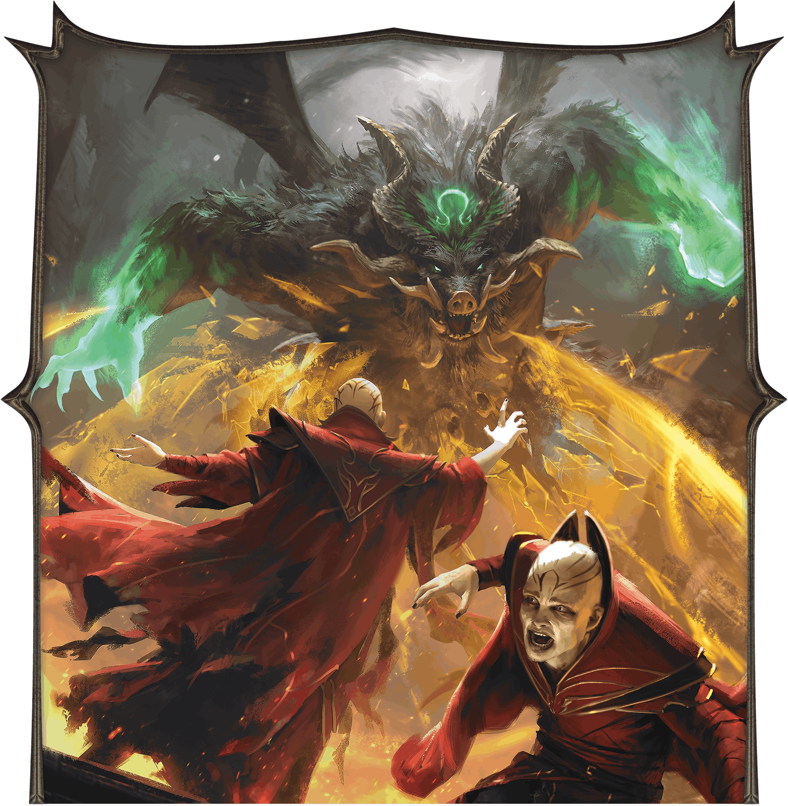
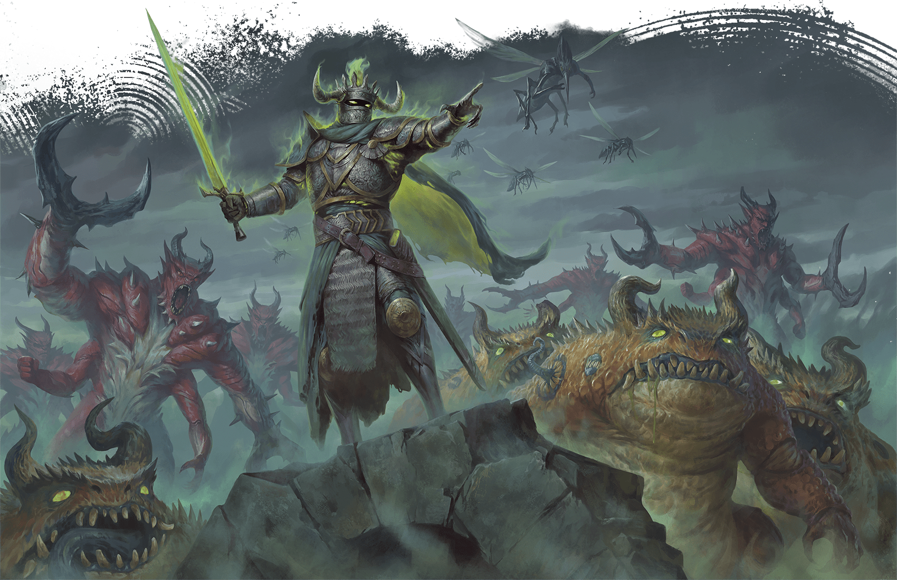
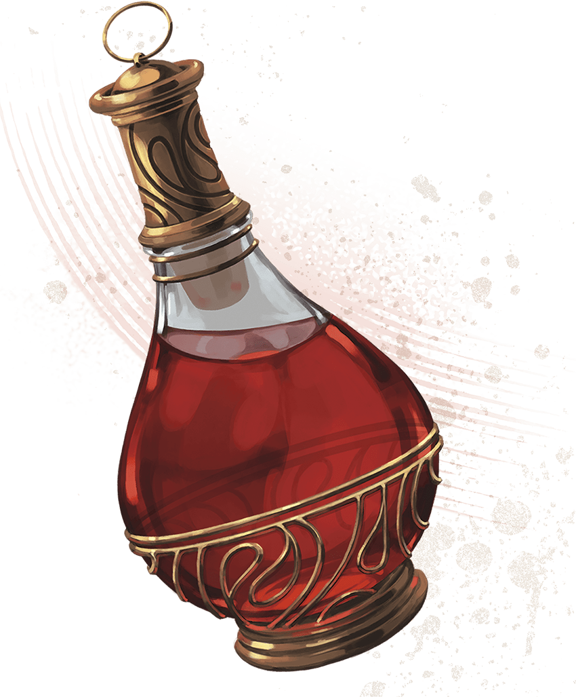
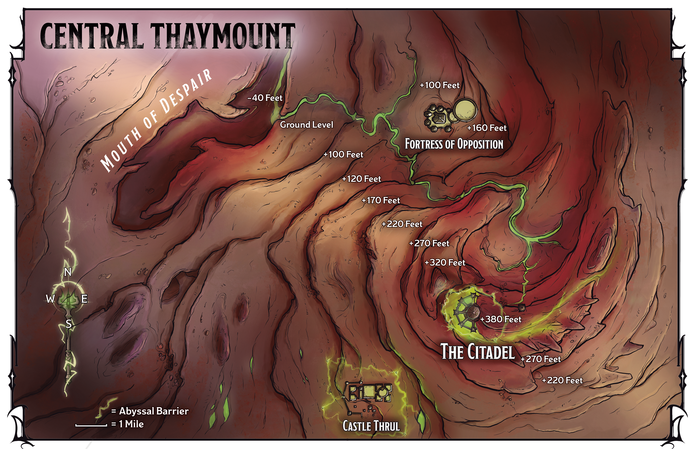
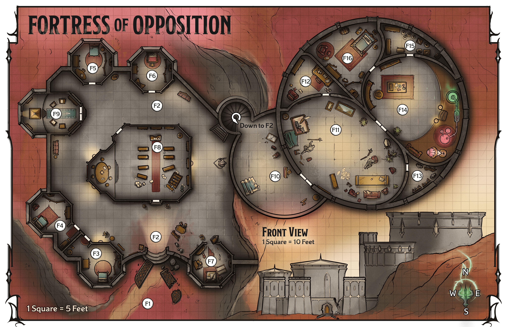
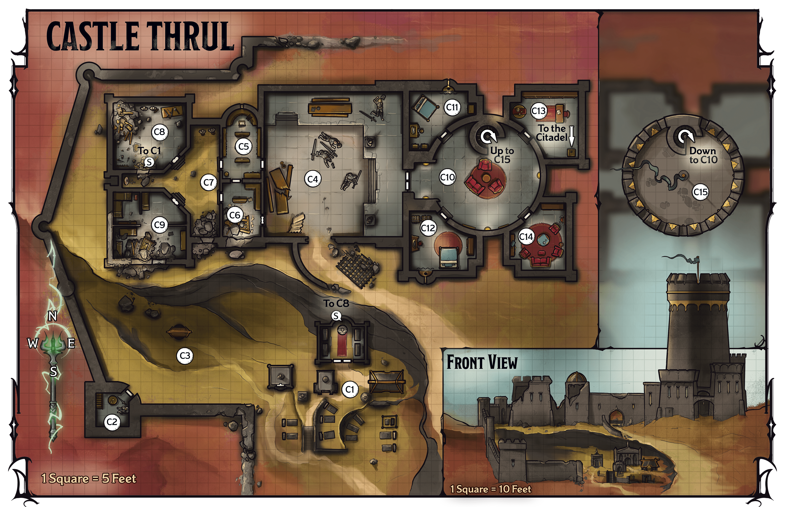
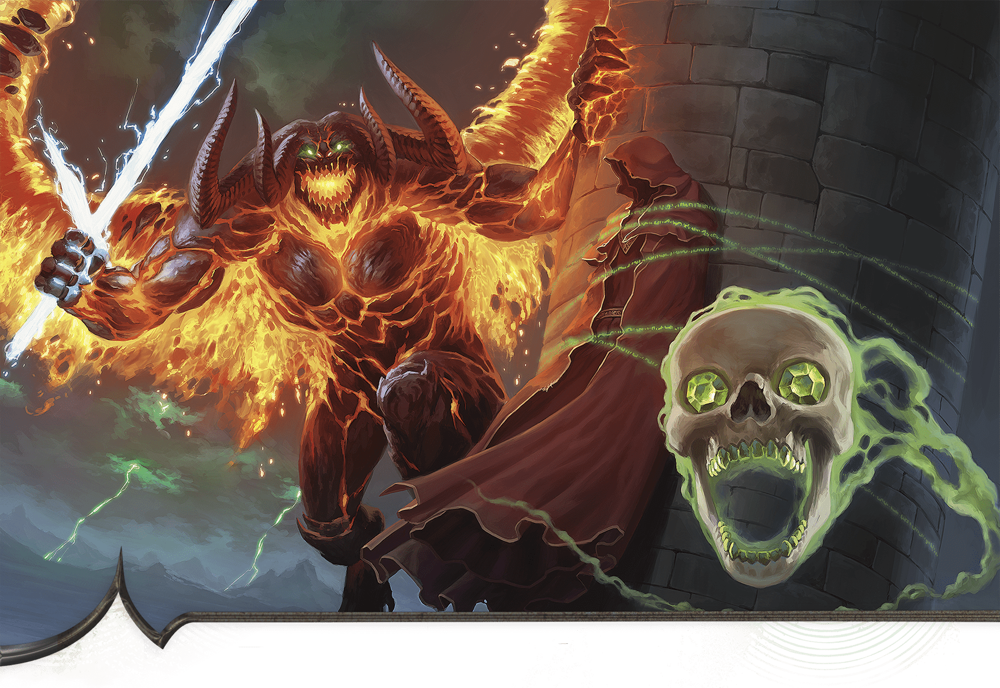

<!-- Notes MJ : contenu fourni par l’utilisateur, non destiné au partage public. -->

# Precipice of Oblivion

Battle Szass Tam’s forces in Thaymount.

Adventure   
for Level

17

Characters

Sessions

3-4

JOSHUA RAPHAEL

Demons are rampaging throughout Thaymount, and the Red Wizards can’t stop them.

## Key Plot Points

The following information is key to this chapter’s story:

- **The Truth Emerges.** Having discovered Operation Deadfall, Szass Tam moves swiftly to crush it. The characters must dispatch the lich’s allies before heading to Thaymount to seek him out.
- **Central Thaymount.** The characters arrive in Thaymount to find that monstrous foes and Szass Tam’s forces are rampaging across the plateau. To reach the tunnel from Castle Thrul to the Citadel, where Szass Tam weaves his ritual, the characters must learn how to get past the barrier around the castle from magic researcher Saraphine Dau in the nearby Fortress of Opposition.

## Preparation

Before running this chapter, prepare as follows:

- **Step 1.** Read the “[Running This Chapter](../chapter.md#RunningThisChapter)” section, including “[Character Advancement](../chapter.md#CharacterAdvancement).”
- **Step 2.** Familiarize yourself with the Key NPCs table.
- **Step 3.** Bookmark the stat blocks below, which appear in the [Monster Manual](https://www.dndbeyond.com/sources/dnd/mm-2024)and on D&D Beyond unless otherwise noted. If a stat block appears in appendix B, an asterisk appears after its name:

[Abveku](https://www.dndbeyond.com/monsters/6719629-abveku)\*

[Archmage](https://www.dndbeyond.com/monsters/5194902-archmage)

[Archpriest](https://www.dndbeyond.com/monsters/5194903-archpriest)

[Balor](https://www.dndbeyond.com/monsters/5194911-balor)

[Death Cultist](https://www.dndbeyond.com/monsters/5194960-death-cultist)

[Death Knight](https://www.dndbeyond.com/monsters/5194963-death-knight)

[Death Knight Aspirant](https://www.dndbeyond.com/monsters/5194962-death-knight-aspirant)

[Demilich](https://www.dndbeyond.com/monsters/5194967-demilich)

[Ghast Gravecaller](https://www.dndbeyond.com/monsters/5195006-ghast-gravecaller)

[Goristro](https://www.dndbeyond.com/monsters/5195053-goristro)

[Hezrou](https://www.dndbeyond.com/monsters/5195073-hezrou)

[Mage](https://www.dndbeyond.com/monsters/4831023-mage)

[Mage Apprentice](https://www.dndbeyond.com/monsters/5195109-mage-apprentice)

[Marilith](https://www.dndbeyond.com/monsters/5195117-marilith)

[Noble](https://www.dndbeyond.com/monsters/5195145-noble)

[Nalfeshnee](https://www.dndbeyond.com/monsters/5195140-nalfeshnee)

[Rendelith](https://www.dndbeyond.com/monsters/6719631-rendelith)\*

[Skeleton](https://www.dndbeyond.com/monsters/4775841-skeleton)

[Spy Master](https://www.dndbeyond.com/monsters/5195216-spy-master)

[Vampire Spawn](https://www.dndbeyond.com/monsters/5195249-vampire-spawn)

[Vampire Umbral Lord](https://www.dndbeyond.com/monsters/5195250-vampire-umbral-lord)

[Warrior Commander](https://www.dndbeyond.com/monsters/5195258-warrior-commander)

[Zombie](https://www.dndbeyond.com/monsters/4775851-zombie)

#### Key NPCs

| Name | Role | Stat Block | Location |
| --- | --- | --- | --- |
| Aventril | Human Dau family staff member | [Noble](https://www.dndbeyond.com/monsters/5195145-noble) (Medium) | [F3](../chapter.md#F3SouthBedchamber) |
| Darvyn Yev | Human dissident Red Wizard | [Archmage](https://www.dndbeyond.com/monsters/5194902-archmage) (Medium) | “[The Mavericks Assist](../chapter.md#TheMavericksAssist)” |
| Goreth Blacktooth | Dragonborn Dread Legion officer attacking the Fortress of Opposition | [Warrior Commander](https://www.dndbeyond.com/monsters/5195258-warrior-commander) (Medium, Neutral Evil) | [F11](../chapter.md#F11Lounge) |
| Jarek | Human Red Wizard coleader of forces assaulting Castle Thrul | [Archmage](https://www.dndbeyond.com/monsters/5194902-archmage) (Medium) | [C15](../chapter.md#C15TowerSummit) |
| Jerica Rey | Gnome Dau family friend | [Mage Apprentice](https://www.dndbeyond.com/monsters/5195109-mage-apprentice) (Small) | [F5](../chapter.md#F5NorthBedchamber) |
| Molly Malu | Human Dau family staff member | [Noble](https://www.dndbeyond.com/monsters/5195145-noble) (Medium) | [F4](../chapter.md#F4SouthwestBedchamber) |
| Sabinia Dau | Tiefling dissident Red Wizard | [Archmage](https://www.dndbeyond.com/monsters/5194902-archmage) (Medium) | “[Speaking with Sabinia Dau](../chapter.md#SpeakingWithSabiniaDau)” |
| Saraphine Dau | Sabinia Dau’s sister; trapped human inhabitant of the Fortress of Opposition | [Mage](https://www.dndbeyond.com/monsters/4831023-mage) (Medium) | [F14](../chapter.md#F14MagicalLab) |
| Viln Crocus | Szass Tam’s lieutenant | [Vampire Umbral Lord](https://www.dndbeyond.com/monsters/5195250-vampire-umbral-lord) (Medium) | “[Assault on the Shop](../chapter.md#AssaultOnTheShop)” |
| Wynston Wrynn | Human tailor and Zulkir Thrul’s spy master | [Spy Master](https://www.dndbeyond.com/monsters/5195216-spy-master) (Medium, Neutral Good) | “[Assault on the Shop](../chapter.md#AssaultOnTheShop)” |
| Xelnene Thrul | Human zulkir of evocation and Operation Deadfall’s missing leader | — | “[Grim Message](../chapter.md#GrimMessage)” |
| Xelnius Thrul | Dead brother of Zulkir Thrul | — | [C3](../chapter.md#C3Courtyard) |
| Yoreth | Coleader of forces assaulting Castle Thrul | [Demilich](https://www.dndbeyond.com/monsters/5194967-demilich) | [C15](../chapter.md#C15TowerSummit) |

## Running This Chapter

This chapter takes place after the characters have completed their missions with the dissident Red Wizards and the pirates of Blackrock Cove.

### Character Advancement

The characters should be level 17 when this chapter begins. They should have enough XP to advance to level 18 before they head to Castle Thrul. They should reach level 19 by the end of this chapter. If you’re using a method of level advancement that doesn’t rely on XP, the characters gain levels at those points.

### Operation Deadfall’s Discovery

While the characters pursued their recent missions, Szass Tam discovered Operation Deadfall. The lich knows that Zulkir Thrul runs the operation, Wynston Wrynn is her spy master, and the characters are her operatives.

The lich has dispatched two underlings to crush Operation Deadfall: the vampire siblings Viln Crocus and Nara Crocus, whose lairs are both in the Citadel. He ordered Viln to kill Wrynn and the characters at Wrynn’s Bespoke Vestments, and he instructed Nara to ambush Thrul elsewhere, incapacitate her, and bring her to his ritual chamber (see [chapter 7](../../chapter-07-szass-tam-must-die/chapter.md)).

## Return to Eltabbar

When the characters return to Eltabbar, they see more signs of Szass Tam’s terrible ritual magic at work.

### Rising Evil Magic

The ritual’s magic has weakened the veil between the Material Plane and the Abyss. When the ritual is complete, demons will pour into Eltabbar. For now, an ominous haze hangs over the city, broken only by flashes of green lightning. Outdoor areas are in [Dim Light](https://www.dndbeyond.com/sources/dnd/free-rules/rules-glossary#DimLight) in the daytime.

#### Terror in the Streets

Szass Tam’s foul magic is splitting the souls of demons between the Material Plane and the [Abyss](https://www.dndbeyond.com/sources/dnd/dmg-2024/cosmology#Abyss), allowing demons to faintly see scenes of Eltabbar’s cityscapes and the city’s residents to faintly see those demons. The demons can’t hurt anyone on the Material Plane, but seeing them still terrifies locals who don’t realize the demons aren’t real.

As the characters move through Eltabbar, roll on or pick a scene from the Eltabbar Demonic Scenes table. Describe the scene and bystanders’ panicked reactions to it before allowing characters to examine it.

A character can take the [Study](https://www.dndbeyond.com/sources/dnd/free-rules/rules-glossary#StudyAction) action to examine a scene and make a DC 15 Intelligence ([Arcana](https://www.dndbeyond.com/sources/dnd/free-rules/playing-the-game#Skills)) check. On a success, the character recognizes the demons aren’t real and can’t hurt anyone. The character realizes the scenes are a result of Szass Tam’s foul magic.

#### Eltabbar’s Demonic Scenes

| 1d4 | Encounter |
| --- | --- |
| 1 | A goristro slavers and roars while a hezrou chases panicking bystanders. |
| 2 | Two glabrezus chase passersby in a crowded square as an abveku (see [appendix B](../../appendix-b-bestiary/chapter.md#Abveku)) pounces on bystanders. |
| 3 | A balor leaps from the top of a building onto a screaming crowd. |
| 4 | A marilith and two hezrous run across an empty bridge toward a crowd. |

## Wrynn’s Bespoke Vestments

TARAS SUSAK

In Eltabbar, illusory scenes—such as this death knight commanding demons to attack—are harbingers of the horrors to come.

The next time the characters approach Wrynn’s Bespoke Vestments, read or paraphrase the following:

The once-gleaming windows of Wrynn’s Bespoke Vestments are shattered. Inside, you can see the shop has been ransacked; clothing and mannequins are strewn about haphazardly.

Szass Tam’s agents are raiding the shop, looking for information about Operation Deadfall.

### Wynston Wrynn’s Fate

Wrynn’s fate depends on whether the characters allied with the militia in chapter 4.

#### Mission Succeeded

If the characters allied with the militia, Fallon Nor and other militia members recently learned that Szass Tam had discovered Operation Deadfall. Nor used her [Sending Stone](https://www.dndbeyond.com/magic-items/9180147-sending-stones) to warn Wrynn, who escaped the shop moments before Viln Crocus arrived. Wrynn arrives at the shop after the characters have dispatched Crocus (see “[Development](../chapter.md#AssaultOnTheShopDevelopment)” below).

#### Mission Failed

If the characters didn’t ally with the militia, Szass Tam’s agents have killed Wrynn. The characters find the tailor’s body near his desk in the shop’s display and fitting space ([area W1](../../chapter-03-operation-deadfall/chapter.md#W3SecretOffice) on map 3.2).

Wrynn has sustained terrible injuries to his throat. As a [Search](https://www.dndbeyond.com/sources/dnd/free-rules/rules-glossary#SearchAction) action, a character can examine his wounds and make a DC 12 Wisdom ([Medicine](https://www.dndbeyond.com/sources/dnd/free-rules/playing-the-game#Skills)) check; on a success, they determine that a fanged creature killed the tailor.

The vampire Viln Crocus killed Wrynn. If the characters don’t kill Crocus (see “Assault on the Shop” below) or raise Wrynn from the dead, the tailor rises the following sunset as a [Vampire Spawn](https://www.dndbeyond.com/monsters/5195249-vampire-spawn) under Crocus’s control.

Wrynn knows who killed him and that Szass Tam deduced Operation Deadfall’s secrets, but he doesn’t know Zulkir Thrul’s fate.

### Assault on the Shop

When the characters enter the tailor shop (shown on [map 3.2](../../chapter-03-operation-deadfall/chapter.md#Map0302wrynnsbespokevestments) in chapter 3), they hear frustrated shouting coming from the secret office ([area W3](../../chapter-03-operation-deadfall/chapter.md#W3SecretOffice)).

As they enter the office, read or paraphrase the following:

The desk is upturned, and papers lie strewn across the floor. As three humans in dark robes emblazoned with a fist ransack the office, a bald, gaunt man with fangs and pupilless, black eyes rasps, “What else are they planning? There must be evidence somewhere!”

The fanged man is Viln Crocus (Medium [Vampire Umbral Lord](https://www.dndbeyond.com/monsters/5195250-vampire-umbral-lord)), and the robed humans (Medium, Neutral Evil [Archpriests](https://www.dndbeyond.com/monsters/5194903-archpriest)) are priests of Bane, god of tyranny. All four Szass Tam loyalists fight the characters on sight.

#### Development

If he escaped earlier, Wrynn returns to the shop after the characters have dispatched Szass Tam’s agents. The tailor has been watching the shop from a distance in disguise.

Wrynn is terrified for Zulkir Thrul, whose fate he doesn’t know. He tries to use his [Sending Stone](https://www.dndbeyond.com/magic-items/9180147-sending-stones) to contact her, to no avail.

***Wrynn’s Stones.*** The tailor carries a smooth, palm-size stone. Each side is engraved with an image of a crane identical to that of the [Masquerader’s Brooches](https://www.dndbeyond.com/magic-items/11914533-masqueraders-brooch) Thrul gave the characters in chapter 3—a reference to the zulkir’s code name, the Crane.

The stone is imbued with a [Programmed Illusion](https://www.dndbeyond.com/spells/2618902-programmed-illusion) spell (detailed in “[Grim Message](../chapter.md#GrimMessage)”). The zulkir instructed Wrynn to activate it with a command word in the event of her death or disappearance.

If Wrynn is alive, he activates the stone for the characters. If he’s dead, the characters can find the stone on his body. A note in Wrynn’s pocket (cloaked with an [Illusory Script](https://www.dndbeyond.com/spells/2619173-illusory-script) spell) says: “The stone is magical and contains a message from the Crane. Its command phrase is ‘the Crane speaks.’”

If Wrynn is dead, the characters also find the [Sending Stones](https://www.dndbeyond.com/magic-items/9180147-sending-stones) connected to Thrul and Fallon Nor on his body.

## Grim Message

When the characters say the stone’s command phrase, its illusion activates and the characters see an image of Zulkir Thrul.

Read or paraphrase the following:

Magical energy shimmers, and a translucent image appears: Zulkir Thrul sits behind her desk, looking stern.

“If you’re seeing this, operatives, it means I’m incapacitated or dead,” she says. “But you aren’t, and therefore Thay has hope. Know that I am proud of you—but your work is not yet done.

“The Hydra is ensconced in his stronghold in Thaymount—the Citadel—where he is nearly unassailable. Layered wards protect the area from teleportation and scrying, and by now every inch of it crawls with malefites and fiends. We have mere days before he finishes his ritual, raises his hordes, and declares himself regent again.

“Use the Mavericks’ ritual to travel to central Thaymount. From there, find the underground tunnel that leads from Castle Thrul—my ancestral home—into the Citadel. You must reach the Citadel without delay.

“The Hydra knows about this underground passage, and his allies may have magically barricaded Castle Thrul to prevent entry. In this case, seek the advice of Sabinia Dau in the Veiled Tower. If she’s unsure, you’ll need the help of her sister, Saraphine, the most brilliant magical theorist I’ve known. She’s most likely in Thaymount.

“I’ve left magic items in my demiplane that might aid you. Consider them payment.”

The zulkir exhales, then smiles grimly, head held high. “You can save Thay from the Hydra, operatives. I believe in you.”

### Szass Tam’s Barrier

As Zulkir Thrul suspects, Szass Tam has erected a powerful barrier around Castle Thrul as described in “[Abyssal Barriers](../chapter.md#AbyssalBarriers)” later in this chapter.

### Zulkir Thrul’s Fate

Zulkir Thrul is alive—barely—because Szass Tam wants her to witness his ritual’s completion before he turns her into an undead servant. Thaymount’s wards against scrying (see “[Magic on Thaymount](../chapter.md#MagicOnThaymount)” later in this chapter) prevent the characters from locating or magically observing Thrul, but they’ll have a chance to reunite with her in chapter 7.

### Zulkir Thrul’s Demiplane

If the characters can cast [Demiplane](https://www.dndbeyond.com/spells/2619088-demiplane), they can enter Zulkir Thrul’s demiplane. If they do so, they find it exactly as described in chapter 3, except the following are neatly laid on the zulkir’s desk:

[Animated Shield](https://www.dndbeyond.com/magic-items/4571-animated-shield)

[Plate Armor of Etherealness (Plate Armor)](https://www.dndbeyond.com/magic-items/9228928-plate-armor-of-etherealness)

[Five Potions of Healing (greater)](https://www.dndbeyond.com/magic-items/5133-potion-of-healing-greater)

[Robe of the Archmagi](https://www.dndbeyond.com/magic-items/4742-robe-of-the-archmagi)

[Spellguard Shield](https://www.dndbeyond.com/magic-items/4757-spellguard-shield)

[Staff of the Magi](https://www.dndbeyond.com/magic-items/9229101-staff-of-the-magi)

[Vorpal Sword (Greatsword)](https://www.dndbeyond.com/magic-items/9229178-vorpal-greatsword)

CoupleOfKooks

The zulkir’s payment includes   
five Potions of Healing (greater).

## Reaching Thaymount

The characters might debate traveling to Thaymount via teleportation to Szul—the only place in the region not warded against teleportation. Make it clear that doing so would be a death sentence, as Szass Tam has stationed an overwhelming force here that the characters can’t overcome. They must rely on the Mavericks’ ritual to teleport to a location in central Thaymount.

The characters’ options for getting there depend on the outcome of their mission to recruit the Mavericks in chapter 5.

### The Mavericks Assist

If the characters allied with the dissident Red Wizards, they can return to the Veiled Tower to obtain the mages’ assistance with reaching Thaymount.

When the characters enter the tower, read or paraphrase the following:

In the tower’s lounge, scattered notes, open books, and strange spell components cover the table. Before you stand the five dissident Red Wizards, looking weary. Darvyn Yev greets you.

“As promised, we have finished the ritual to teleport to central Thaymount. Given the situation, though, we have some concerns that you can help with.”

#### Speaking with Yev

Yev reveals the following in conversation:

- **The Mavericks’ Fears.** Yev explains condescendingly that the mages fear that Szass Tam’s evil magic and marauding allies have made central Thaymount unsafe.
- **A Coward’s Proposal.** Yev suggests that the Red Wizards teleport the characters to the Mouth of Despair (as described in [chapter 5](../../chapter-05-rebel-alliances/chapter.md#V4Lounge)), while the Red Wizards stay in the Veiled Tower until the party tells them the Fortress of Opposition is safe.

#### Speaking with Sabinia Dau

If the characters ask Sabinia Dau about circumventing the barrier around Castle Thrul, she ponders their question carefully. Read or paraphrase the following:

“If Szass Tam is trying to prevent you from entering Castle Thrul, you won’t be able to circumvent his barrier with everyday magic,” Dau says.

“I doubt I could help even if I knew the details. However, my sister Saraphine is a genius when it comes to magical barriers. She’ll know how to thwart it—and she’s likely to have the magic on hand. Saraphine’s in Thaymount, in our family’s home, the Fortress of Opposition.”

***Dau’s Request.*** Regardless whether the characters ask about traveling to Castle Thrul, before the mages begin the ritual, Dau asks them to investigate the Fortress of Opposition and confirm Saraphine’s safety.

If the characters agree, Dau gives them the perfumes, rare oils, and coins (worth 40,000 GP in total) and the [Crystal Ball of Ominous Portent](https://www.dndbeyond.com/magic-items/11914525-crystal-ball-of-ominous-portent) (see appendix A) that she keeps in her bedroom (area [V5d](../../chapter-05-rebel-alliances/chapter.md#V5AEBedrooms) on [map 5.1](../../chapter-05-rebel-alliances/chapter.md#Map-05-01VeiledTowerImg) in chapter 5).

Saraphine, a human, was residing at the fortress with five others when Szass Tam began his final ritual steps and Thaymount was thrown into chaos (see “[Thaymount in Chaos](../chapter.md#ThaymountInChaos)” later in this chapter). More information about the fortress’s inhabitants appears in “[Trapped Inhabitants](../chapter.md#TrappedInhabitants)” later in this chapter.

#### Performing the Teleportation Ritual

When the characters are ready, the Red Wizards perform their ritual, which takes 10 minutes. Afterward, the characters arrive in the Mouth of Despair (see “[Central Thaymount](../chapter.md#CentralThaymount)”).

### The Mavericks Don’t Assist

If the characters failed to impress the dissident Red Wizards—or killed them—they can still use the mages’ ritual to reach Thaymount.

#### The Mavericks Are Dead

If the dissidents died, the characters can use the ritual notes and components in Darvyn Yev’s bedroom (area [V5e](https://www.dndbeyond.com/sources/dnd/aud/chapter-5-rebel-alliances##V5AEBedrooms) on [map 5.1](../../chapter-05-rebel-alliances/chapter.md) in chapter 5) to teleport to central Thaymount. However, the unfinished ritual proves difficult to perform.

The characters each must take an action to follow the notes and make a DC 20 Intelligence ([Arcana](https://www.dndbeyond.com/sources/dnd/free-rules/playing-the-game#Skills)) check. On a success, a character teleports to central Thaymount and takes 22 (5d8) Force damage. On a failure, a character teleports there and takes 45 (10d8) Force damage.

#### The Mavericks Are Unimpressed

If the characters failed to impress the dissidents in chapter 5, they can return to the Veiled Tower and ask for the mages’ help again.

A character must take the [Influence](https://www.dndbeyond.com/sources/dnd/free-rules/rules-glossary#InfluenceAction) action to explain what has happened since their last meeting with the mages, then make a DC 15 Charisma ([Persuasion](https://www.dndbeyond.com/sources/dnd/free-rules/playing-the-game#Skills)) check. On a success, the mages explain that they’ve finished the ritual to teleport to Thaymount and agree to help the characters. Proceed with “[Speaking with Yev](../chapter.md#SpeakingWithYev)” above.

On a failure, the mages are enraged at the characters’ incompetence and fight them. When one mage is [Bloodied](https://www.dndbeyond.com/sources/dnd/free-rules/rules-glossary#Bloodied), however, the Mavericks reassess the characters’ abilities, stop fighting, and tell the characters they’ve finished their ritual to travel to Thaymount. Proceed with “[Speaking with Yev](../chapter.md#SpeakingWithYev)” above.

## Central Thaymount

Gerralt Landman

Map 6.1: Central Thaymount [View Player Version](../assets/maps/players/map-06-01.central-thaymount-player.png)

When the characters teleport to central Thaymount, an area many miles across, they arrive in the Mouth of Despair, as shown on map 6.1. See “[Thaymount](../../chapter-01-thay/chapter.md#Thaymount)” in chapter 1 for details on the tharch.

### Mouth of Despair

A natural fissure in the plateau, the Mouth of Despair divides the Fortress of Opposition, Castle Thrul, and the Citadel from the more populated areas to the west.

The dissident Red Wizards targeted this area to avoid Szass Tam knowing about their arrival in Thaymount. Now that the characters are involved, these mages are happy to let the characters face Thaymount’s dangers and report back.

The Red Wizards’ ritual deposits the characters in the middle of the Mouth of Despair, at the bottom of the fissure near its eastern wall. When they arrive, read or paraphrase the following:

You find yourselves at the bottom of a forty-foot-deep chasm. Above, green lightning flashes amid a gray, oppressive haze pierced only by Thaymount’s volcanic peaks far overhead.

[Dim Light](https://www.dndbeyond.com/sources/dnd/free-rules/rules-glossary#DimLight) filters into the chasm during daytime.

Before the characters leave the Mouth of Despair, they see an illusion of Saraphine Dau, as described below.

#### Saraphine’s Plea

If the characters reached the Mouth of Despair with the help of the dissident Red Wizards, Sabinia Dau told her sister via a [Spell Scroll](https://www.dndbeyond.com/magic-items/9229085-spell-scroll) *of* [Sending](https://www.dndbeyond.com/spells/2619015-sending) where and when to expect the characters to arrive in Central Thaymount. Shortly afterward, demons began attacking the Fortress of Opposition. Saraphine hid in the fortress and, desperate for help, used a [Spell Scroll](https://www.dndbeyond.com/magic-items/9229085-spell-scroll) *of* [Project Image](https://www.dndbeyond.com/spells/2618903-project-image) to create an illusory copy of herself, which she sent into the Mouth of Despair to meet the characters.

If the dissident Red Wizards are dead, Saraphine sent her illusory copy here knowing that the mages were working on a way to reach the Mouth of Despair. It’s a long shot, but she hopes her sister will arrive in the fissure and help her escape the fortress.

Read or paraphrase the following, changing Saraphine’s recognition to surprise if she isn’t expecting the characters to arrive:

Sitting on a nearby rock outcropping is the shimmering image of a young human woman, her navy blue cloak drawn around her. When she notices you, relief and excitement cross her face.

“You must be Sabinia’s friends!” she says. “I’m Saraphine Dau, Sabinia’s sister. You’ve got to help me! I’m stuck in the Fortress of Opposition. Fiends are destroying the place, and I fear they’ll soon rip me to pieces. Others are hiding in the fortress too. Please help us!”

The characters recognize the image as an illusion. Saraphine Dau’s image offers the characters the scrolls and magic items she keeps in the fortress (see [area F14](../chapter.md#F14MagicalLab)) in exchange for saving her and the others trapped in the fortress. She can tell the characters everything in the “[Trapped Inhabitants](../chapter.md#TrappedInhabitants)” section.

If the characters ask Saraphine about the barrier around Castle Thrul, she won’t discuss the matter until the characters agree to help her.

### Magic on Thaymount

Ancient magical wards erected by paranoid Red Wizards block scrying and teleportation in most of Thaymount. The exception is Szul, one of Szass Tam’s strongholds (see [chapter 1](../../chapter-01-thay/chapter.md#ThaymountPlateau)).

Spells and effects that would teleport creatures to other areas of Thaymount don’t work. In addition, the following spells don’t function in Thaymount:

- [Arcane Eye](https://www.dndbeyond.com/spells/2618863-arcane-eye)
- [Beast Sense](https://www.dndbeyond.com/spells/2618914-beast-sense)
- [Clairvoyance](https://www.dndbeyond.com/spells/2618972-clairvoyance)
- [Locate Creature](https://www.dndbeyond.com/spells/2619001-locate-creature)

- [Locate Object](https://www.dndbeyond.com/spells/2619002-locate-object)
- [Passwall](https://www.dndbeyond.com/spells/2618852-passwall)
- [Scrying](https://www.dndbeyond.com/spells/2619007-scrying)

If a creature tries to cast one of these spells, the spell slot is expended, but the spell has no effect.

Creatures with Legendary Actions that are in their lairs (such as [Szass Tam](https://www.dndbeyond.com/monsters/6719633-szass-tam) in chapter 7) ignore these impediments and can teleport or cast spells normally.

### Thaymount in Chaos

With Szass Tam’s ritual animating malefites and allowing demons to slip onto the Material Plane, Thaymount is in chaos. Central Thaymount is sparsely inhabited, though Castle Thrul and the Fortress of Opposition are both under attack, and magical barriers surround Castle Thrul and the Citadel (see “[Abyssal Barriers](../chapter.md#AbyssalBarriers)”). Central Thaymount’s layout is shown on [map 6.1](../chapter.md#Map6.1CentralThaymountImg).

Malefites and demons have overrun this area. Every mile the adventurers spend traveling, roll once on the Thaymount Encounters table below. As shown on map 6.1, the Mouth of Despair is about seven miles from the Fortress of Opposition, which is about eight miles from Castle Thrul.

Use [map 4.1](../../chapter-04-peril-in-pyarados/chapter.md#Map0401EasternPyaradosTrailImg) in chapter 4 for each encounter, but clarify to the players that its location is Thaymount.

#### Thaymount Encounters

| 1d4 | Encounter |
| --- | --- |
| 1 | A [Death Knight](https://www.dndbeyond.com/monsters/5194963-death-knight) directs four [Hezrous](https://www.dndbeyond.com/monsters/5195073-hezrou) to dig in the rocky soil of an ancient graveyard. The demons search for dead spellcasters who will animate once Szass Tam completes his ritual. |
| 2 | A [Balor](https://www.dndbeyond.com/monsters/5194911-balor) guarded by three [Death Cultists](https://www.dndbeyond.com/monsters/5194960-death-cultist) tries to open a portal to the Abyss. Nearby are the corpses of a dozen Red Wizards who tried to stop them. |
| 3 | A [Marilith](https://www.dndbeyond.com/monsters/5195117-marilith) and three [Death Knight Aspirants](https://www.dndbeyond.com/monsters/5194962-death-knight-aspirant) hunt for vulnerable people to slaughter. |
| 4 | Two [Goristros](https://www.dndbeyond.com/monsters/5195053-goristro) make their way west to attack mages’ fortresses nearby. |

#### Rising Evil Magic

As in Eltabbar, Szass Tam’s demonic magic has created an ominous haze over Thaymount. Outdoor areas are in [Dim Light](https://www.dndbeyond.com/sources/dnd/free-rules/rules-glossary#DimLight) in the daytime, and green lightning flashes in the sky.

#### Abyssal Barriers

When Szass Tam discovered Operation Deadfall, he used Abyssal magic to erect powerful barriers around Castle Thrul and the Citadel. The barriers are shown on [map 6.1](../chapter.md#Map6.1CentralThaymountImg) and look like thick, green, translucent domes.

***Castle Thrul.*** A barrier surrounds [Castle Thrul](../chapter.md#CastleThrul) outside the crumbling stone walls that surround the complex. The barrier functions like a [Wall of Force](https://www.dndbeyond.com/spells/2619194-wall-of-force) spell, but it’s permanent and can’t be destroyed with a [Disintegrate](https://www.dndbeyond.com/spells/2619094-disintegrate) spell. The barrier prevents entry into the areas described in “Castle Thrul” later in this chapter. The characters can punch a hole in this barrier using Saraphine Dau’s instructions (see [area F14](../chapter.md#F14MagicalLab) in “[Fortress of Opposition](../chapter.md#FortressOfOpposition)”).

***The Citadel.*** Another domed barrier surrounds the Citadel. It functions like the barrier surrounding Castle Thrul, but it can’t be penetrated. However, the barrier doesn’t extend far enough underground to impede the characters from reaching Szass Tam’s ritual chamber via the tunnels under Castle Thrul.

The ritual’s foul magic bathes the Citadel in green, malevolent energy that sweeps east, as shown on [map 6.1](../chapter.md#Map6.1CentralThaymountImg). This energy is harmless to the living, but if Szass Tam’s ritual isn’t stopped, the energy will envelop Thaymount, causing malefites to rise en masse.

## Fortress of Opposition

The Fortress of Opposition comprises two structures that form one facility. The eastern portion stands atop a sixty-foot cliff, while the western portion sits at the cliff’s base. A staircase connects the two sections.

The Dau family of Red Wizards has owned the fortress for centuries. While most family members prefer primary residences in more cosmopolitan parts of Thay, Saraphine Dau relishes the fortress’s isolation. It’s her primary residence. (For more about Saraphine, see “[Trapped Inhabitants](../chapter.md#TrappedInhabitants)” below.)

Read or paraphrase the following when the characters approach the Fortress of Opposition:

A sturdy fortress rises before you in two sections: a broad structure with a central tower and numerous small towers around its perimeter, and a wide tower atop a sixty-foot cliff to the east connected to the structure below. Green lightning strikes the upper portion, while hulking demonic forms lumber near the lower towers.

### Trapped Inhabitants

Saraphine Dau, her friend, and two Dau family staff are trapped inside the fortress. They were staying in the fortress when Szass Tam began escalating his ritual. When rampaging demons attacked the fortress, the staff and Saraphine’s friend locked themselves in their bedrooms, while Saraphine, who was in the lab upstairs, locked herself inside and ordered the fortress’s two guards to ward the lab’s entrance.

The three hiding downstairs know each others’ locations; they also know Saraphine was in the lab and the two guards were in the fortress’s lounge, but they don’t know that the guards have been killed or whether Saraphine is alive. Similarly, Saraphine is unaware of the fate of those downstairs.

The names and locations of these individuals are in the Trapped Inhabitants table below.

#### Trapped Inhabitants

| Name | Area Found |
| --- | --- |
| Aventril | [F3](../chapter.md#F3SouthBedchamber) |
| Jerica Rey | [F5](../chapter.md#F5NorthBedchamber) |
| Molly Malu | [F4](../chapter.md#F4SouthwestBedchamber) |
| Saraphine Dau | [F14](../chapter.md#F14MagicalLab) |

#### Rescuing the Inhabitants

If the characters defeat the monsters in the fortress courtyard ([area F1](../chapter.md#F1FortressCourtyard)), great hall ([area F2](../chapter.md#F2GreatHall)), and library ([area F8](../chapter.md#F8Library)), and tell those trapped in the bedchambers (areas [F3–F5](../chapter.md#F3SouthBedchamber)) that they did so, those three inhabitants become [Friendly](https://www.dndbeyond.com/sources/dnd/free-rules/rules-glossary#FriendlyAttitude) toward the party and unlock their doors. If the characters haven’t rescued Saraphine in the lab ([area F14](../chapter.md#F14MagicalLab)), those downstairs beg the characters to rescue her before they’ll talk further. Otherwise, they thank the characters profusely and offer to help the characters in any way they can, including giving them any treasure they have. See area F14 for Saraphine’s response to rescue.

If the characters don’t defeat all the creatures in the fortress, the besieging forces break through the locked doors—or smash holes in the walls—in one hour and kill Saraphine and the others.

### Assaulting Force

When Sabinia Dau published her anti-Szass Tam pamphlet, “Death to Tyrants,” the dragonborn Goreth Blacktooth took note. A low-ranking officer in Szass Tam’s Dread Legion (see [chapter 1](../../chapter-01-thay/chapter.md#DreadLegion)), Blacktooth recently mustered two undead knights and set off for the Fortress of Opposition, hoping to earn a position closer to Szass Tam’s side by killing Sabinia Dau, who he assumes is in the fortress.

Blacktooth has marshaled demons and undead he encountered en route to attack the fortress. They are only loosely under his command and are mostly interested in causing destruction and suffering.

### Fortress Features

The fortress is made of magically treated stone that has Resistance to all damage. The structure also has the following features.

#### Ceilings

Ceilings in the fortress are 50 feet high, except for the ceiling over the staircase leading from [area F2](../chapter.md#F2GreatHall)

#### Doors

The fortress’s doors are made of magically treated metal that has Resistance to all damage. The doors to most bedrooms (areas [F3–F6](../chapter.md#F3SouthBedchamber)) are locked; their locks are Complex (1 minute to pick) and of Superior quality (DC 20). (See “Doors” in the [Dungeon Master’s Guide](https://www.dndbeyond.com/sources/dnd/dmg-2024/dms-toolbox#Doors).)

#### Lighting

Sconces with [Continual Flame](https://www.dndbeyond.com/spells/2619065-continual-flame) spells cast on them shed [Bright Light](https://www.dndbeyond.com/sources/dnd/free-rules/rules-glossary#BrightLight) in all interior areas. Outside, the evil magic haze swirling in the region allows only [Dim Light](https://www.dndbeyond.com/sources/dnd/free-rules/rules-glossary#DimLight) to shine through during the day.

#### Thaymount’s Wards

Like everywhere on the plateau, the fortress is affected by Thaymount’s ancient magical wards (see “[Magic on Thaymount](../chapter.md#MagicOnThaymount)” earlier in this chapter).

### Fortress Locations

Gerralt Landman

Map 6.2: Fortress of Opposition [View Player Version](https://media-stg.dndbeyond.com/compendium-images/aud/aqZhSuV5QislqWyN/map-06-02.fortress-of-opposition-player.png)

The following locations are keyed to map 6.2.

#### F1: Fortress Courtyard

The fortress’s enormous metal doors lie shattered on the ground. A massive fiend resembling a nightmarish centaur slams a warhammer against the northwest wall, while two horned, toad-faced monsters drool and laugh evilly. Meanwhile, skeletons and zombies claw ineffectually at the fortress’s outer wall.

A [Rendelith](https://www.dndbeyond.com/monsters/6719631-rendelith) (see appendix B) works to smash its way into a bedchamber inside the fortress ([area F3](../chapter.md#F3SouthBedchamber)) while two [Hezrous](https://www.dndbeyond.com/monsters/5195073-hezrou) rumble encouragement. The demons fight the characters as soon as they notice them.

Five groups of undead (each made up of five [Skeletons](https://www.dndbeyond.com/monsters/4775841-skeleton) and five [Zombies](https://www.dndbeyond.com/monsters/4775851-zombie)) scrabble at different sections of the outer wall, to no effect.

#### F2: Great Hall

Ripped carpets and smashed furniture litter this once-luxurious hall with soaring ceilings. A staircase in the northeast corner spirals upward.

Two fiendish horrors lumber purposefully toward the northwest: massive, horned creatures with black, bony spikes protruding from their crimson-furred backs. Elsewhere in the hall, skeletons and zombies shamble aimlessly.

The Fiends are two [Goristros](https://www.dndbeyond.com/monsters/5195053-goristro), which are searching for the inhabitants who have locked themselves in nearby bedchambers (areas [F3–F5](../chapter.md#F3SouthBedchamber)). The goristros fight the characters as soon as they notice them.

Lying in wait to the north of the library ([area F8](../chapter.md#F8Library)), out of sight of the entrance, is an [Abveku](https://www.dndbeyond.com/monsters/6719629-abveku) (see appendix B). It joins the fight when the goristros begin combat. Four groups of undead, each made up of five [Skeletons](https://www.dndbeyond.com/monsters/4775841-skeleton) and five [Zombies](https://www.dndbeyond.com/monsters/4775851-zombie), scrabble at the doors that lead to bedchambers.

#### F3: South Bedchamber

The door to this room is locked as detailed in “Fortress Features.”

A bed, nightstand, and wardrobe furnish this comfortable bedroom, and its textiles boast subtle patterns. A human man wearing a green-and-gold robe huddles on the bed.

Hiding here is Aventril (Medium [Noble](https://www.dndbeyond.com/monsters/5195145-noble)), a personal assistant to Saraphine. A no-nonsense but friendly human man, Aventril manages Saraphine’s calendar and stays here while Saraphine is in residence.

***Treasure.*** Aventril has few valuable personal possessions, but he does keep a [Potion of Gaseous Form](https://www.dndbeyond.com/magic-items/4705-potion-of-gaseous-form) and a [Potion of Comprehension](https://www.dndbeyond.com/magic-items/954138-potion-of-comprehension) in his nightstand.

#### F4: Southwest Bedchamber

The door to this room is locked as detailed in “[Fortress Features](../chapter.md#FortressFeaturesDoors).”

This comfortable bedroom is decorated in geometric patterns. A bed, wardrobe, and nightstand furnish the room. A human woman with waist-length black hair paces the floor.

Hiding here is Molly Malu (Medium [Noble](https://www.dndbeyond.com/monsters/5195145-noble)), a personal assistant to Saraphine. The bubbly and passionate human woman provides Saraphine with social advice and organizes the parties Saraphine throws in Eltabbar.

***Treasure.*** Malu enjoys fashion. Fifteen sets of [Fine Clothes](https://www.dndbeyond.com/equipment/539-fine-clothes) hang in her wardrobe.

#### F5: North Bedchamber

The door to this room is locked as detailed in “[Fortress Features](../chapter.md#FortressFeatures).”

This bedroom is decorated with velvet curtains and bedclothes, a silk rug, and stylized wood carvings. It’s furnished with a bed, a nightstand, and a wardrobe. A young, pale gnome woman sits on the bed scribbling notes in a journal.

Jerica Rey (Small [Mage Apprentice](https://www.dndbeyond.com/monsters/5195109-mage-apprentice)), Saraphine’s close friend and fellow aspiring Red Wizard, hides here. The young gnome hasn’t yet earned an apprenticeship with a Red Wizard, though it’s her ardent wish. Rey is chronicling her ordeal in her journal when the characters arrive.

***Treasure.*** Rey wears a [Cloak of Displacement](https://www.dndbeyond.com/magic-items/9228407-cloak-of-displacement) but gripes about not having other magic items. She tells the characters about the repository of [Spell Scrolls](https://www.dndbeyond.com/magic-items/9229085-spell-scroll) and magic items in the magical lab ([area F14](../chapter.md#F14MagicalLab)).

#### F6: Northeast Bedchamber

The door to this room is locked as detailed in “[Fortress Features](../chapter.md#FortressFeaturesDoors).”

In this comfortable bedroom, Red Wizard symbols adorn the duvet and rug. Sitting on the nightstand are a stoppered flask and a clay jug.

Sabinia Dau stays here when she visits.

***Treasure.*** On the nightstand are an [Alchemy Jug](https://www.dndbeyond.com/magic-items/9228343-alchemy-jug) and a [Decanter of Endless Water](https://www.dndbeyond.com/magic-items/9228419-decanter-of-endless-water).

#### F7: Southeast Bedchamber

This bedroom lies in shambles. The door hangs open on its hinges. Someone has snapped the wooden bed frame, torn the rugs, and splintered the wardrobe and nightstand.

Normally the guards’ bedroom, this chamber was destroyed by the [goristros](https://www.dndbeyond.com/monsters/5195053-goristro) in the great hall ([area F2](../chapter.md#F2GreatHall)).

#### F8: Library

Two enormous, board-headed beasts knock over bookshelves in this spacious library while a six-armed, serpentine fiend flings tables and scatters books around the room.

Two [Nalfeshnees](https://www.dndbeyond.com/monsters/5195140-nalfeshnee) and a [Marilith](https://www.dndbeyond.com/monsters/5195117-marilith) wreak havoc here. They fight the characters as soon as they notice them.

***Treasure.*** If the characters spend 10 minutes searching the toppled shelves, they find a [Spell Scroll](https://www.dndbeyond.com/magic-items/9229085-spell-scroll) *of* [Circle of Power](https://www.dndbeyond.com/spells/2618970-circle-of-power) and a [Spell Scroll](https://www.dndbeyond.com/magic-items/9229085-spell-scroll) *of* [Contact Other Plane](https://www.dndbeyond.com/spells/2619052-contact-other-plane) among the wreckage.

#### F9: Azuth Shrine

A fifteen-foot-tall pyramid made of gold sits in this room’s west alcove. Around it flit colored lights. A symbol emblazoned near the pyramid’s apex depicts a hand holding up its index finger.

This room is a shrine to Azuth, god of spellcasting, whom the Dau family worships. Any character who has proficiency in [Religion](https://www.dndbeyond.com/sources/dnd/free-rules/playing-the-game#Skills) or worships Azuth recognizes the symbol.

***Praying at the Shrine.*** Azuth, the Lord of Spells, is aware of the events unfolding and wants the characters to stop Szass Tam. If a creature takes an action to pray at the shrine, Azuth restores that creature’s expended spell slots. A creature can benefit from the shrine only once every 24 hours.

#### F10: Abyssal Vestibule

A double door stands in the east wall here, and a spiral staircase leads down in its north end. A mirror and furniture lie smashed on the floor.

Scorched red banners bearing a pronged symbol hang in ripped ribbons from the hundred-foot ceiling. The portraits of red-robed mages that adorn the curved walls bear smears of filth and claw marks.

The mages in the paintings suddenly grow horns, and their eyes glow green. They try to scrabble out of the walls, hissing like demonic beasts, and an overwhelming sense of murderous chaos washes over you.

A [Marilith](https://www.dndbeyond.com/monsters/5195117-marilith) desecrated this place with Abyssal filth it brought when it slipped onto the Material Plane. Blacktooth and his death knights then urged it to proceed to the lounge (see [area F11](../chapter.md#F11Lounge)).

***Demonic Possession.*** When a character enters this area, they can take the [Study](https://www.dndbeyond.com/sources/dnd/free-rules/rules-glossary#StudyAction) action to focus on the portraits’ unsettling images and make a DC 15 Intelligence ([Arcana](https://www.dndbeyond.com/sources/dnd/free-rules/playing-the-game#Skills)) check. On a success, the character realizes the portraits’ movements aren’t real and that the area is desecrated with Abyssal energy. The character knows that any player character who lingers in this room for 1 minute or longer will be subject to possession by demons.

If a character lingers in the room for 1 minute or longer, the character hears the mages speak with demonic voices. The mages say phrases in Abyssal such as “Bathe in their blood!” and “Chaos and murder reign supreme.” The character is the target of Demonic Possession, as described in the [Dungeon Master’s Guide](https://www.dndbeyond.com/sources/dnd/dmg-2024/dms-toolbox#DemonicPossession). A character is targeted by this effect only once.

#### F11: Lounge

What was once a beautiful lounge lies in disarray. Armchairs are toppled, and tables are smashed. Two bodies, blood dried on their dented plate armor, lie splayed on the floor. A hulking dragonborn man in black armor watches while a six-armed monster and two desiccated, black-armored knights with green, glowing eyes move to attack a double door to the northeast.

A [Marilith](https://www.dndbeyond.com/monsters/5195117-marilith) and two [Death Knight Aspirants](https://www.dndbeyond.com/monsters/5194962-death-knight-aspirant) move to assault the locked doors to [area F14](../chapter.md#F14MagicalLab) as Goreth Blacktooth (Medium, Neutral Evil [Warrior Commander](https://www.dndbeyond.com/monsters/5195258-warrior-commander)) looks on. When any of them notices the characters, they fight to the death; Goreth shrieks his devotion to Szass Tam all the while.

***Bodies.*** The bodies are those of Dau family guards: the orc Gregesh and the human Karla. Saraphine asked them to guard the doors to the magical lab ([area F14](../chapter.md#F14MagicalLab)); Goreth and his allies slaughtered them before the characters arrived.

***Treasure.*** A [+1 Greatsword](https://www.dndbeyond.com/magic-items/5238-greatsword-1) lies near the western fallen guard.

#### F12: Study

This cozy space boasts comfortable chairs, a table, and many open books.

Saraphine was pouring through tomes here before Goreth Blacktooth attacked the fortress.

***Treasure.*** If the characters spend 10 minutes searching this room, they find a [Tome of Leadership and Influence](https://www.dndbeyond.com/magic-items/4782-tome-of-leadership-and-influence) among the books.

#### F13: Armory

Suits of armor are stored here, and weapon racks stand against the east wall.

Weapons and armor are kept here for use by the family’s guards.

***Treasure.*** The armor stands and weapon racks hold the following items:

Two [Longswords](https://www.dndbeyond.com/equipment/4-longsword)

Three [Spears](https://www.dndbeyond.com/equipment/14-spear)

[Suit of Plate Armor](https://www.dndbeyond.com/equipment/18-plate)

[Suit of Scale Mail](https://www.dndbeyond.com/equipment/6-scale-mail)

#### F14: Magical Lab

The double door to this area is locked with an [Arcane Lock](https://www.dndbeyond.com/spells/2618868-arcane-lock) spell. When the characters enter this area, read or paraphrase the following:

An enormous desk curves along the south and east walls, supporting magical laboratory equipment. At the desk, a young human woman frantically scans a book and mumbles to herself. Shelves stand against the north and west walls.

The characters recognize the woman as Saraphine Dau (Medium [Mage](https://www.dndbeyond.com/monsters/4831023-mage)), Sabinia’s sister.

Saraphine is overjoyed if the characters have killed the monsters in the fortress. If they haven’t yet freed the people trapped in the bedchambers (areas [F3–F5](../chapter.md#F3SouthBedchamber)), she begs the characters to do so. She feels terrible that the assault on the fortress began before she could usher the others into the safety of this lab and that the guards died trying to defend her.

Here, generations of the Dau family have researched magic and created new spells. Although she’s not yet a Red Wizard, Saraphine covets the title and hopes to make magical advances to impress the mages and her family. She is an ingenious magical researcher and understands magical theory better than most Red Wizards, though she finds spellcasting difficult.

***Development.*** If the characters defeat all the monsters in the Fortress of Opposition, Saraphine gladly answers their questions about magical barriers. When the characters describe the barrier around Castle Thrul, read or paraphrase the following:

Saraphine sighs thoughtfully, then snaps her fingers in triumph.

“Yes, of course!” she exclaims. “The barrier must be constructed from Abyssal energy. It’s like a wall of force but more potent. You need disintegration magic designed specifically to affect the spiritual resonances of that realm.

“I’ve got a scroll I can make some adjustments to. You can use it to punch a hole in the barrier.”

Saraphine rummages through a nearby table and finds a [Spell Scroll](https://www.dndbeyond.com/magic-items/9229085-spell-scroll) *of* [Disintegrate](https://www.dndbeyond.com/spells/2619094-disintegrate). Over the course of 10 minutes, she makes adjustments to the scroll’s writing and diagrams. She then offers the modified scroll to the characters.

Saraphine explains that a character must use the adjusted [Spell Scroll](https://www.dndbeyond.com/magic-items/9229085-spell-scroll) while within 30 feet of the barrier around Castle Thrul. Doing this will create a permanent 10-foot-by-10-foot hole in the barrier.

If no character can use the scroll, Saraphine instead scribbles a phonetic representation of the [Disintegrate](https://www.dndbeyond.com/spells/2619094-disintegrate) spell’s modified verbal component. She modifies and then demonstrates the accompanying somatic component. She tells the characters that one of them must re-create these components within 30 feet of the barrier to create a permanent 10-foot-by-10-foot hole in it. This is dangerous; see “[Abyssal Barrier](../chapter.md#CastleThrulAbyssalBarriers)” in “Castle Thrul.”

Once the fortress is free of monsters, Saraphine musters the other trapped inhabitants to stay in the lab with her until the region is safe.

When the characters learn how to punch a hole in the barrier around Castle Thrul, each character earns 11,700 XP.

***Treasure.*** Saraphine gives the characters the items she has stockpiled here to help their fight against Szass Tam:

[Potion of Heroism](https://www.dndbeyond.com/magic-items/4709-potion-of-heroism)

Three [Potions of Healing (superior)](https://www.dndbeyond.com/magic-items/5134-potion-of-healing-superior)

[Ring of Candor](https://www.dndbeyond.com/magic-items/11914534-ring-of-candor) (see appendix A)

[Spell Scroll](https://www.dndbeyond.com/magic-items/9229085-spell-scroll) *of* [Antimagic Field](https://www.dndbeyond.com/spells/2618860-antimagic-field)

[Spell Scroll](https://www.dndbeyond.com/magic-items/9229085-spell-scroll) *of* [Stoneskin](https://www.dndbeyond.com/spells/2619095-stoneskin)

[Spell Scroll](https://www.dndbeyond.com/magic-items/9229085-spell-scroll) *of* [True Seeing](https://www.dndbeyond.com/spells/2619201-true-seeing)

Two [Spell Scrolls](https://www.dndbeyond.com/magic-items/9229085-spell-scroll) *of* [Project Image](https://www.dndbeyond.com/spells/2618903-project-image)

#### F15: Storage

Shelves full of linens and open boxes line the walls of this storage room.

This room holds household supplies.

***Treasure.*** If the characters search this room, they find three vials each of [Acid](https://www.dndbeyond.com/equipment/500-acid), [Alchemist’s Fire](https://www.dndbeyond.com/equipment/504-alchemists-fire), [Antitoxin](https://www.dndbeyond.com/equipment/520-antitoxin), and [Basic Poison](https://www.dndbeyond.com/equipment/398-basic-poison).

#### F16: Master Bedchamber

Within this luxurious room, a gorgeous canopy bed with embroidered silk hangings occupies the northeast corner, an ornate wardrobe sits along the southwest wall, and an armchair nestles into the northwest corner.

This is Saraphine’s bedroom.

***Treasure.*** Twenty sets of [Fine Clothes](https://www.dndbeyond.com/equipment/539-fine-clothes) hang in the wardrobe. A drawer inside the wardrobe holds five diamonds worth 25,000 GP total.

## Castle Thrul

One of the oldest buildings in Thaymount, Castle Thrul is a sprawling stone complex that includes a main hall and a 130-foot central tower surrounded by a stone wall. A necropolis where esteemed family members are interred sits south of the primary complex. An underground tunnel in the necropolis’s largest mausoleum leads into the castle’s armory ([area C8](../chapter.md#C8Armory) on [map 6.3](../chapter.md#Map06-03CastleThrulImg)), while a passage in the northeast wing ([area C13](../chapter.md#C13ZulkirThrulsChamber)) leads to the Citadel, where Szass Tam weaves his ritual.

### Lich’s Strike Force

When Szass Tam discovered Zulkir Thrul was behind Operation Deadfall, he vowed to destroy her and everyone she loves, starting with those in Castle Thrul. The lich assigned this job to the demilich Yoreth, whose lair is in the Citadel, and the human Red Wizard Jarek.

Szass Tam instructed Yoreth and Jarek to marshal demonic and undead forces to descend on Castle Thrul and kill anyone they encountered.

#### Keeping the Characters Out

After Szass Tam dispatched Yoreth and Jarek to Castle Thrul, the lich erected a barrier around the castle grounds outside the stone wall as described in “[Abyssal Barriers](../chapter.md#AbyssalBarriers)” earlier in this chapter.

As a contingency, Szass Tam instructed Yoreth to set a trap for the characters.

***False Zulkir.*** Using a [Spell Scroll](https://www.dndbeyond.com/magic-items/9229085-spell-scroll) *of* [Programmed Illusion](https://www.dndbeyond.com/spells/2618902-programmed-illusion) (DC 17), Jarek has created an illusion of Zulkir Thrul bound with magically glowing chains to the summit of the castle’s tower ([area C15](../chapter.md#C15TowerSummit)). The illusion activates when the characters come within 150 feet of the castle. For five minutes, the illusion depicts Thrul struggling against the chains and shouting for help. After five minutes, it disappears; it reactivates after 10 minutes if the party moves anywhere outside the castle within 150 feet.

Jarek hopes the illusion will fool the characters into trying to rescue the zulkir so Jarek, Yoreth, and their balor ally can ambush them.

### Approaching the Castle

Read or paraphrase the following when the characters come within 150 feet of Castle Thrul:

Black haze billows in the sky, where green lightning flashes. Behind a translucent green barrier, a stalwart fortress ringed by a stone wall rises along the hill before you. South of the fortress, squat buildings with interspersed gravestones stands somberly; four black-armored soldiers patrol the grounds with jerky movements.

Jutting from the fortress against the hazy horizon is a tower, around which flies a tiny orb that glows green. Lashed to the tower is a red-robed figure that shouts for help.

### Castle Features

Castle Thrul is made of magically treated stone that has Resistance to all damage. The castle otherwise has the following features.

#### Abyssal Barrier

The characters must punch a hole through the Abyssal barrier surrounding the castle (see [area F14](../chapter.md#F14MagicalLab) in “Fortress of Opposition” earlier in this chapter). They can create this hole anywhere they want.

If the characters use Saraphine’s modified verbal and somatic components to punch a hole in the barrier instead of her modified [Spell Scroll](https://www.dndbeyond.com/magic-items/9229085-spell-scroll) *of* [Disintegrate](https://www.dndbeyond.com/spells/2619094-disintegrate), a character takes an action to follow Saraphine’s instructions and makes a DC 20 Intelligence ([Arcana](https://www.dndbeyond.com/sources/dnd/free-rules/playing-the-game#Skills)) check. On a successful check, the character punches a hole in the barrier and takes 13 (3d8) Necrotic damage from magical backlash. On a failure, the character punches a hole in the barrier, but the magical backlash rips through them, and they take 27 (6d8) Necrotic damage.

#### Ceilings

Ceilings in buildings in the necropolis ([area C1](../chapter.md#C1Necropolis)) are 10 feet high. The ceiling in the guard tower ([area C2](../chapter.md#C2GuardTower)) is 20 feet high. Those on the castle’s main floor (areas [C4–C14](../chapter.md#C4GreatHall)) are 30 feet high.

#### Corpses

Yoreth and Jarek’s forces killed many of those who were in Castle Thrul when their strike force descended. Bodies of these victims are in areas [C2](../chapter.md#C2GuardTower)–[C4](../chapter.md#C4GreatHall). The victims knew key information that can help the characters as they explore the castle.

The characters might communicate with or raise a victim from the dead, perhaps using the [Rod of Resurrection](https://www.dndbeyond.com/magic-items/10609326-rod-of-resurrection) found in [area C1](../chapter.md#C1Necropolis) to cast [Resurrection](https://www.dndbeyond.com/spells/2618953-resurrection) on a victim. Each victim shares a different piece of information, beginning with “Door Passphrase,” until the characters know all the following:

- **Door Passphrase.** The only way to open the door to the gallery ([area C10](../chapter.md#C10Gallery)) is to use the passphrase “Thay shall endure.”
- **Lurking Balor.** The forces that are attacking the castle include a [balor](https://www.dndbeyond.com/monsters/5194911-balor).
- **Strike Force Leaders.** The forces that overran the castle were led by a demilich named Yoreth and a Red Wizard named Jarek, both of whom serve Szass Tam.
- **Tower Trap.** The leaders of the attack on the castle bragged about a trap involving an illusion of Zulkir Thrul lashed to the tower ([area C15](../chapter.md#C15TowerSummit)).

#### Doors

The castle’s doors are made of metal and are unlocked, except for the double door leading into the gallery ([area C10](../chapter.md#C10Gallery)).

#### Lighting

Areas outside Castle Thrul have [Dim Light](https://www.dndbeyond.com/sources/dnd/free-rules/rules-glossary#DimLight) during the day due to the evil magic that swirls through Thaymount. Inside the castle, sconces with [Continual Flame](https://www.dndbeyond.com/spells/2619065-continual-flame) spells cast on them shed [Bright Light](https://www.dndbeyond.com/sources/dnd/free-rules/rules-glossary#BrightLight).

#### Structural Damage

Castle Thrul has been under assault for days, during which time demons have damaged its structure—particularly the roof and walls on the west side of the fortress. The chunks of rubble on the ground in most of the western spaces (areas [C6](../chapter.md#C6SouthLibrary)–[C9](../chapter.md#C9Barrack)) make those areas [Difficult Terrain](https://www.dndbeyond.com/sources/dnd/free-rules/rules-glossary#DifficultTerrain).

#### Thaymount’s Wards

Like everywhere on the plateau, the castle is affected by Thaymount’s ancient magical wards (see “[Magic on Thaymount](../chapter.md#MagicOnThaymount)” earlier in this chapter).

### Castle Locations

Gerralt Landman

Map 6.3: Castle Thrul [View Player Version](https://media-stg.dndbeyond.com/compendium-images/aud/aqZhSuV5QislqWyN/map-06-03.castle-thrul-player.png)

The following locations are keyed to map 6.3.

#### C1: Necropolis

A side path branching off the road to Castle Thrul leads to an austere graveyard at the base of a low cliff. The gravestones, obelisks, and covered tombs bear the names of Thrul ancestors.

A mausoleum sits on the necropolis’s north end. Four soldiers in black armor with green, glowing eyes patrol the area haltingly.

The patrolling soldiers are four [Death Knight Aspirants](https://www.dndbeyond.com/monsters/5194962-death-knight-aspirant); they fight the characters on sight.

***Graves.*** All the graves, some as old as four hundred years, belong to members of the Thrul family.

***Mausoleum.*** The mausoleum includes four sarcophagi, in which are interred prominent Thrul Red Wizards. The mausoleum includes a shrine for offerings and a secret door to a tunnel leading into the castle (see below for both).

***Secret Door.*** The back of the mausoleum houses a secret door (marked with an *S* on the map; DC 20 to notice), behind which a staircase leads to an underground tunnel. The tunnel leads to the armory ([area C8](../chapter.md#C8Armory)). The door leading to area C8 is visible from inside the tunnel.

***Treasure.*** An unlocked drawer in the shrine’s base contains a [Rod of Resurrection](https://www.dndbeyond.com/magic-items/10609326-rod-of-resurrection). On the shrine, jewelry worth 10,000 GP in total is laid out as offerings.

#### C2: Guard Tower

A stone tower sits at the castle complex’s southwest corner. Inside slumps an armored body, whose sword lies nearby. A ladder leads upward.

The death knights in the necropolis ([area C1](../chapter.md#C1Necropolis)) have already swept through this area.

***Ladder.*** The ladder leads to the top of the guard tower, where battlements surround the flat roof. Any creature on the roof has [Half Cover](https://www.dndbeyond.com/sources/dnd/free-rules/rules-glossary#Cover) from creatures on the ground.

***Thuvia’s Corpse.*** The corpse belongs to Thuvia, captain of the Thruls’ family guard. The rest of the guards fled the castle when Thuvia fell. See “[Castle Features](../chapter.md#CastleFeaturesCorpses)” for additional details on corpses.

***Journal.*** Thuvia’s small, leather-bound journal is tucked in a pouch on her belt. If the characters spend 10 minutes perusing it, they learn the passphrase to the locked door that leads to the gallery ([area C10](../chapter.md#C10Gallery)): “Thay shall endure.”

***Treasure.*** Thuvia’s equipment includes a suit of [Plate Armor](https://www.dndbeyond.com/equipment/18-plate) and a [+3 Longsword](https://www.dndbeyond.com/magic-items/5320-longsword-3).

#### C3: Courtyard

Just west of the necropolis is a courtyard that holds a small well.

A peaked wooden roof tops the 5-foot-diameter stone well, which is 20 feet deep. The rope for the well’s bucket has been cut, and the bucket has fallen into the well.

***Xelnius’s Corpse.*** In the well is the corpse of the human Red Wizard Xelnius Thrul, Zulkir Thrul’s brother. Xelnius’s body floats at the water’s surface, 10 feet belowground, though it is easy to spot thanks to his red robes. Before he died, Xelnius was terrified for his sister, whom he loves dearly. See “[Castle Features](../chapter.md#CastleFeaturesCorpses)” for additional details on corpses.

***Treasure.*** Xelnius wears a [Headband of Intellect](https://www.dndbeyond.com/magic-items/4652-headband-of-intellect) and a set of crimson [Fine Clothes](https://www.dndbeyond.com/equipment/539-fine-clothes).

#### C4: Great Hall

A huge portcullis, ripped from its housing, lies dented here on the ground. Three enormous, crimson bipedal fiends with horns and massive claws rampage through the once-lavish great hall, knocking over pedestals, smashing busts and statues, and shredding crimson banners. Four armored bodies, their corpses twisted strangely, lie scattered about the room. A dais to the east leads to a large double door.

The fiends are three [Goristros](https://www.dndbeyond.com/monsters/5195053-goristro); they fight the characters on sight.

The hall was once decorated with tapestries and statuary depicting the glories of House Thrul over the centuries, but they’ve all been destroyed.

***Corpses.*** The bodies are those of four Thrul family guards: the humans Retha and Rian and the orcs Wythe and Cadeth. See “[Castle Features](../chapter.md#CastleFeaturesCorpses)” for additional details on corpses.

***Treasure.*** The guards’ weapons and armor include the following:

- [Greatsword](https://www.dndbeyond.com/equipment/22-greatsword)
- Three [Heavy Crossbows](https://www.dndbeyond.com/equipment/36-crossbow-heavy)
- [Longbow](https://www.dndbeyond.com/equipment/37-longbow)
- Six [Longswords](https://www.dndbeyond.com/equipment/4-longsword)

- Sap
- Three [Chain Shirts](https://www.dndbeyond.com/equipment/12-chain-shirt)
- [Suit of Scale Mail](https://www.dndbeyond.com/equipment/6-scale-mail)
- [+3 Longsword](https://www.dndbeyond.com/magic-items/5320-longsword-3)

#### C5: North Library

Undisturbed bookshelves fill this small library.

The demons haven’t reached this area yet.

***Treasure.*** If the characters spend 10 minutes searching the shelves, they find a [Tome of Clear Thought](https://www.dndbeyond.com/magic-items/4781-tome-of-clear-thought) and a [Tome of Understanding](https://www.dndbeyond.com/magic-items/4783-tome-of-understanding).

#### C6: South Library

Chunks of masonry have fallen from the roof here and lie atop collapsed shelves. Fallen books are scattered about the area.

Demons smashed a hole through the roof, showering the room with masonry.

***Treasure.*** A character can take the [Search](https://www.dndbeyond.com/sources/dnd/free-rules/rules-glossary#SearchAction) action to sift through the rubble and make a DC 15 Wisdom ([Perception](https://www.dndbeyond.com/sources/dnd/free-rules/playing-the-game#Skills)) check. On a success, the character finds a [Manual of Golems](https://www.dndbeyond.com/magic-items/5416-manual-of-golems).

#### C7: Mustering Yard

The south end of this open yard is choked with rubble from a partially collapsed wall.

This yard is abandoned.

#### C8: Armory

Weapons and shields litter the floor, and suits of armor lie strewn about. Rubble from the damaged ceiling fills the northwest corner.

This chamber stored arms and armor for the Thrul family’s guards, as well as household supplies. Demons damaged the roof and tore through the armory, leaving it in disarray.

***Secret Door.*** A secret door (marked with an *S* on the map; DC 20 to notice) opens to a steep staircase down. The stairs lead to a tunnel that emerges in the mausoleum in the necropolis ([area C1](../chapter.md#C1Necropolis)). The secret door to the necropolis is visible from inside the tunnel.

***Treasure.*** The Thrul family generously outfitted the castle’s guards. A character who searches the area finds the following:

Two [Greatswords](https://www.dndbeyond.com/equipment/22-greatsword)

Two [Longswords](https://www.dndbeyond.com/equipment/4-longsword)

[Suit of Plate Armor](https://www.dndbeyond.com/equipment/18-plate)

Three [suits of Scale Mail](https://www.dndbeyond.com/equipment/6-scale-mail)

#### C9: Barrack

Partial walls create a semblance of privacy in this crowded barrack. Rubble from a collapsed wall fills the southern half of the barrack.

This barrack once housed Thrul family guards and servants, as well as staff accompanying dignitaries. The servants were sent away when the situation in Thaymount escalated.

***Treasure.*** As a [Search](https://www.dndbeyond.com/sources/dnd/free-rules/rules-glossary#SearchAction) action, a character can look under the beds and make a DC 15 Wisdom ([Perception](https://www.dndbeyond.com/sources/dnd/free-rules/playing-the-game#Skills)) check. On a success, the character finds rucksacks under three of the beds. The rucksacks each contain various coins worth 250 GP total.

#### C10: Gallery

When the characters approach the gallery’s entrance, read or paraphrase the following:

This metal double door bears embossed images of eight mages in regal poses and flowing robes. Most are bald and bear tattoos. Above the image are the words “All Glory to Thrul” in Common.

This double door is protected with a magical, Invisible barrier similar to the effect of a [Wall of Force](https://www.dndbeyond.com/spells/2619194-wall-of-force) spell, except it can’t be suppressed and a [Disintegrate](https://www.dndbeyond.com/spells/2619094-disintegrate) spell doesn’t destroy it. Only speaking the passphrase “Thay shall endure” removes the barrier. The barrier reappears 1 minute after the passphrase is spoken.

A character can take the [Study](https://www.dndbeyond.com/sources/dnd/free-rules/rules-glossary#StudyAction) action to examine the barrier and make a DC 15 Intelligence ([Arcana](https://www.dndbeyond.com/sources/dnd/free-rules/playing-the-game#Skills)) check. On a success, the character realizes a passphrase is the only way to bypass the barrier.

***Discovering the Passphrase.*** The characters might learn the passphrase from one of the corpses in areas [C2](../chapter.md#C2GuardTower)–[C4](../chapter.md#C4GreatHall) (see “[Castle Features](../chapter.md#CastleFeaturesCorpses)” for more about learning from corpses). They might also learn the passphrase from the journal on Thuvia’s body in [area C2](../chapter.md#C2GuardTower).

Once the characters enter this area, read or paraphrase the following:

Eight twenty-foot-tall portraits of mages in crimson robes ring this gallery. Each portrait bears a brass nameplate. The portraits overlook a cozy, undisturbed lounge, with plush armchairs in the center and a spiral staircase to the north.

The eight nameplates bear the names Renia Thrul, Darius Thrul, Zulkir Aznar Thrul, Ferene Thrul, Xander Thrul, Vernus Thrul, Geryn Thrul, and Zulkir Xelnene Thrul. The characters recognize the portrait of Xelnene, who bears a dour, regal expression matching those of her ancestors.

If the characters aren’t already aware of Zulkir Aznar Thrul, a character can take the [Study](https://www.dndbeyond.com/sources/dnd/free-rules/rules-glossary#StudyAction) action to examine Aznar’s portrait and make a DC 15 Intelligence ([History](https://www.dndbeyond.com/sources/dnd/free-rules/playing-the-game#Skills)) check. On a success, the character knows everything in the “[History](../../appendix-b-bestiary/chapter.md#XelneneThrulHistory)” section of Xelnene Thrul’s entry in appendix B.

***Staircase.*** The staircase to the north ascends 130 feet to the top of the castle’s tower ([area C15](../chapter.md#C15TowerSummit)).

#### C11: Thuvia’s Chamber

This bedchamber displays an array of military medals. Along the south wall are two trunks.

This was the bedroom of guard captain Thuvia, whose body is in the guard tower ([area C2](../chapter.md#C2GuardTower)). The Thruls considered her a member of the family.

***Treasure.*** The left trunk holds Thuvia’s emergency stash of coins. It totals 50,000 GP.

The trunk on the right contains five sets of [Traveler’s Clothes](https://www.dndbeyond.com/equipment/541-travelers-clothes) and a [Dread Helm](https://www.dndbeyond.com/magic-items/27045-dread-helm) that was a gift from Xelnene Thrul’s late father, Geryn.

#### C12: Xelnius’s Chamber

This lavish chamber includes a bed with a blue duvet, a marble washbasin in a wooden stand, and two trunks to the north.

This was the bedroom of Xelnius Thrul, whose body was thrown into the well ([area C3](../chapter.md#C3Courtyard)).

***Treasure.*** The trunks and wardrobe are unlocked. The wardrobe holds ten sets of [Fine Clothes](https://www.dndbeyond.com/equipment/539-fine-clothes). The right trunk contains four [Potions of Healing (superior)](https://www.dndbeyond.com/magic-items/5134-potion-of-healing-superior); the left one is empty.

#### C13: Zulkir Thrul’s Chamber

This bedroom’s red bedspread and nightstand bear a light layer of dust. A trapdoor is built into the stone floor.

This chamber is Xelnene Thrul’s bedroom, though the zulkir rarely stays here. She keeps nothing of value in this room.

***Underground Passage.*** The trapdoor on the south end of the room leads to a maze of tunnels underneath Thaymount. From this maze, the characters can reach the area of the Citadel where Szass Tam weaves his ritual. (See “[Next Steps](../chapter.md#NextSteps)” when the characters descend into these tunnels.)

#### C14: Family Lounge

This rich-looking lounge contains plush crimson armchairs gathered around a central table.

Members of the family relax and eat their meals in this lounge.

#### C15: Tower Summit

BRIAN VALEZA

Szass Tam’s forces have created this illusion of Zulkir Thrul in danger.

When the characters come within 10 feet of the outside of this tower on foot or via flight, read or paraphrase the following:

A massive, four-horned fiend leaps onto the top of the tower, laughing hideously. It is joined by a flying mage with red robes and facial tattoos and by a skull alight with green flames, which flies at you, screaming, “You shall pay with your lives for opposing Szass Tam!”

The skull is Yoreth ([Demilich](https://www.dndbeyond.com/monsters/5194967-demilich)), and the mage is the Red Wizard Jarek (Medium [Archmage](https://www.dndbeyond.com/monsters/5194902-archmage)). They are further described in “[Lich’s Strike Force](../chapter.md#LichsStrikeForce).” Accompanying them is a [Balor](https://www.dndbeyond.com/monsters/5194911-balor) that slipped onto the Material Plane near the castle. Yoreth and Jarek enticed the fiendish general to assault the castle, promising the balor could kill powerful heroes—the characters. These three fight the characters to the death.

## Next Steps

When the characters descend through the trapdoor in the zulkir’s chamber ([area C13](../chapter.md#C13ZulkirThrulsChamber)), each character earns 14,200 XP. The trapdoor opens into a tunnel to the Citadel; this journey is described in chapter 7.
