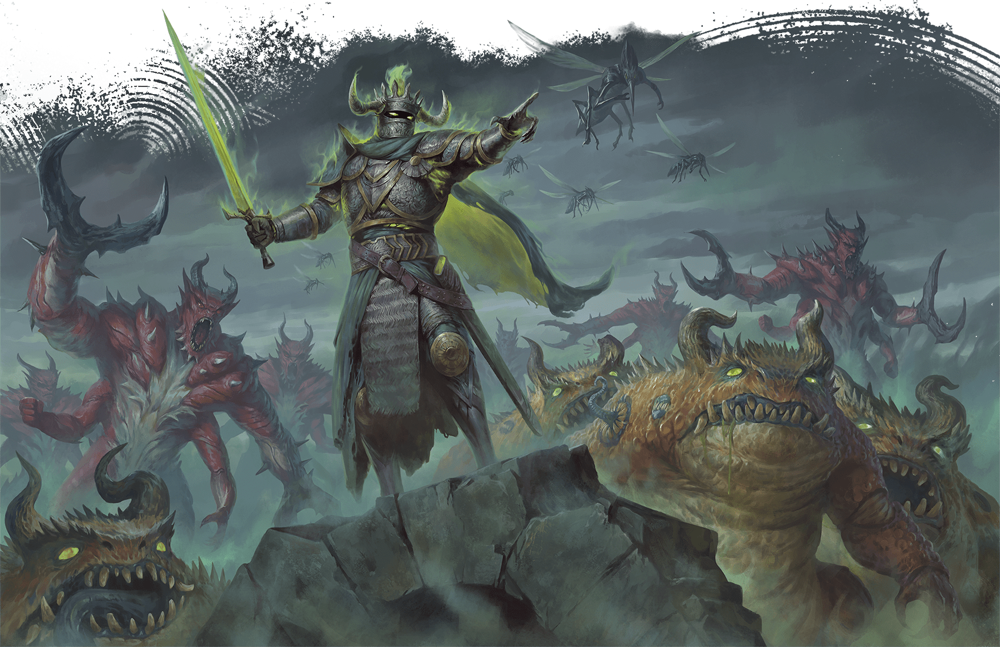

<!-- Notes MJ : contenu fourni par l’utilisateur, non destiné au partage public. -->

## Wrynn’s Bespoke Vestments

TARAS SUSAK

In Eltabbar, illusory scenes—such as this death knight commanding demons to attack—are harbingers of the horrors to come.

The next time the characters approach Wrynn’s Bespoke Vestments, read or paraphrase the following:

The once-gleaming windows of Wrynn’s Bespoke Vestments are shattered. Inside, you can see the shop has been ransacked; clothing and mannequins are strewn about haphazardly.

Szass Tam’s agents are raiding the shop, looking for information about Operation Deadfall.

### Wynston Wrynn’s Fate

Wrynn’s fate depends on whether the characters allied with the militia in chapter 4.

#### Mission Succeeded

If the characters allied with the militia, Fallon Nor and other militia members recently learned that Szass Tam had discovered Operation Deadfall. Nor used her [Sending Stone](https://www.dndbeyond.com/magic-items/9180147-sending-stones) to warn Wrynn, who escaped the shop moments before Viln Crocus arrived. Wrynn arrives at the shop after the characters have dispatched Crocus (see “[Development](../chapter.md#AssaultOnTheShopDevelopment)” below).

#### Mission Failed

If the characters didn’t ally with the militia, Szass Tam’s agents have killed Wrynn. The characters find the tailor’s body near his desk in the shop’s display and fitting space ([area W1](../../chapter-03-operation-deadfall/chapter.md#W3SecretOffice) on map 3.2).

Wrynn has sustained terrible injuries to his throat. As a [Search](https://www.dndbeyond.com/sources/dnd/free-rules/rules-glossary#SearchAction) action, a character can examine his wounds and make a DC 12 Wisdom ([Medicine](https://www.dndbeyond.com/sources/dnd/free-rules/playing-the-game#Skills)) check; on a success, they determine that a fanged creature killed the tailor.

The vampire Viln Crocus killed Wrynn. If the characters don’t kill Crocus (see “Assault on the Shop” below) or raise Wrynn from the dead, the tailor rises the following sunset as a [Vampire Spawn](https://www.dndbeyond.com/monsters/5195249-vampire-spawn) under Crocus’s control.

Wrynn knows who killed him and that Szass Tam deduced Operation Deadfall’s secrets, but he doesn’t know Zulkir Thrul’s fate.

### Assault on the Shop

When the characters enter the tailor shop (shown on [map 3.2](../../chapter-03-operation-deadfall/chapter.md#Map0302wrynnsbespokevestments) in chapter 3), they hear frustrated shouting coming from the secret office ([area W3](../../chapter-03-operation-deadfall/chapter.md#W3SecretOffice)).

As they enter the office, read or paraphrase the following:

The desk is upturned, and papers lie strewn across the floor. As three humans in dark robes emblazoned with a fist ransack the office, a bald, gaunt man with fangs and pupilless, black eyes rasps, “What else are they planning? There must be evidence somewhere!”

The fanged man is Viln Crocus (Medium [Vampire Umbral Lord](https://www.dndbeyond.com/monsters/5195250-vampire-umbral-lord)), and the robed humans (Medium, Neutral Evil [Archpriests](https://www.dndbeyond.com/monsters/5194903-archpriest)) are priests of Bane, god of tyranny. All four Szass Tam loyalists fight the characters on sight.

#### Development

If he escaped earlier, Wrynn returns to the shop after the characters have dispatched Szass Tam’s agents. The tailor has been watching the shop from a distance in disguise.

Wrynn is terrified for Zulkir Thrul, whose fate he doesn’t know. He tries to use his [Sending Stone](https://www.dndbeyond.com/magic-items/9180147-sending-stones) to contact her, to no avail.

***Wrynn’s Stones.*** The tailor carries a smooth, palm-size stone. Each side is engraved with an image of a crane identical to that of the [Masquerader’s Brooches](https://www.dndbeyond.com/magic-items/11914533-masqueraders-brooch) Thrul gave the characters in chapter 3—a reference to the zulkir’s code name, the Crane.

The stone is imbued with a [Programmed Illusion](https://www.dndbeyond.com/spells/2618902-programmed-illusion) spell (detailed in “[Grim Message](../chapter.md#GrimMessage)”). The zulkir instructed Wrynn to activate it with a command word in the event of her death or disappearance.

If Wrynn is alive, he activates the stone for the characters. If he’s dead, the characters can find the stone on his body. A note in Wrynn’s pocket (cloaked with an [Illusory Script](https://www.dndbeyond.com/spells/2619173-illusory-script) spell) says: “The stone is magical and contains a message from the Crane. Its command phrase is ‘the Crane speaks.’”

If Wrynn is dead, the characters also find the [Sending Stones](https://www.dndbeyond.com/magic-items/9180147-sending-stones) connected to Thrul and Fallon Nor on his body.
