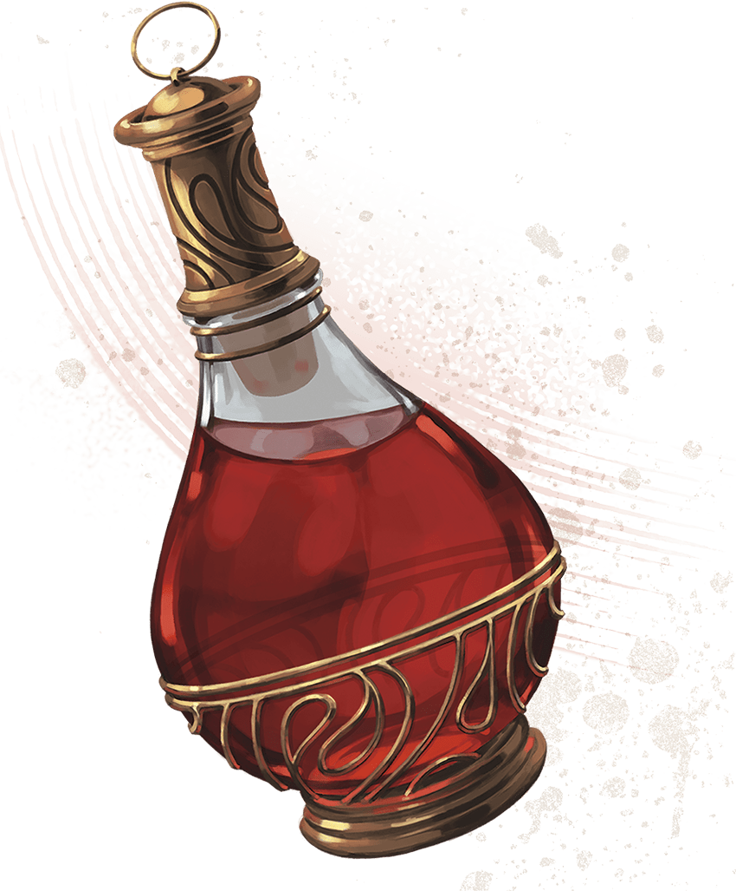

<!-- Notes MJ : contenu fourni par l’utilisateur, non destiné au partage public. -->

## Grim Message

When the characters say the stone’s command phrase, its illusion activates and the characters see an image of Zulkir Thrul.

Read or paraphrase the following:

Magical energy shimmers, and a translucent image appears: Zulkir Thrul sits behind her desk, looking stern.

“If you’re seeing this, operatives, it means I’m incapacitated or dead,” she says. “But you aren’t, and therefore Thay has hope. Know that I am proud of you—but your work is not yet done.

“The Hydra is ensconced in his stronghold in Thaymount—the Citadel—where he is nearly unassailable. Layered wards protect the area from teleportation and scrying, and by now every inch of it crawls with malefites and fiends. We have mere days before he finishes his ritual, raises his hordes, and declares himself regent again.

“Use the Mavericks’ ritual to travel to central Thaymount. From there, find the underground tunnel that leads from Castle Thrul—my ancestral home—into the Citadel. You must reach the Citadel without delay.

“The Hydra knows about this underground passage, and his allies may have magically barricaded Castle Thrul to prevent entry. In this case, seek the advice of Sabinia Dau in the Veiled Tower. If she’s unsure, you’ll need the help of her sister, Saraphine, the most brilliant magical theorist I’ve known. She’s most likely in Thaymount.

“I’ve left magic items in my demiplane that might aid you. Consider them payment.”

The zulkir exhales, then smiles grimly, head held high. “You can save Thay from the Hydra, operatives. I believe in you.”

### Szass Tam’s Barrier

As Zulkir Thrul suspects, Szass Tam has erected a powerful barrier around Castle Thrul as described in “[Abyssal Barriers](../chapter.md#AbyssalBarriers)” later in this chapter.

### Zulkir Thrul’s Fate

Zulkir Thrul is alive—barely—because Szass Tam wants her to witness his ritual’s completion before he turns her into an undead servant. Thaymount’s wards against scrying (see “[Magic on Thaymount](../chapter.md#MagicOnThaymount)” later in this chapter) prevent the characters from locating or magically observing Thrul, but they’ll have a chance to reunite with her in chapter 7.

### Zulkir Thrul’s Demiplane

If the characters can cast [Demiplane](https://www.dndbeyond.com/spells/2619088-demiplane), they can enter Zulkir Thrul’s demiplane. If they do so, they find it exactly as described in chapter 3, except the following are neatly laid on the zulkir’s desk:

[Animated Shield](https://www.dndbeyond.com/magic-items/4571-animated-shield)

[Plate Armor of Etherealness (Plate Armor)](https://www.dndbeyond.com/magic-items/9228928-plate-armor-of-etherealness)

[Five Potions of Healing (greater)](https://www.dndbeyond.com/magic-items/5133-potion-of-healing-greater)

[Robe of the Archmagi](https://www.dndbeyond.com/magic-items/4742-robe-of-the-archmagi)

[Spellguard Shield](https://www.dndbeyond.com/magic-items/4757-spellguard-shield)

[Staff of the Magi](https://www.dndbeyond.com/magic-items/9229101-staff-of-the-magi)

[Vorpal Sword (Greatsword)](https://www.dndbeyond.com/magic-items/9229178-vorpal-greatsword)

CoupleOfKooks

The zulkir’s payment includes   
five Potions of Healing (greater).
