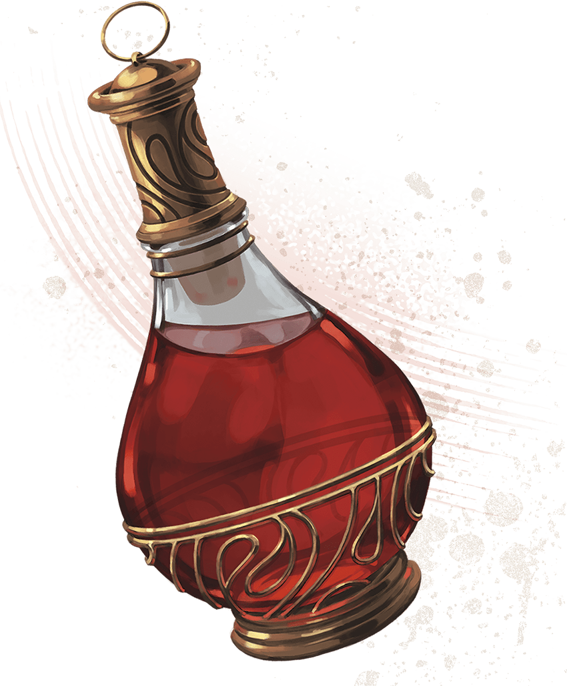

<!-- Notes MJ : contenu fourni par l’utilisateur, non destiné au partage public. -->

### Zulkir Thrul’s Fate

Zulkir Thrul is alive—barely—because Szass Tam wants her to witness his ritual’s completion before he turns her into an undead servant. Thaymount’s wards against scrying (see “[Magic on Thaymount](../chapter.md#MagicOnThaymount)” later in this chapter) prevent the characters from locating or magically observing Thrul, but they’ll have a chance to reunite with her in chapter 7.

### Zulkir Thrul’s Demiplane

If the characters can cast [Demiplane](https://www.dndbeyond.com/spells/2619088-demiplane), they can enter Zulkir Thrul’s demiplane. If they do so, they find it exactly as described in chapter 3, except the following are neatly laid on the zulkir’s desk:

[Animated Shield](https://www.dndbeyond.com/magic-items/4571-animated-shield)

[Plate Armor of Etherealness (Plate Armor)](https://www.dndbeyond.com/magic-items/9228928-plate-armor-of-etherealness)

[Five Potions of Healing (greater)](https://www.dndbeyond.com/magic-items/5133-potion-of-healing-greater)

[Robe of the Archmagi](https://www.dndbeyond.com/magic-items/4742-robe-of-the-archmagi)

[Spellguard Shield](https://www.dndbeyond.com/magic-items/4757-spellguard-shield)

[Staff of the Magi](https://www.dndbeyond.com/magic-items/9229101-staff-of-the-magi)

[Vorpal Sword (Greatsword)](https://www.dndbeyond.com/magic-items/9229178-vorpal-greatsword)

CoupleOfKooks

The zulkir’s payment includes   
five Potions of Healing (greater).
