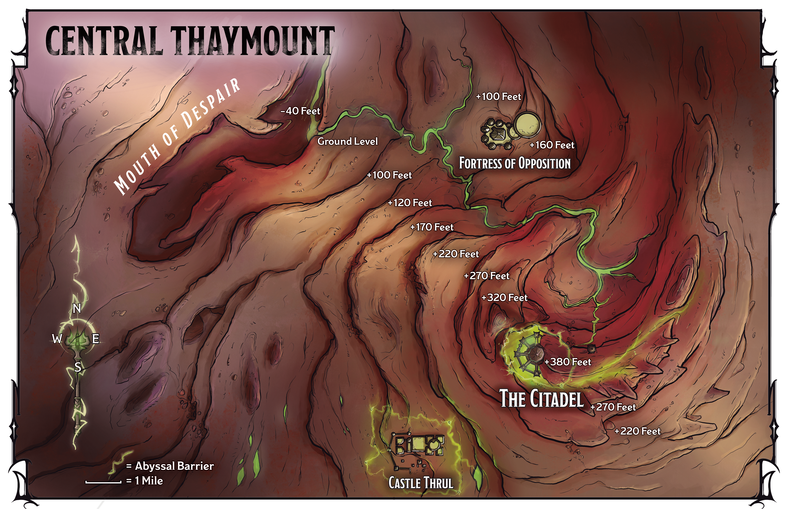

<!-- Notes MJ : contenu fourni par l’utilisateur, non destiné au partage public. -->

## Central Thaymount

Gerralt Landman

Map 6.1: Central Thaymount [View Player Version](../assets/maps/players/map-06-01.central-thaymount-player.png)

When the characters teleport to central Thaymount, an area many miles across, they arrive in the Mouth of Despair, as shown on map 6.1. See “[Thaymount](../../chapter-01-thay/chapter.md#Thaymount)” in chapter 1 for details on the tharch.

### Mouth of Despair

A natural fissure in the plateau, the Mouth of Despair divides the Fortress of Opposition, Castle Thrul, and the Citadel from the more populated areas to the west.

The dissident Red Wizards targeted this area to avoid Szass Tam knowing about their arrival in Thaymount. Now that the characters are involved, these mages are happy to let the characters face Thaymount’s dangers and report back.

The Red Wizards’ ritual deposits the characters in the middle of the Mouth of Despair, at the bottom of the fissure near its eastern wall. When they arrive, read or paraphrase the following:

You find yourselves at the bottom of a forty-foot-deep chasm. Above, green lightning flashes amid a gray, oppressive haze pierced only by Thaymount’s volcanic peaks far overhead.

[Dim Light](https://www.dndbeyond.com/sources/dnd/free-rules/rules-glossary#DimLight) filters into the chasm during daytime.

Before the characters leave the Mouth of Despair, they see an illusion of Saraphine Dau, as described below.

#### Saraphine’s Plea

If the characters reached the Mouth of Despair with the help of the dissident Red Wizards, Sabinia Dau told her sister via a [Spell Scroll](https://www.dndbeyond.com/magic-items/9229085-spell-scroll) *of* [Sending](https://www.dndbeyond.com/spells/2619015-sending) where and when to expect the characters to arrive in Central Thaymount. Shortly afterward, demons began attacking the Fortress of Opposition. Saraphine hid in the fortress and, desperate for help, used a [Spell Scroll](https://www.dndbeyond.com/magic-items/9229085-spell-scroll) *of* [Project Image](https://www.dndbeyond.com/spells/2618903-project-image) to create an illusory copy of herself, which she sent into the Mouth of Despair to meet the characters.

If the dissident Red Wizards are dead, Saraphine sent her illusory copy here knowing that the mages were working on a way to reach the Mouth of Despair. It’s a long shot, but she hopes her sister will arrive in the fissure and help her escape the fortress.

Read or paraphrase the following, changing Saraphine’s recognition to surprise if she isn’t expecting the characters to arrive:

Sitting on a nearby rock outcropping is the shimmering image of a young human woman, her navy blue cloak drawn around her. When she notices you, relief and excitement cross her face.

“You must be Sabinia’s friends!” she says. “I’m Saraphine Dau, Sabinia’s sister. You’ve got to help me! I’m stuck in the Fortress of Opposition. Fiends are destroying the place, and I fear they’ll soon rip me to pieces. Others are hiding in the fortress too. Please help us!”

The characters recognize the image as an illusion. Saraphine Dau’s image offers the characters the scrolls and magic items she keeps in the fortress (see [area F14](../chapter.md#F14MagicalLab)) in exchange for saving her and the others trapped in the fortress. She can tell the characters everything in the “[Trapped Inhabitants](../chapter.md#TrappedInhabitants)” section.

If the characters ask Saraphine about the barrier around Castle Thrul, she won’t discuss the matter until the characters agree to help her.

### Magic on Thaymount

Ancient magical wards erected by paranoid Red Wizards block scrying and teleportation in most of Thaymount. The exception is Szul, one of Szass Tam’s strongholds (see [chapter 1](../../chapter-01-thay/chapter.md#ThaymountPlateau)).

Spells and effects that would teleport creatures to other areas of Thaymount don’t work. In addition, the following spells don’t function in Thaymount:

- [Arcane Eye](https://www.dndbeyond.com/spells/2618863-arcane-eye)
- [Beast Sense](https://www.dndbeyond.com/spells/2618914-beast-sense)
- [Clairvoyance](https://www.dndbeyond.com/spells/2618972-clairvoyance)
- [Locate Creature](https://www.dndbeyond.com/spells/2619001-locate-creature)

- [Locate Object](https://www.dndbeyond.com/spells/2619002-locate-object)
- [Passwall](https://www.dndbeyond.com/spells/2618852-passwall)
- [Scrying](https://www.dndbeyond.com/spells/2619007-scrying)

If a creature tries to cast one of these spells, the spell slot is expended, but the spell has no effect.

Creatures with Legendary Actions that are in their lairs (such as [Szass Tam](https://www.dndbeyond.com/monsters/6719633-szass-tam) in chapter 7) ignore these impediments and can teleport or cast spells normally.

### Thaymount in Chaos

With Szass Tam’s ritual animating malefites and allowing demons to slip onto the Material Plane, Thaymount is in chaos. Central Thaymount is sparsely inhabited, though Castle Thrul and the Fortress of Opposition are both under attack, and magical barriers surround Castle Thrul and the Citadel (see “[Abyssal Barriers](../chapter.md#AbyssalBarriers)”). Central Thaymount’s layout is shown on [map 6.1](../chapter.md#Map6.1CentralThaymountImg).

Malefites and demons have overrun this area. Every mile the adventurers spend traveling, roll once on the Thaymount Encounters table below. As shown on map 6.1, the Mouth of Despair is about seven miles from the Fortress of Opposition, which is about eight miles from Castle Thrul.

Use [map 4.1](../../chapter-04-peril-in-pyarados/chapter.md#Map0401EasternPyaradosTrailImg) in chapter 4 for each encounter, but clarify to the players that its location is Thaymount.

#### Thaymount Encounters

| 1d4 | Encounter |
| --- | --- |
| 1 | A [Death Knight](https://www.dndbeyond.com/monsters/5194963-death-knight) directs four [Hezrous](https://www.dndbeyond.com/monsters/5195073-hezrou) to dig in the rocky soil of an ancient graveyard. The demons search for dead spellcasters who will animate once Szass Tam completes his ritual. |
| 2 | A [Balor](https://www.dndbeyond.com/monsters/5194911-balor) guarded by three [Death Cultists](https://www.dndbeyond.com/monsters/5194960-death-cultist) tries to open a portal to the Abyss. Nearby are the corpses of a dozen Red Wizards who tried to stop them. |
| 3 | A [Marilith](https://www.dndbeyond.com/monsters/5195117-marilith) and three [Death Knight Aspirants](https://www.dndbeyond.com/monsters/5194962-death-knight-aspirant) hunt for vulnerable people to slaughter. |
| 4 | Two [Goristros](https://www.dndbeyond.com/monsters/5195053-goristro) make their way west to attack mages’ fortresses nearby. |

#### Rising Evil Magic

As in Eltabbar, Szass Tam’s demonic magic has created an ominous haze over Thaymount. Outdoor areas are in [Dim Light](https://www.dndbeyond.com/sources/dnd/free-rules/rules-glossary#DimLight) in the daytime, and green lightning flashes in the sky.

#### Abyssal Barriers

When Szass Tam discovered Operation Deadfall, he used Abyssal magic to erect powerful barriers around Castle Thrul and the Citadel. The barriers are shown on [map 6.1](../chapter.md#Map6.1CentralThaymountImg) and look like thick, green, translucent domes.

***Castle Thrul.*** A barrier surrounds [Castle Thrul](../chapter.md#CastleThrul) outside the crumbling stone walls that surround the complex. The barrier functions like a [Wall of Force](https://www.dndbeyond.com/spells/2619194-wall-of-force) spell, but it’s permanent and can’t be destroyed with a [Disintegrate](https://www.dndbeyond.com/spells/2619094-disintegrate) spell. The barrier prevents entry into the areas described in “Castle Thrul” later in this chapter. The characters can punch a hole in this barrier using Saraphine Dau’s instructions (see [area F14](../chapter.md#F14MagicalLab) in “[Fortress of Opposition](../chapter.md#FortressOfOpposition)”).

***The Citadel.*** Another domed barrier surrounds the Citadel. It functions like the barrier surrounding Castle Thrul, but it can’t be penetrated. However, the barrier doesn’t extend far enough underground to impede the characters from reaching Szass Tam’s ritual chamber via the tunnels under Castle Thrul.

The ritual’s foul magic bathes the Citadel in green, malevolent energy that sweeps east, as shown on [map 6.1](../chapter.md#Map6.1CentralThaymountImg). This energy is harmless to the living, but if Szass Tam’s ritual isn’t stopped, the energy will envelop Thaymount, causing malefites to rise en masse.
