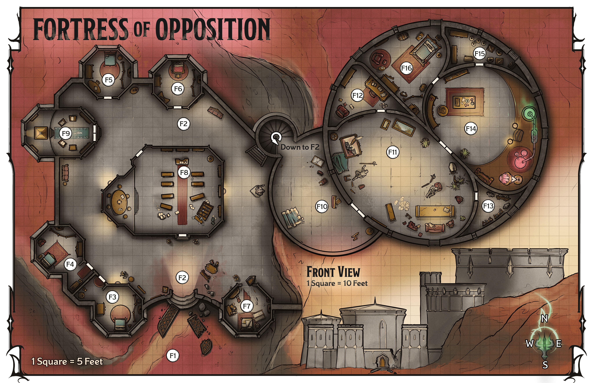

<!-- Notes MJ : contenu fourni par l’utilisateur, non destiné au partage public. -->

### Fortress Locations

Gerralt Landman

Map 6.2: Fortress of Opposition [View Player Version](https://media-stg.dndbeyond.com/compendium-images/aud/aqZhSuV5QislqWyN/map-06-02.fortress-of-opposition-player.png)

The following locations are keyed to map 6.2.

#### F1: Fortress Courtyard

The fortress’s enormous metal doors lie shattered on the ground. A massive fiend resembling a nightmarish centaur slams a warhammer against the northwest wall, while two horned, toad-faced monsters drool and laugh evilly. Meanwhile, skeletons and zombies claw ineffectually at the fortress’s outer wall.

A [Rendelith](https://www.dndbeyond.com/monsters/6719631-rendelith) (see appendix B) works to smash its way into a bedchamber inside the fortress ([area F3](../chapter.md#F3SouthBedchamber)) while two [Hezrous](https://www.dndbeyond.com/monsters/5195073-hezrou) rumble encouragement. The demons fight the characters as soon as they notice them.

Five groups of undead (each made up of five [Skeletons](https://www.dndbeyond.com/monsters/4775841-skeleton) and five [Zombies](https://www.dndbeyond.com/monsters/4775851-zombie)) scrabble at different sections of the outer wall, to no effect.

#### F2: Great Hall

Ripped carpets and smashed furniture litter this once-luxurious hall with soaring ceilings. A staircase in the northeast corner spirals upward.

Two fiendish horrors lumber purposefully toward the northwest: massive, horned creatures with black, bony spikes protruding from their crimson-furred backs. Elsewhere in the hall, skeletons and zombies shamble aimlessly.

The Fiends are two [Goristros](https://www.dndbeyond.com/monsters/5195053-goristro), which are searching for the inhabitants who have locked themselves in nearby bedchambers (areas [F3–F5](../chapter.md#F3SouthBedchamber)). The goristros fight the characters as soon as they notice them.

Lying in wait to the north of the library ([area F8](../chapter.md#F8Library)), out of sight of the entrance, is an [Abveku](https://www.dndbeyond.com/monsters/6719629-abveku) (see appendix B). It joins the fight when the goristros begin combat. Four groups of undead, each made up of five [Skeletons](https://www.dndbeyond.com/monsters/4775841-skeleton) and five [Zombies](https://www.dndbeyond.com/monsters/4775851-zombie), scrabble at the doors that lead to bedchambers.

#### F3: South Bedchamber

The door to this room is locked as detailed in “Fortress Features.”

A bed, nightstand, and wardrobe furnish this comfortable bedroom, and its textiles boast subtle patterns. A human man wearing a green-and-gold robe huddles on the bed.

Hiding here is Aventril (Medium [Noble](https://www.dndbeyond.com/monsters/5195145-noble)), a personal assistant to Saraphine. A no-nonsense but friendly human man, Aventril manages Saraphine’s calendar and stays here while Saraphine is in residence.

***Treasure.*** Aventril has few valuable personal possessions, but he does keep a [Potion of Gaseous Form](https://www.dndbeyond.com/magic-items/4705-potion-of-gaseous-form) and a [Potion of Comprehension](https://www.dndbeyond.com/magic-items/954138-potion-of-comprehension) in his nightstand.

#### F4: Southwest Bedchamber

The door to this room is locked as detailed in “[Fortress Features](../chapter.md#FortressFeaturesDoors).”

This comfortable bedroom is decorated in geometric patterns. A bed, wardrobe, and nightstand furnish the room. A human woman with waist-length black hair paces the floor.

Hiding here is Molly Malu (Medium [Noble](https://www.dndbeyond.com/monsters/5195145-noble)), a personal assistant to Saraphine. The bubbly and passionate human woman provides Saraphine with social advice and organizes the parties Saraphine throws in Eltabbar.

***Treasure.*** Malu enjoys fashion. Fifteen sets of [Fine Clothes](https://www.dndbeyond.com/equipment/539-fine-clothes) hang in her wardrobe.

#### F5: North Bedchamber

The door to this room is locked as detailed in “[Fortress Features](../chapter.md#FortressFeatures).”

This bedroom is decorated with velvet curtains and bedclothes, a silk rug, and stylized wood carvings. It’s furnished with a bed, a nightstand, and a wardrobe. A young, pale gnome woman sits on the bed scribbling notes in a journal.

Jerica Rey (Small [Mage Apprentice](https://www.dndbeyond.com/monsters/5195109-mage-apprentice)), Saraphine’s close friend and fellow aspiring Red Wizard, hides here. The young gnome hasn’t yet earned an apprenticeship with a Red Wizard, though it’s her ardent wish. Rey is chronicling her ordeal in her journal when the characters arrive.

***Treasure.*** Rey wears a [Cloak of Displacement](https://www.dndbeyond.com/magic-items/9228407-cloak-of-displacement) but gripes about not having other magic items. She tells the characters about the repository of [Spell Scrolls](https://www.dndbeyond.com/magic-items/9229085-spell-scroll) and magic items in the magical lab ([area F14](../chapter.md#F14MagicalLab)).

#### F6: Northeast Bedchamber

The door to this room is locked as detailed in “[Fortress Features](../chapter.md#FortressFeaturesDoors).”

In this comfortable bedroom, Red Wizard symbols adorn the duvet and rug. Sitting on the nightstand are a stoppered flask and a clay jug.

Sabinia Dau stays here when she visits.

***Treasure.*** On the nightstand are an [Alchemy Jug](https://www.dndbeyond.com/magic-items/9228343-alchemy-jug) and a [Decanter of Endless Water](https://www.dndbeyond.com/magic-items/9228419-decanter-of-endless-water).

#### F7: Southeast Bedchamber

This bedroom lies in shambles. The door hangs open on its hinges. Someone has snapped the wooden bed frame, torn the rugs, and splintered the wardrobe and nightstand.

Normally the guards’ bedroom, this chamber was destroyed by the [goristros](https://www.dndbeyond.com/monsters/5195053-goristro) in the great hall ([area F2](../chapter.md#F2GreatHall)).

#### F8: Library

Two enormous, board-headed beasts knock over bookshelves in this spacious library while a six-armed, serpentine fiend flings tables and scatters books around the room.

Two [Nalfeshnees](https://www.dndbeyond.com/monsters/5195140-nalfeshnee) and a [Marilith](https://www.dndbeyond.com/monsters/5195117-marilith) wreak havoc here. They fight the characters as soon as they notice them.

***Treasure.*** If the characters spend 10 minutes searching the toppled shelves, they find a [Spell Scroll](https://www.dndbeyond.com/magic-items/9229085-spell-scroll) *of* [Circle of Power](https://www.dndbeyond.com/spells/2618970-circle-of-power) and a [Spell Scroll](https://www.dndbeyond.com/magic-items/9229085-spell-scroll) *of* [Contact Other Plane](https://www.dndbeyond.com/spells/2619052-contact-other-plane) among the wreckage.

#### F9: Azuth Shrine

A fifteen-foot-tall pyramid made of gold sits in this room’s west alcove. Around it flit colored lights. A symbol emblazoned near the pyramid’s apex depicts a hand holding up its index finger.

This room is a shrine to Azuth, god of spellcasting, whom the Dau family worships. Any character who has proficiency in [Religion](https://www.dndbeyond.com/sources/dnd/free-rules/playing-the-game#Skills) or worships Azuth recognizes the symbol.

***Praying at the Shrine.*** Azuth, the Lord of Spells, is aware of the events unfolding and wants the characters to stop Szass Tam. If a creature takes an action to pray at the shrine, Azuth restores that creature’s expended spell slots. A creature can benefit from the shrine only once every 24 hours.

#### F10: Abyssal Vestibule

A double door stands in the east wall here, and a spiral staircase leads down in its north end. A mirror and furniture lie smashed on the floor.

Scorched red banners bearing a pronged symbol hang in ripped ribbons from the hundred-foot ceiling. The portraits of red-robed mages that adorn the curved walls bear smears of filth and claw marks.

The mages in the paintings suddenly grow horns, and their eyes glow green. They try to scrabble out of the walls, hissing like demonic beasts, and an overwhelming sense of murderous chaos washes over you.

A [Marilith](https://www.dndbeyond.com/monsters/5195117-marilith) desecrated this place with Abyssal filth it brought when it slipped onto the Material Plane. Blacktooth and his death knights then urged it to proceed to the lounge (see [area F11](../chapter.md#F11Lounge)).

***Demonic Possession.*** When a character enters this area, they can take the [Study](https://www.dndbeyond.com/sources/dnd/free-rules/rules-glossary#StudyAction) action to focus on the portraits’ unsettling images and make a DC 15 Intelligence ([Arcana](https://www.dndbeyond.com/sources/dnd/free-rules/playing-the-game#Skills)) check. On a success, the character realizes the portraits’ movements aren’t real and that the area is desecrated with Abyssal energy. The character knows that any player character who lingers in this room for 1 minute or longer will be subject to possession by demons.

If a character lingers in the room for 1 minute or longer, the character hears the mages speak with demonic voices. The mages say phrases in Abyssal such as “Bathe in their blood!” and “Chaos and murder reign supreme.” The character is the target of Demonic Possession, as described in the [Dungeon Master’s Guide](https://www.dndbeyond.com/sources/dnd/dmg-2024/dms-toolbox#DemonicPossession). A character is targeted by this effect only once.

#### F11: Lounge

What was once a beautiful lounge lies in disarray. Armchairs are toppled, and tables are smashed. Two bodies, blood dried on their dented plate armor, lie splayed on the floor. A hulking dragonborn man in black armor watches while a six-armed monster and two desiccated, black-armored knights with green, glowing eyes move to attack a double door to the northeast.

A [Marilith](https://www.dndbeyond.com/monsters/5195117-marilith) and two [Death Knight Aspirants](https://www.dndbeyond.com/monsters/5194962-death-knight-aspirant) move to assault the locked doors to [area F14](../chapter.md#F14MagicalLab) as Goreth Blacktooth (Medium, Neutral Evil [Warrior Commander](https://www.dndbeyond.com/monsters/5195258-warrior-commander)) looks on. When any of them notices the characters, they fight to the death; Goreth shrieks his devotion to Szass Tam all the while.

***Bodies.*** The bodies are those of Dau family guards: the orc Gregesh and the human Karla. Saraphine asked them to guard the doors to the magical lab ([area F14](../chapter.md#F14MagicalLab)); Goreth and his allies slaughtered them before the characters arrived.

***Treasure.*** A [+1 Greatsword](https://www.dndbeyond.com/magic-items/5238-greatsword-1) lies near the western fallen guard.

#### F12: Study

This cozy space boasts comfortable chairs, a table, and many open books.

Saraphine was pouring through tomes here before Goreth Blacktooth attacked the fortress.

***Treasure.*** If the characters spend 10 minutes searching this room, they find a [Tome of Leadership and Influence](https://www.dndbeyond.com/magic-items/4782-tome-of-leadership-and-influence) among the books.

#### F13: Armory

Suits of armor are stored here, and weapon racks stand against the east wall.

Weapons and armor are kept here for use by the family’s guards.

***Treasure.*** The armor stands and weapon racks hold the following items:

Two [Longswords](https://www.dndbeyond.com/equipment/4-longsword)

Three [Spears](https://www.dndbeyond.com/equipment/14-spear)

[Suit of Plate Armor](https://www.dndbeyond.com/equipment/18-plate)

[Suit of Scale Mail](https://www.dndbeyond.com/equipment/6-scale-mail)

#### F14: Magical Lab

The double door to this area is locked with an [Arcane Lock](https://www.dndbeyond.com/spells/2618868-arcane-lock) spell. When the characters enter this area, read or paraphrase the following:

An enormous desk curves along the south and east walls, supporting magical laboratory equipment. At the desk, a young human woman frantically scans a book and mumbles to herself. Shelves stand against the north and west walls.

The characters recognize the woman as Saraphine Dau (Medium [Mage](https://www.dndbeyond.com/monsters/4831023-mage)), Sabinia’s sister.

Saraphine is overjoyed if the characters have killed the monsters in the fortress. If they haven’t yet freed the people trapped in the bedchambers (areas [F3–F5](../chapter.md#F3SouthBedchamber)), she begs the characters to do so. She feels terrible that the assault on the fortress began before she could usher the others into the safety of this lab and that the guards died trying to defend her.

Here, generations of the Dau family have researched magic and created new spells. Although she’s not yet a Red Wizard, Saraphine covets the title and hopes to make magical advances to impress the mages and her family. She is an ingenious magical researcher and understands magical theory better than most Red Wizards, though she finds spellcasting difficult.

***Development.*** If the characters defeat all the monsters in the Fortress of Opposition, Saraphine gladly answers their questions about magical barriers. When the characters describe the barrier around Castle Thrul, read or paraphrase the following:

Saraphine sighs thoughtfully, then snaps her fingers in triumph.

“Yes, of course!” she exclaims. “The barrier must be constructed from Abyssal energy. It’s like a wall of force but more potent. You need disintegration magic designed specifically to affect the spiritual resonances of that realm.

“I’ve got a scroll I can make some adjustments to. You can use it to punch a hole in the barrier.”

Saraphine rummages through a nearby table and finds a [Spell Scroll](https://www.dndbeyond.com/magic-items/9229085-spell-scroll) *of* [Disintegrate](https://www.dndbeyond.com/spells/2619094-disintegrate). Over the course of 10 minutes, she makes adjustments to the scroll’s writing and diagrams. She then offers the modified scroll to the characters.

Saraphine explains that a character must use the adjusted [Spell Scroll](https://www.dndbeyond.com/magic-items/9229085-spell-scroll) while within 30 feet of the barrier around Castle Thrul. Doing this will create a permanent 10-foot-by-10-foot hole in the barrier.

If no character can use the scroll, Saraphine instead scribbles a phonetic representation of the [Disintegrate](https://www.dndbeyond.com/spells/2619094-disintegrate) spell’s modified verbal component. She modifies and then demonstrates the accompanying somatic component. She tells the characters that one of them must re-create these components within 30 feet of the barrier to create a permanent 10-foot-by-10-foot hole in it. This is dangerous; see “[Abyssal Barrier](../chapter.md#CastleThrulAbyssalBarriers)” in “Castle Thrul.”

Once the fortress is free of monsters, Saraphine musters the other trapped inhabitants to stay in the lab with her until the region is safe.

When the characters learn how to punch a hole in the barrier around Castle Thrul, each character earns 11,700 XP.

***Treasure.*** Saraphine gives the characters the items she has stockpiled here to help their fight against Szass Tam:

[Potion of Heroism](https://www.dndbeyond.com/magic-items/4709-potion-of-heroism)

Three [Potions of Healing (superior)](https://www.dndbeyond.com/magic-items/5134-potion-of-healing-superior)

[Ring of Candor](https://www.dndbeyond.com/magic-items/11914534-ring-of-candor) (see appendix A)

[Spell Scroll](https://www.dndbeyond.com/magic-items/9229085-spell-scroll) *of* [Antimagic Field](https://www.dndbeyond.com/spells/2618860-antimagic-field)

[Spell Scroll](https://www.dndbeyond.com/magic-items/9229085-spell-scroll) *of* [Stoneskin](https://www.dndbeyond.com/spells/2619095-stoneskin)

[Spell Scroll](https://www.dndbeyond.com/magic-items/9229085-spell-scroll) *of* [True Seeing](https://www.dndbeyond.com/spells/2619201-true-seeing)

Two [Spell Scrolls](https://www.dndbeyond.com/magic-items/9229085-spell-scroll) *of* [Project Image](https://www.dndbeyond.com/spells/2618903-project-image)

#### F15: Storage

Shelves full of linens and open boxes line the walls of this storage room.

This room holds household supplies.

***Treasure.*** If the characters search this room, they find three vials each of [Acid](https://www.dndbeyond.com/equipment/500-acid), [Alchemist’s Fire](https://www.dndbeyond.com/equipment/504-alchemists-fire), [Antitoxin](https://www.dndbeyond.com/equipment/520-antitoxin), and [Basic Poison](https://www.dndbeyond.com/equipment/398-basic-poison).

#### F16: Master Bedchamber

Within this luxurious room, a gorgeous canopy bed with embroidered silk hangings occupies the northeast corner, an ornate wardrobe sits along the southwest wall, and an armchair nestles into the northwest corner.

This is Saraphine’s bedroom.

***Treasure.*** Twenty sets of [Fine Clothes](https://www.dndbeyond.com/equipment/539-fine-clothes) hang in the wardrobe. A drawer inside the wardrobe holds five diamonds worth 25,000 GP total.
