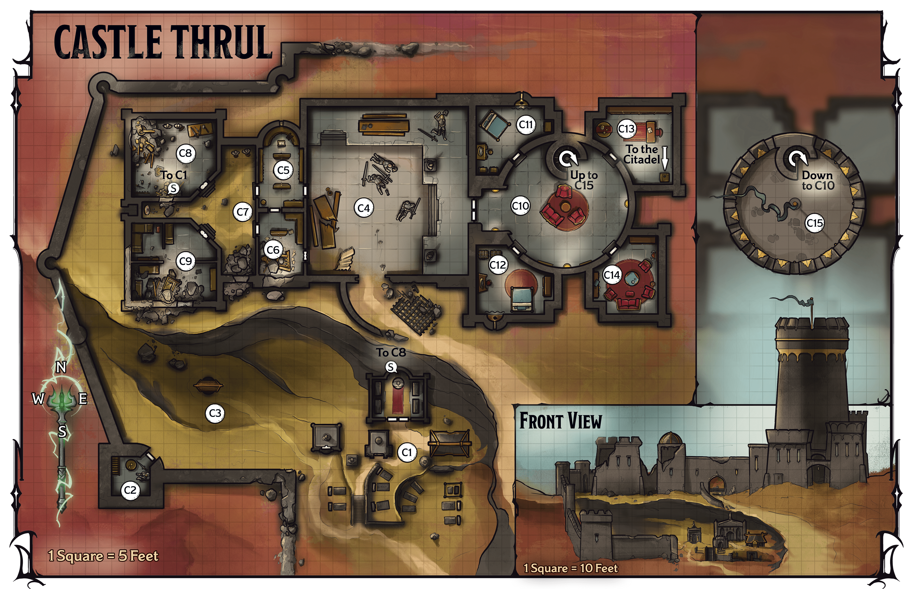
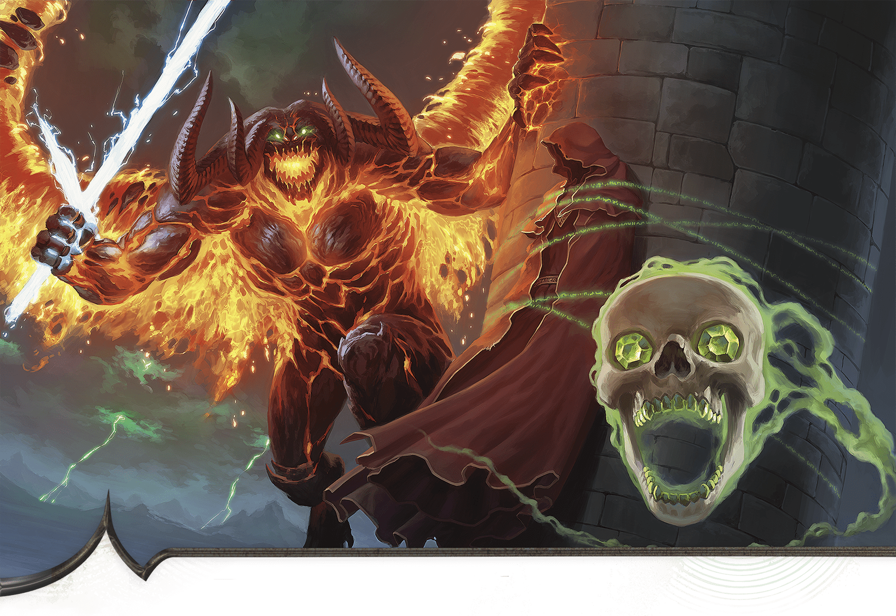

<!-- Notes MJ : contenu fourni par l’utilisateur, non destiné au partage public. -->

## Castle Thrul

One of the oldest buildings in Thaymount, Castle Thrul is a sprawling stone complex that includes a main hall and a 130-foot central tower surrounded by a stone wall. A necropolis where esteemed family members are interred sits south of the primary complex. An underground tunnel in the necropolis’s largest mausoleum leads into the castle’s armory ([area C8](../chapter.md#C8Armory) on [map 6.3](../chapter.md#Map06-03CastleThrulImg)), while a passage in the northeast wing ([area C13](../chapter.md#C13ZulkirThrulsChamber)) leads to the Citadel, where Szass Tam weaves his ritual.

### Lich’s Strike Force

When Szass Tam discovered Zulkir Thrul was behind Operation Deadfall, he vowed to destroy her and everyone she loves, starting with those in Castle Thrul. The lich assigned this job to the demilich Yoreth, whose lair is in the Citadel, and the human Red Wizard Jarek.

Szass Tam instructed Yoreth and Jarek to marshal demonic and undead forces to descend on Castle Thrul and kill anyone they encountered.

#### Keeping the Characters Out

After Szass Tam dispatched Yoreth and Jarek to Castle Thrul, the lich erected a barrier around the castle grounds outside the stone wall as described in “[Abyssal Barriers](../chapter.md#AbyssalBarriers)” earlier in this chapter.

As a contingency, Szass Tam instructed Yoreth to set a trap for the characters.

***False Zulkir.*** Using a [Spell Scroll](https://www.dndbeyond.com/magic-items/9229085-spell-scroll) *of* [Programmed Illusion](https://www.dndbeyond.com/spells/2618902-programmed-illusion) (DC 17), Jarek has created an illusion of Zulkir Thrul bound with magically glowing chains to the summit of the castle’s tower ([area C15](../chapter.md#C15TowerSummit)). The illusion activates when the characters come within 150 feet of the castle. For five minutes, the illusion depicts Thrul struggling against the chains and shouting for help. After five minutes, it disappears; it reactivates after 10 minutes if the party moves anywhere outside the castle within 150 feet.

Jarek hopes the illusion will fool the characters into trying to rescue the zulkir so Jarek, Yoreth, and their balor ally can ambush them.

### Approaching the Castle

Read or paraphrase the following when the characters come within 150 feet of Castle Thrul:

Black haze billows in the sky, where green lightning flashes. Behind a translucent green barrier, a stalwart fortress ringed by a stone wall rises along the hill before you. South of the fortress, squat buildings with interspersed gravestones stands somberly; four black-armored soldiers patrol the grounds with jerky movements.

Jutting from the fortress against the hazy horizon is a tower, around which flies a tiny orb that glows green. Lashed to the tower is a red-robed figure that shouts for help.

### Castle Features

Castle Thrul is made of magically treated stone that has Resistance to all damage. The castle otherwise has the following features.

#### Abyssal Barrier

The characters must punch a hole through the Abyssal barrier surrounding the castle (see [area F14](../chapter.md#F14MagicalLab) in “Fortress of Opposition” earlier in this chapter). They can create this hole anywhere they want.

If the characters use Saraphine’s modified verbal and somatic components to punch a hole in the barrier instead of her modified [Spell Scroll](https://www.dndbeyond.com/magic-items/9229085-spell-scroll) *of* [Disintegrate](https://www.dndbeyond.com/spells/2619094-disintegrate), a character takes an action to follow Saraphine’s instructions and makes a DC 20 Intelligence ([Arcana](https://www.dndbeyond.com/sources/dnd/free-rules/playing-the-game#Skills)) check. On a successful check, the character punches a hole in the barrier and takes 13 (3d8) Necrotic damage from magical backlash. On a failure, the character punches a hole in the barrier, but the magical backlash rips through them, and they take 27 (6d8) Necrotic damage.

#### Ceilings

Ceilings in buildings in the necropolis ([area C1](../chapter.md#C1Necropolis)) are 10 feet high. The ceiling in the guard tower ([area C2](../chapter.md#C2GuardTower)) is 20 feet high. Those on the castle’s main floor (areas [C4–C14](../chapter.md#C4GreatHall)) are 30 feet high.

#### Corpses

Yoreth and Jarek’s forces killed many of those who were in Castle Thrul when their strike force descended. Bodies of these victims are in areas [C2](../chapter.md#C2GuardTower)–[C4](../chapter.md#C4GreatHall). The victims knew key information that can help the characters as they explore the castle.

The characters might communicate with or raise a victim from the dead, perhaps using the [Rod of Resurrection](https://www.dndbeyond.com/magic-items/10609326-rod-of-resurrection) found in [area C1](../chapter.md#C1Necropolis) to cast [Resurrection](https://www.dndbeyond.com/spells/2618953-resurrection) on a victim. Each victim shares a different piece of information, beginning with “Door Passphrase,” until the characters know all the following:

- **Door Passphrase.** The only way to open the door to the gallery ([area C10](../chapter.md#C10Gallery)) is to use the passphrase “Thay shall endure.”
- **Lurking Balor.** The forces that are attacking the castle include a [balor](https://www.dndbeyond.com/monsters/5194911-balor).
- **Strike Force Leaders.** The forces that overran the castle were led by a demilich named Yoreth and a Red Wizard named Jarek, both of whom serve Szass Tam.
- **Tower Trap.** The leaders of the attack on the castle bragged about a trap involving an illusion of Zulkir Thrul lashed to the tower ([area C15](../chapter.md#C15TowerSummit)).

#### Doors

The castle’s doors are made of metal and are unlocked, except for the double door leading into the gallery ([area C10](../chapter.md#C10Gallery)).

#### Lighting

Areas outside Castle Thrul have [Dim Light](https://www.dndbeyond.com/sources/dnd/free-rules/rules-glossary#DimLight) during the day due to the evil magic that swirls through Thaymount. Inside the castle, sconces with [Continual Flame](https://www.dndbeyond.com/spells/2619065-continual-flame) spells cast on them shed [Bright Light](https://www.dndbeyond.com/sources/dnd/free-rules/rules-glossary#BrightLight).

#### Structural Damage

Castle Thrul has been under assault for days, during which time demons have damaged its structure—particularly the roof and walls on the west side of the fortress. The chunks of rubble on the ground in most of the western spaces (areas [C6](../chapter.md#C6SouthLibrary)–[C9](../chapter.md#C9Barrack)) make those areas [Difficult Terrain](https://www.dndbeyond.com/sources/dnd/free-rules/rules-glossary#DifficultTerrain).

#### Thaymount’s Wards

Like everywhere on the plateau, the castle is affected by Thaymount’s ancient magical wards (see “[Magic on Thaymount](../chapter.md#MagicOnThaymount)” earlier in this chapter).

### Castle Locations

Gerralt Landman

Map 6.3: Castle Thrul [View Player Version](https://media-stg.dndbeyond.com/compendium-images/aud/aqZhSuV5QislqWyN/map-06-03.castle-thrul-player.png)

The following locations are keyed to map 6.3.

#### C1: Necropolis

A side path branching off the road to Castle Thrul leads to an austere graveyard at the base of a low cliff. The gravestones, obelisks, and covered tombs bear the names of Thrul ancestors.

A mausoleum sits on the necropolis’s north end. Four soldiers in black armor with green, glowing eyes patrol the area haltingly.

The patrolling soldiers are four [Death Knight Aspirants](https://www.dndbeyond.com/monsters/5194962-death-knight-aspirant); they fight the characters on sight.

***Graves.*** All the graves, some as old as four hundred years, belong to members of the Thrul family.

***Mausoleum.*** The mausoleum includes four sarcophagi, in which are interred prominent Thrul Red Wizards. The mausoleum includes a shrine for offerings and a secret door to a tunnel leading into the castle (see below for both).

***Secret Door.*** The back of the mausoleum houses a secret door (marked with an *S* on the map; DC 20 to notice), behind which a staircase leads to an underground tunnel. The tunnel leads to the armory ([area C8](../chapter.md#C8Armory)). The door leading to area C8 is visible from inside the tunnel.

***Treasure.*** An unlocked drawer in the shrine’s base contains a [Rod of Resurrection](https://www.dndbeyond.com/magic-items/10609326-rod-of-resurrection). On the shrine, jewelry worth 10,000 GP in total is laid out as offerings.

#### C2: Guard Tower

A stone tower sits at the castle complex’s southwest corner. Inside slumps an armored body, whose sword lies nearby. A ladder leads upward.

The death knights in the necropolis ([area C1](../chapter.md#C1Necropolis)) have already swept through this area.

***Ladder.*** The ladder leads to the top of the guard tower, where battlements surround the flat roof. Any creature on the roof has [Half Cover](https://www.dndbeyond.com/sources/dnd/free-rules/rules-glossary#Cover) from creatures on the ground.

***Thuvia’s Corpse.*** The corpse belongs to Thuvia, captain of the Thruls’ family guard. The rest of the guards fled the castle when Thuvia fell. See “[Castle Features](../chapter.md#CastleFeaturesCorpses)” for additional details on corpses.

***Journal.*** Thuvia’s small, leather-bound journal is tucked in a pouch on her belt. If the characters spend 10 minutes perusing it, they learn the passphrase to the locked door that leads to the gallery ([area C10](../chapter.md#C10Gallery)): “Thay shall endure.”

***Treasure.*** Thuvia’s equipment includes a suit of [Plate Armor](https://www.dndbeyond.com/equipment/18-plate) and a [+3 Longsword](https://www.dndbeyond.com/magic-items/5320-longsword-3).

#### C3: Courtyard

Just west of the necropolis is a courtyard that holds a small well.

A peaked wooden roof tops the 5-foot-diameter stone well, which is 20 feet deep. The rope for the well’s bucket has been cut, and the bucket has fallen into the well.

***Xelnius’s Corpse.*** In the well is the corpse of the human Red Wizard Xelnius Thrul, Zulkir Thrul’s brother. Xelnius’s body floats at the water’s surface, 10 feet belowground, though it is easy to spot thanks to his red robes. Before he died, Xelnius was terrified for his sister, whom he loves dearly. See “[Castle Features](../chapter.md#CastleFeaturesCorpses)” for additional details on corpses.

***Treasure.*** Xelnius wears a [Headband of Intellect](https://www.dndbeyond.com/magic-items/4652-headband-of-intellect) and a set of crimson [Fine Clothes](https://www.dndbeyond.com/equipment/539-fine-clothes).

#### C4: Great Hall

A huge portcullis, ripped from its housing, lies dented here on the ground. Three enormous, crimson bipedal fiends with horns and massive claws rampage through the once-lavish great hall, knocking over pedestals, smashing busts and statues, and shredding crimson banners. Four armored bodies, their corpses twisted strangely, lie scattered about the room. A dais to the east leads to a large double door.

The fiends are three [Goristros](https://www.dndbeyond.com/monsters/5195053-goristro); they fight the characters on sight.

The hall was once decorated with tapestries and statuary depicting the glories of House Thrul over the centuries, but they’ve all been destroyed.

***Corpses.*** The bodies are those of four Thrul family guards: the humans Retha and Rian and the orcs Wythe and Cadeth. See “[Castle Features](../chapter.md#CastleFeaturesCorpses)” for additional details on corpses.

***Treasure.*** The guards’ weapons and armor include the following:

- [Greatsword](https://www.dndbeyond.com/equipment/22-greatsword)
- Three [Heavy Crossbows](https://www.dndbeyond.com/equipment/36-crossbow-heavy)
- [Longbow](https://www.dndbeyond.com/equipment/37-longbow)
- Six [Longswords](https://www.dndbeyond.com/equipment/4-longsword)

- Sap
- Three [Chain Shirts](https://www.dndbeyond.com/equipment/12-chain-shirt)
- [Suit of Scale Mail](https://www.dndbeyond.com/equipment/6-scale-mail)
- [+3 Longsword](https://www.dndbeyond.com/magic-items/5320-longsword-3)

#### C5: North Library

Undisturbed bookshelves fill this small library.

The demons haven’t reached this area yet.

***Treasure.*** If the characters spend 10 minutes searching the shelves, they find a [Tome of Clear Thought](https://www.dndbeyond.com/magic-items/4781-tome-of-clear-thought) and a [Tome of Understanding](https://www.dndbeyond.com/magic-items/4783-tome-of-understanding).

#### C6: South Library

Chunks of masonry have fallen from the roof here and lie atop collapsed shelves. Fallen books are scattered about the area.

Demons smashed a hole through the roof, showering the room with masonry.

***Treasure.*** A character can take the [Search](https://www.dndbeyond.com/sources/dnd/free-rules/rules-glossary#SearchAction) action to sift through the rubble and make a DC 15 Wisdom ([Perception](https://www.dndbeyond.com/sources/dnd/free-rules/playing-the-game#Skills)) check. On a success, the character finds a [Manual of Golems](https://www.dndbeyond.com/magic-items/5416-manual-of-golems).

#### C7: Mustering Yard

The south end of this open yard is choked with rubble from a partially collapsed wall.

This yard is abandoned.

#### C8: Armory

Weapons and shields litter the floor, and suits of armor lie strewn about. Rubble from the damaged ceiling fills the northwest corner.

This chamber stored arms and armor for the Thrul family’s guards, as well as household supplies. Demons damaged the roof and tore through the armory, leaving it in disarray.

***Secret Door.*** A secret door (marked with an *S* on the map; DC 20 to notice) opens to a steep staircase down. The stairs lead to a tunnel that emerges in the mausoleum in the necropolis ([area C1](../chapter.md#C1Necropolis)). The secret door to the necropolis is visible from inside the tunnel.

***Treasure.*** The Thrul family generously outfitted the castle’s guards. A character who searches the area finds the following:

Two [Greatswords](https://www.dndbeyond.com/equipment/22-greatsword)

Two [Longswords](https://www.dndbeyond.com/equipment/4-longsword)

[Suit of Plate Armor](https://www.dndbeyond.com/equipment/18-plate)

Three [suits of Scale Mail](https://www.dndbeyond.com/equipment/6-scale-mail)

#### C9: Barrack

Partial walls create a semblance of privacy in this crowded barrack. Rubble from a collapsed wall fills the southern half of the barrack.

This barrack once housed Thrul family guards and servants, as well as staff accompanying dignitaries. The servants were sent away when the situation in Thaymount escalated.

***Treasure.*** As a [Search](https://www.dndbeyond.com/sources/dnd/free-rules/rules-glossary#SearchAction) action, a character can look under the beds and make a DC 15 Wisdom ([Perception](https://www.dndbeyond.com/sources/dnd/free-rules/playing-the-game#Skills)) check. On a success, the character finds rucksacks under three of the beds. The rucksacks each contain various coins worth 250 GP total.

#### C10: Gallery

When the characters approach the gallery’s entrance, read or paraphrase the following:

This metal double door bears embossed images of eight mages in regal poses and flowing robes. Most are bald and bear tattoos. Above the image are the words “All Glory to Thrul” in Common.

This double door is protected with a magical, Invisible barrier similar to the effect of a [Wall of Force](https://www.dndbeyond.com/spells/2619194-wall-of-force) spell, except it can’t be suppressed and a [Disintegrate](https://www.dndbeyond.com/spells/2619094-disintegrate) spell doesn’t destroy it. Only speaking the passphrase “Thay shall endure” removes the barrier. The barrier reappears 1 minute after the passphrase is spoken.

A character can take the [Study](https://www.dndbeyond.com/sources/dnd/free-rules/rules-glossary#StudyAction) action to examine the barrier and make a DC 15 Intelligence ([Arcana](https://www.dndbeyond.com/sources/dnd/free-rules/playing-the-game#Skills)) check. On a success, the character realizes a passphrase is the only way to bypass the barrier.

***Discovering the Passphrase.*** The characters might learn the passphrase from one of the corpses in areas [C2](../chapter.md#C2GuardTower)–[C4](../chapter.md#C4GreatHall) (see “[Castle Features](../chapter.md#CastleFeaturesCorpses)” for more about learning from corpses). They might also learn the passphrase from the journal on Thuvia’s body in [area C2](../chapter.md#C2GuardTower).

Once the characters enter this area, read or paraphrase the following:

Eight twenty-foot-tall portraits of mages in crimson robes ring this gallery. Each portrait bears a brass nameplate. The portraits overlook a cozy, undisturbed lounge, with plush armchairs in the center and a spiral staircase to the north.

The eight nameplates bear the names Renia Thrul, Darius Thrul, Zulkir Aznar Thrul, Ferene Thrul, Xander Thrul, Vernus Thrul, Geryn Thrul, and Zulkir Xelnene Thrul. The characters recognize the portrait of Xelnene, who bears a dour, regal expression matching those of her ancestors.

If the characters aren’t already aware of Zulkir Aznar Thrul, a character can take the [Study](https://www.dndbeyond.com/sources/dnd/free-rules/rules-glossary#StudyAction) action to examine Aznar’s portrait and make a DC 15 Intelligence ([History](https://www.dndbeyond.com/sources/dnd/free-rules/playing-the-game#Skills)) check. On a success, the character knows everything in the “[History](../../appendix-b-bestiary/chapter.md#XelneneThrulHistory)” section of Xelnene Thrul’s entry in appendix B.

***Staircase.*** The staircase to the north ascends 130 feet to the top of the castle’s tower ([area C15](../chapter.md#C15TowerSummit)).

#### C11: Thuvia’s Chamber

This bedchamber displays an array of military medals. Along the south wall are two trunks.

This was the bedroom of guard captain Thuvia, whose body is in the guard tower ([area C2](../chapter.md#C2GuardTower)). The Thruls considered her a member of the family.

***Treasure.*** The left trunk holds Thuvia’s emergency stash of coins. It totals 50,000 GP.

The trunk on the right contains five sets of [Traveler’s Clothes](https://www.dndbeyond.com/equipment/541-travelers-clothes) and a [Dread Helm](https://www.dndbeyond.com/magic-items/27045-dread-helm) that was a gift from Xelnene Thrul’s late father, Geryn.

#### C12: Xelnius’s Chamber

This lavish chamber includes a bed with a blue duvet, a marble washbasin in a wooden stand, and two trunks to the north.

This was the bedroom of Xelnius Thrul, whose body was thrown into the well ([area C3](../chapter.md#C3Courtyard)).

***Treasure.*** The trunks and wardrobe are unlocked. The wardrobe holds ten sets of [Fine Clothes](https://www.dndbeyond.com/equipment/539-fine-clothes). The right trunk contains four [Potions of Healing (superior)](https://www.dndbeyond.com/magic-items/5134-potion-of-healing-superior); the left one is empty.

#### C13: Zulkir Thrul’s Chamber

This bedroom’s red bedspread and nightstand bear a light layer of dust. A trapdoor is built into the stone floor.

This chamber is Xelnene Thrul’s bedroom, though the zulkir rarely stays here. She keeps nothing of value in this room.

***Underground Passage.*** The trapdoor on the south end of the room leads to a maze of tunnels underneath Thaymount. From this maze, the characters can reach the area of the Citadel where Szass Tam weaves his ritual. (See “[Next Steps](../chapter.md#NextSteps)” when the characters descend into these tunnels.)

#### C14: Family Lounge

This rich-looking lounge contains plush crimson armchairs gathered around a central table.

Members of the family relax and eat their meals in this lounge.

#### C15: Tower Summit

BRIAN VALEZA

Szass Tam’s forces have created this illusion of Zulkir Thrul in danger.

When the characters come within 10 feet of the outside of this tower on foot or via flight, read or paraphrase the following:

A massive, four-horned fiend leaps onto the top of the tower, laughing hideously. It is joined by a flying mage with red robes and facial tattoos and by a skull alight with green flames, which flies at you, screaming, “You shall pay with your lives for opposing Szass Tam!”

The skull is Yoreth ([Demilich](https://www.dndbeyond.com/monsters/5194967-demilich)), and the mage is the Red Wizard Jarek (Medium [Archmage](https://www.dndbeyond.com/monsters/5194902-archmage)). They are further described in “[Lich’s Strike Force](../chapter.md#LichsStrikeForce).” Accompanying them is a [Balor](https://www.dndbeyond.com/monsters/5194911-balor) that slipped onto the Material Plane near the castle. Yoreth and Jarek enticed the fiendish general to assault the castle, promising the balor could kill powerful heroes—the characters. These three fight the characters to the death.
