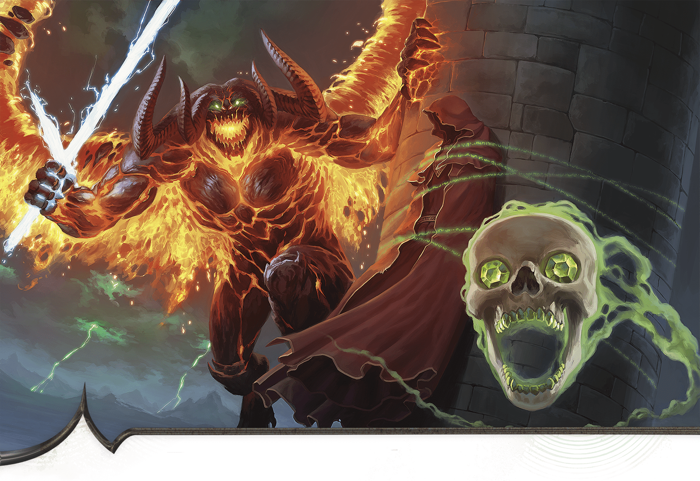

<!-- Notes MJ : contenu fourni par l’utilisateur, non destiné au partage public. -->

#### C15: Tower Summit

BRIAN VALEZA

Szass Tam’s forces have created this illusion of Zulkir Thrul in danger.

When the characters come within 10 feet of the outside of this tower on foot or via flight, read or paraphrase the following:

A massive, four-horned fiend leaps onto the top of the tower, laughing hideously. It is joined by a flying mage with red robes and facial tattoos and by a skull alight with green flames, which flies at you, screaming, “You shall pay with your lives for opposing Szass Tam!”

The skull is Yoreth ([Demilich](https://www.dndbeyond.com/monsters/5194967-demilich)), and the mage is the Red Wizard Jarek (Medium [Archmage](https://www.dndbeyond.com/monsters/5194902-archmage)). They are further described in “[Lich’s Strike Force](../chapter.md#LichsStrikeForce).” Accompanying them is a [Balor](https://www.dndbeyond.com/monsters/5194911-balor) that slipped onto the Material Plane near the castle. Yoreth and Jarek enticed the fiendish general to assault the castle, promising the balor could kill powerful heroes—the characters. These three fight the characters to the death.
