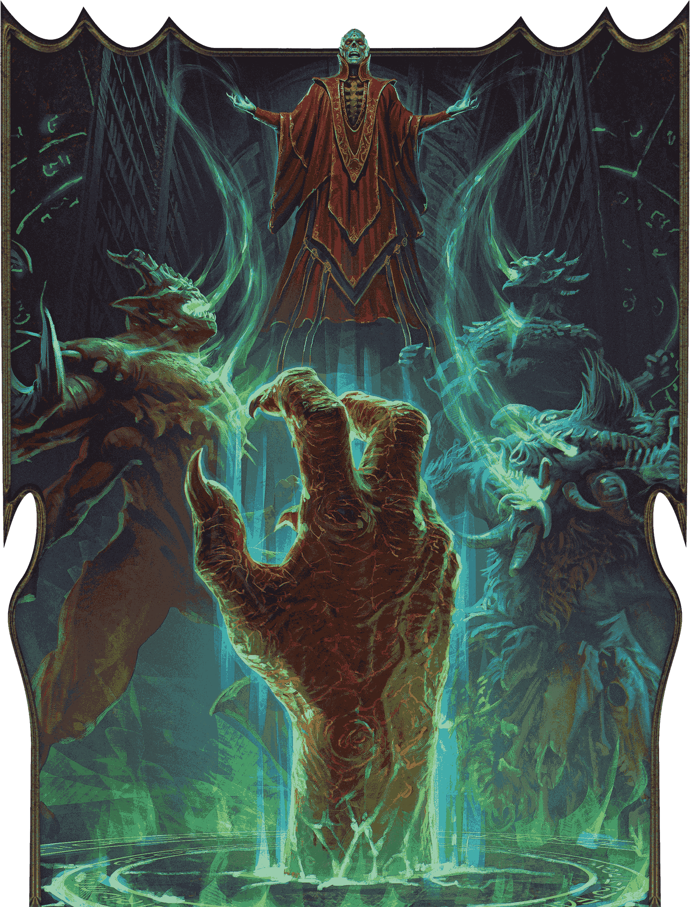
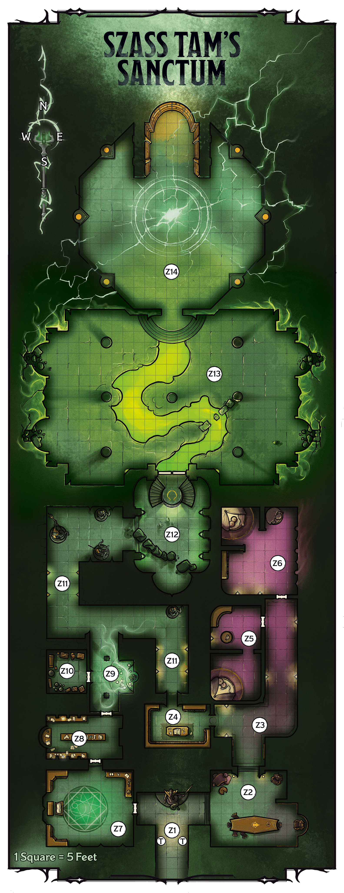
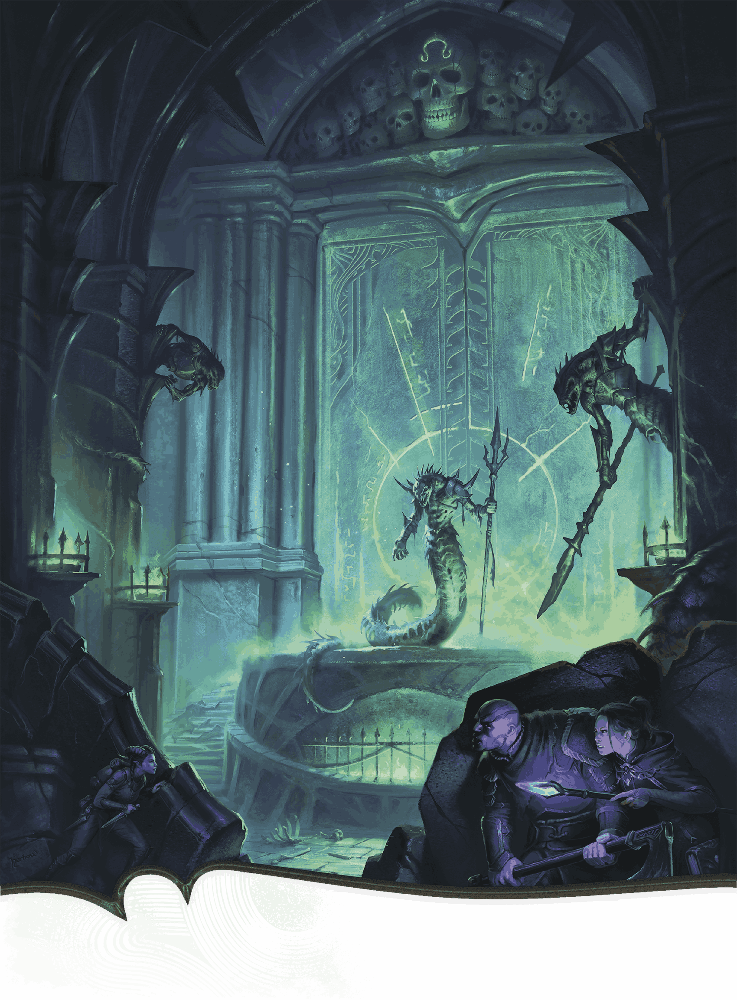

<!-- Notes MJ : contenu fourni par l’utilisateur, non destiné au partage public. -->

# Chapter 7: Szass Tam Must Die

Chapter 7

# Szass Tam Must Die

Fight Szass Tam and save Thay from destruction.

Adventure   
for Level

19

Characters

sessions

2

ANDREY KUZINSKIY

Szass Tam nears the end of his ritual to raise an overwhelming horde of malefites.

## Key Plot Points

The following information is key to this chapter’s story:

- **Sarrukh Guardians.** Magical serpentine creatures called sarrukhs guard the entrance to Szass Tam’s ritual chamber. The characters must circumvent or dispatch the sarrukhs before they face the lich.
- **Stop Szass Tam.** When the characters arrive in the ritual chamber, they can confront Szass Tam and his allies and stop him from raising a malefite army that will destroy Thay.

## Preparation

Before running this chapter, prepare as follows:

- **Step 1.** Read the “[Running This Chapter](#RunningThisChapter)” section, including “[Character Advancement](#CharacterAdvancement).”
- **Step 2.** Familiarize yourself with the Key NPCs table below.
- **Step 3.** Bookmark the stat blocks below, which appear in the *Monster Manual* and on D&D Beyond unless otherwise noted. If a stat block appears in appendix B, an asterisk appears after its name:

- [Arisen Sarrukh](https://www.dndbeyond.com/monsters/6719630-arisen-sarrukh)\*
- [Dracolich](https://www.dndbeyond.com/monsters/5194972-dracolich)
- [Nalfeshnee](https://www.dndbeyond.com/monsters/5195140-nalfeshnee)
- [Sarrukh Tyrant](https://www.dndbeyond.com/monsters/6719632-sarrukh-tyrant)\*

- [Szass Tam](https://www.dndbeyond.com/monsters/6719633-szass-tam)\*
- [Vampire Umbral Lord](https://www.dndbeyond.com/monsters/5195250-vampire-umbral-lord)
- [Xelnene Thrul](https://www.dndbeyond.com/monsters/6719634-xelnene-thrul)

#### Key NPCs

| Name | Role | Stat Block | Location |
| --- | --- | --- | --- |
| Drevoralyx | Draconic malefite allied with Szass Tam | [Dracolich](https://www.dndbeyond.com/monsters/5194972-dracolich) (Huge) | [Z13](#Z13HallOfCorruptedLava) |
| Nara Crocus | Szass Tam’s lieutenant | [Vampire Umbral Lord](https://www.dndbeyond.com/monsters/5195250-vampire-umbral-lord) (Medium) | [Z14](#Z14RitualChamber) |
| Szass Tam | Lich plotting to unleash a malefite horde against Thay | [See appendix B](../appendix-b-bestiary/chapter.md#SzassTam) | [Z14](#Z14RitualChamber) |
| Vartheeth | Sarrukh who might surrender | [Sarrukh Tyrant](https://www.dndbeyond.com/monsters/6719632-sarrukh-tyrant) (see appendix B) | [Z2](#Z2CommunalHall) |
| Vorsoth and Xileesh | Sarrukh clan leaders and Szass Tam’s allies | [Arisen Sarrukhs](https://www.dndbeyond.com/monsters/6719630-arisen-sarrukh) (see appendix B) | [Z13](#Z13HallOfCorruptedLava) |
| Xelnene Thrul | Human zulkir of evocation and Operation Deadfall’s leader | [See appendix B](../appendix-b-bestiary/chapter.md#XelneneThrul) | [Z14](#Z14RitualChamber) |

## Running This Chapter

This chapter takes place after the characters have found the tunnel from Castle Thrul to the Citadel.

## Character Advancement

The characters should be level 19 when this chapter begins. They should be level 20 by the time they face Szass Tam in [area Z14](#Z14RitualChamber).

## Reaching the Citadel

The tunnel in Castle Thrul leads to a labyrinthine underground structure of caverns and passageways. The route to the Citadel is about two miles.

These underground areas, which are in [Darkness](https://www.dndbeyond.com/sources/dnd/free-rules/rules-glossary#Darkness), are difficult to navigate. To keep the characters on the safest, most direct route, one character makes a DC 15 Wisdom ([Survival](https://www.dndbeyond.com/sources/dnd/free-rules/playing-the-game#Skills)) check. On a success, the characters reach the sanctum without incident. Proceed with “[Szass Tam’s Sanctum](#SzassTamsSanctum).”

On a failure, the characters stray into dangerous tunnels and encounter monsters, as described below.

### Underground Ambush

Use any area on the Underdark Warren map in the [Dungeon Master’s Guide](https://www.dndbeyond.com/sources/dnd/dmg-2024/maps#UnderdarkWarren) for this encounter.

Read or paraphrase the following, which assumes the characters have a way to see in the dark:

Three hulking serpentine warriors wielding polearms patrol this passage.

These three [Sarrukh Tyrants](https://www.dndbeyond.com/monsters/6719632-sarrukh-tyrant) serve Szass Tam and search the area for intruders.

When the sarrukhs notice the characters, read or paraphrase the following:

One of the serpentine horrors shrieks in Common, “Intruders! For nearing the sarrukh stronghold, you shall die. For defying Szass Tam, you shall become the lich’s rotting puppets!”

***Sarrukh Lore.*** A character can take the [Study](https://www.dndbeyond.com/sources/dnd/free-rules/rules-glossary#StudyAction) action and make a DC 15 Intelligence ([History](https://www.dndbeyond.com/sources/dnd/free-rules/playing-the-game#Skills)) check. On a success, the character realizes the creatures are sarrukhs and recalls that these creatures once commanded a wicked empire that spanned Faerûn, but it fell millennia ago. The character knows sarrukhs are now nearly extinct.

The sarrukhs fight to the death. Once the characters defeat the sarrukhs, they can proceed to the Citadel, emerging in Szass Tam’s sanctum.

## Szass Tam’s Sanctum

A subterranean level of the Citadel serves as Szass Tam’s sanctum for weaving the Malefice Mortum ritual.

Like the rest of the Citadel, the sarrukhs built this area millennia ago. Szass Tam long ago allied with the sarrukhs still in this complex. He promised that once he controls Thay, he’ll help them conquer the other peoples in the Underdark under Thaymount.

### Sanctum Features

Szass Tam’s sanctum has the following features.

#### Ceilings

Ceilings in the sanctum are 40 feet high, with the exception of areas [Z13](#Z13HallOfCorruptedLava) and [Z14](#Z14RitualChamber). Ceilings in those areas are 100 feet high.

#### Doors

The sanctum’s doors are made of stone. All are unlocked except the double door to the hall of corrupted lava ([area Z13](#Z13HallOfCorruptedLava)), which is locked with an [Arcane Lock](https://www.dndbeyond.com/spells/2618868-arcane-lock) spell. (See “Doors” in the [Dungeon Master’s Guide](https://www.dndbeyond.com/sources/dnd/dmg-2024/dms-toolbox#Doors).)

#### Lighting

Sconces and braziers with [Continual Flame](https://www.dndbeyond.com/spells/2619065-continual-flame) spells cast on them illuminate the sanctum with green-tinted [Dim Light](https://www.dndbeyond.com/sources/dnd/free-rules/rules-glossary#DimLight). The exception is [area Z13](#Z13HallOfCorruptedLava), where the green lava’s glow creates eerie [Bright Light](https://www.dndbeyond.com/sources/dnd/free-rules/rules-glossary#BrightLight).

#### Szass Tam’s Lair

The sanctum is Szass Tam’s lair. It exhibits the effects described in his entry in [appendix B](../appendix-b-bestiary/chapter.md#SzassTamsLair).

#### Unhallowed Ward

Szass Tam’s evil magic has created a permanent effect similar to that of a [Hallow](https://www.dndbeyond.com/spells/2619138-hallow) spell, but it affects the whole sanctum. Celestials can’t willingly enter the sanctum, and Humanoids have Vulnerability to Necrotic damage here. The effect is suppressed for any creature in the area of an [Antimagic Field](https://www.dndbeyond.com/spells/2618860-antimagic-field) spell. The effect can’t be dispelled.

### Sanctum Locations

The following locations are keyed to map 7.1.

#### Z1: Entryway

An ancient statue of a serpentine warrior wielding a polearm stands against the far wall. Green light flickers off its carved armor and scales.

The statue depicts a hero of the long-lost sarrukh empire. A character can take the [Study](https://www.dndbeyond.com/sources/dnd/free-rules/rules-glossary#StudyAction) action to examine the statue and make a DC 15 Intelligence ([History](https://www.dndbeyond.com/sources/dnd/free-rules/playing-the-game#Skills)) check. On a success, the character recalls the lore about sarrukhs described in “[Underground Ambush](#UndergroundAmbush).”

***Poisoned Dart Traps.*** The traps marked by the letter *T* on the map are poisoned dart traps, as described in the [Dungeon Master’s Guide](https://www.dndbeyond.com/sources/dnd/dmg-2024/dms-toolbox#PoisonedDarts), except the darts—sarrukh fangs dripping with poison—deal 24 (7d6) Poison damage each.

#### Z2: Communal Hall

Two serpentine figures near a long table argue in a hissing, guttural tongue. Both have the heads and lower bodies of snakes but torsos like those of humanoids, albeit scaly. One is bulkier than the other and has glowing green eyes; black rot mottles its desiccated scales.

The bulky creature is Ssarthe ([Arisen Sarrukh](https://www.dndbeyond.com/monsters/6719630-arisen-sarrukh)), who achieved undeath long ago. Ssarthe argues in Draconic with Vartheeth ([Sarrukh Tyrant](https://www.dndbeyond.com/monsters/6719632-sarrukh-tyrant)).

The sarrukhs fight the characters on noticing them. Ssarthe fights to the death, but if Ssarthe is killed or Vartheeth is [Bloodied](https://www.dndbeyond.com/sources/dnd/free-rules/rules-glossary#Bloodied), Vartheeth surrenders. Vartheeth reveals the following if the characters agree to let her flee:

Gerralt Landman

Map 7.1: Szass Tam’s Sanctum [View Player Version](https://media-stg.dndbeyond.com/compendium-images/aud/aqZhSuV5QislqWyN/map-07-01.szass-tams-sanctum-player.png)

- **Return to Glory.** Szass Tam has promised this sarrukh clan he’ll help them conquer the other peoples under Thaymount once his ritual is complete. Vartheeth is skeptical, as the lich ignored their earlier requests for such help for centuries.
- **Ritual Chamber Guardians.** An undead dragon with glowing green eyes guards the lich’s ritual chamber. The dragon is joined by undead sarrukhs named Vorsoth and Xileesh, the stronghold’s leaders, whom the lich has promised to install as emperors in the future sarrukh empire. Szass Tam has also promised the dragon something valuable in exchange for his service, but Vartheeth doesn’t know the details. Vartheeth suspects Szass Tam is lying about everything.
- **Sarrukh Superiority.** Like all sarrukhs, Vartheeth believes sarrukhs are superior to everyone else.
- **Undead Aspirations.** Like most sarrukhs, Vartheeth wants to become undead to ensure she’ll witness the resurgence of the sarrukh empire.

#### Z3: Hall of Tyranny

Flickering green light from sconces forms shadowy scenes on the walls of serpentine creatures hoisting polearms. An overwhelming sense of dread fills you as the shadows leap from the walls and slither toward you.

This magical effect is an illusion.

***Illusory Danger.*** When a character enters this area, they can take the [Study](https://www.dndbeyond.com/sources/dnd/free-rules/rules-glossary#StudyAction) action and make a DC 18 Intelligence ([Investigation](https://www.dndbeyond.com/sources/dnd/free-rules/playing-the-game#Skills)) check to try to recognize the illusion.

On a failed check, a character makes a DC 15 Wisdom saving throw, taking 42 (12d6) Psychic damage on a failed save or half as much on a successful one.

A character is subject to this magical effect only once. A character who carries a figurine from [area Z9](#Z9Shrine) is immune to this effect.

#### Z4: Library

Bookcases filled with weathered tomes surround a reading table here. Two bulky serpentine figures peruse the volumes on the shelves.

Two [Arisen Sarrukhs](https://www.dndbeyond.com/monsters/6719630-arisen-sarrukh) (see appendix B) search through these books about necromancy, seeking to better understand Szass Tam’s ritual. The sarrukhs fight the characters on noticing them.

***Treasure.*** The books contain all the Necromancy spells in the [Player’s Handbook](https://www.dndbeyond.com/sources/dnd/phb-2024). A character can take the [Search](https://www.dndbeyond.com/sources/dnd/free-rules/rules-glossary#SearchAction) action and make a DC 15 Wisdom ([Perception](https://www.dndbeyond.com/sources/dnd/free-rules/playing-the-game#Skills)) check to examine the books. On a success, the character finds five tomes worth 500 GP each.

#### Z5: South Sarrukh Chambers

A wall divides this hall into two chambers with a doorless opening between them. Each chamber holds a nest of green cushions; the northern chamber also holds a desk.

The clan’s sarrukh tyrants rest here and in [area Z6](#Z6NorthSarrukhQuarters).

In the northern chamber, an unlocked drawer in the northwest desk holds a [Potion of Vitality](https://www.dndbeyond.com/magic-items/5360-potion-of-vitality). In the southern chamber, underneath the cushions is a small pouch containing 100 PP.

#### Z6: North Sarrukh Quarters

Several nests made from blankets lie to the north.

If the characters spend 10 minutes searching the northwest nest, they find Vartheeth’s journal, written in Draconic. It reveals the information she might mention in [area Z2](#Z2CommunalHall).

#### Z7: Magical Laboratory

A twenty-foot-wide rune scribed on the floor glows green. Two serpentine figures chant incantations in a hissing, guttural tone, their eyes closed in concentration. Tables holding open books and vials of liquid sit along the walls.

The chanting figures are Tresshe and Yethel ([Sarrukh Tyrants](https://www.dndbeyond.com/monsters/6719632-sarrukh-tyrant); see appendix B). They know Szass Tam’s ritual has bathed the area in unholy magic (see “[Unhallowed Ward](#UnhallowedWard)”). They hope the effect, mixed with their own magic, will turn them undead.

The sarrukhs fight the characters on sight but surrender if [Bloodied](https://www.dndbeyond.com/sources/dnd/free-rules/rules-glossary#Bloodied). In exchange for being allowed to escape, they reveal the information Vartheeth might share in [area Z2](#Z2CommunalHall), though they believe Szass Tam’s promise.

***Glowing Rune.*** The rune on the floor thrums with ancient magic. As an action, a creature can stand on the rune and feel magical energy flow through them. For the next hour, whenever that creature casts a spell that forces a creature to make a saving throw, one target of the spellcaster’s choice has [Disadvantage](https://www.dndbeyond.com/sources/dnd/free-rules/rules-glossary#Disadvantage) on saves against the spell.

***Treasure.*** A [Potion of Healing (supreme)](https://www.dndbeyond.com/magic-items/5135-potion-of-healing-supreme) lies on the northeast table.

#### Z8: Scriptorium

The tables here bear writing supplies and coins. Three serpentine figures are writing furiously.

In this scriptorium, three [Sarrukh Tyrants](https://www.dndbeyond.com/monsters/6719632-sarrukh-tyrant) (see appendix B) scribe [Spell Scrolls](https://www.dndbeyond.com/magic-items/5418-spell-scroll) to help Szass Tam’s cause. They fight the characters on noticing them.

***Treasure.*** The tables hold three sets of [Calligrapher’s Supplies](https://www.dndbeyond.com/equipment/404-calligraphers-supplies), as well as [Ink](https://www.dndbeyond.com/equipment/503-ink) and [Parchment](https://www.dndbeyond.com/equipment/395-parchment). The tables also contain three [Spell Scrolls](https://www.dndbeyond.com/magic-items/9229085-spell-scroll) *of* [Delayed Blast Fireball](https://www.dndbeyond.com/spells/2619086-delayed-blast-fireball), a [Spell Scroll](https://www.dndbeyond.com/magic-items/9229085-spell-scroll) *of* [Imprisonment](https://www.dndbeyond.com/spells/2619175-imprisonment), and a [Spell Scroll](https://www.dndbeyond.com/magic-items/9229085-spell-scroll) *of* [Time Stop](https://www.dndbeyond.com/spells/2619185-time-stop).

The coins on the tables amount to 1,000 GP total.

#### Z9: Shrine

Candles burn green here in a semicircle on the floor, and foot-tall serpentine figurines stand on velvet cloths. The east wall is carved with a relief of an enormous serpent biting its own tail.

This is a shrine to the enigmatic World Serpent and other gods the sarrukhs venerate. Characters proficient in [Religion](https://www.dndbeyond.com/sources/dnd/free-rules/playing-the-game#Skills) identify the World Serpent carving.

***Figurines.*** The figurines on the ground depict snakelike or draconic deities that the sarrukhs believe are manifestations of the World Serpent. Characters proficient in [Religion](https://www.dndbeyond.com/sources/dnd/free-rules/playing-the-game#Skills) identify the figurines as depicting the following deities:

- **Asgorath:** Dragon said to have created the world
- **Jazirian:** Couatl deity
- **Shekinester:** Patron god of nagas

There is one figurine per character; more than one figurine can depict each deity if needed.

***Development.*** A character carrying a figurine is immune to the effects of the illusion in [area Z3](#Z3HallOfTyranny).

#### Z10: Storage

This room bears trunks and crates.

These trunks contain 50 [Rations](https://www.dndbeyond.com/equipment/411-rations) total.

#### Z11: Hall of Glories

Dotting this corridor are frescoes and statues depicting serpentine conquerers cowing myriad other creatures depicted as terrified and weak.

Characters proficient in [History](https://www.dndbeyond.com/sources/dnd/free-rules/playing-the-game#Skills) recognize that the frescoes and statues depict sarrukh history.

#### Z12: Antechamber of Skulls

JORDAN KERBOW

Heroes prepare to confront the sarrukhs who guard an antechamber in Szass Tam’s sanctum.

Two curved stairways rise five feet to a double door guarded by two serpentine warriors, one wielding a fauchard and the other a trident.

The guards are an [Arisen Sarrukh](https://www.dndbeyond.com/monsters/6719630-arisen-sarrukh) and [Sarrukh Tyrant](https://www.dndbeyond.com/monsters/6719632-sarrukh-tyrant) (see appendix B for both), who fight the characters on noticing them.

***Explosive Glyph.*** A nearly imperceptible glyph is scribed on the center of the double door (see area Z13). Noticing the glyph requires a successful DC 21 Wisdom ([Perception](https://www.dndbeyond.com/sources/dnd/free-rules/playing-the-game#Skills)) check.

The glyph triggers when a creature touches the double door. When triggered, the glyph erupts with magical energy in a 30-foot [Cone](https://www.dndbeyond.com/sources/dnd/free-rules/rules-glossary#ConeAreaofEffect) originating from the center of the door. Each creature in that area makes a Dexterity saving throw. A creature takes 22 (5d8) Acid damage on a failed save or half as much damage on a successful one.

#### Z13: Hall of Corrupted Lava

The double door to this area is locked with an [Arcane Lock](https://www.dndbeyond.com/spells/2618868-arcane-lock) spell. When the characters enter this area, read or paraphrase the following:

Heat rises off the green river of bubbling lava that snakes northward toward a dais, where an enormous dragon of bone and desiccated flesh looms. Two serpentine warriors with rotting scales, each brandishing a trident, stand near the dais. Rubble chokes alcoves to the east and west.

The dragon is Drevoralyx, a Huge [Dracolich](https://www.dndbeyond.com/monsters/5194972-dracolich). Two [Arisen Sarrukhs](https://www.dndbeyond.com/monsters/6719630-arisen-sarrukh) (see appendix B) accompany him—Vorsoth and Xileesh, the sarrukh clan’s leaders. Since Drevoralyx isn’t a true dracolich, he has no lair (see “[Draconic Malefite](#DraconicMalefite)”).

When any of these creatures notice the characters, read or paraphrase the following:

The dragon shouts in a guttural voice, “You must be the maggots Szass Tam described. Leave now, or I shall squash you like the bugs you are!”

The creatures will entertain a question before they fight the characters to the death. If the characters ask why they’re protecting Szass Tam, Drevoralyx reveals that Szass Tam has promised to install him as the malefites’ general. Vorsoth and Xileesh reveal that Szass Tam has promised to help them become joint emperors of a new sarrukh empire in the Underdark.

***Draconic Malefite.*** A character can take the [Study](https://www.dndbeyond.com/sources/dnd/free-rules/rules-glossary#StudyAction) action to examine Drevoralyx and make a DC 15 Intelligence ([Arcana](https://www.dndbeyond.com/sources/dnd/free-rules/playing-the-game#Skills)) check. On a success, the character realizes the foul magic from Szass Tam’s ritual animated the dead dragon, who traveled here from another part of the Citadel. The character knows this means Drevoralyx has no lair, doesn’t have the Soul Gem trait, and is destroyed when reduced to 0 Hit Points.

***Alcoves.*** The alcoves are blocked with rubble from collapsed stairs. Szass Tam blocked these stairways to ensure no one could enter his sanctum from here.

***Lava River.*** The lava flow here occurs naturally, fueled by a nearby volcano. Szass Tam’s magic has corrupted it, turning it green. The lava is 5 feet deep and [Difficult Terrain](https://www.dndbeyond.com/sources/dnd/free-rules/rules-glossary#DifficultTerrain). A creature that enters the lava or begins its turn there takes 27 (5d10) Fire damage and 27 (5d10) Necrotic damage.

#### Z14: Ritual Chamber

If the characters failed to receive the help of the pirates in chapter 5, Szass Tam received a number of ritual-boosting demon skulls equal to the number of characters. Add the following to the description of the ritual chamber after the first paragraph:

The horned, fanged skulls of fiends rest along the ritual circle. Runes glowing with green light cover the skulls.

When the characters enter this chamber, read or paraphrase the following:

A wide circle inscribed with profane runes glows green on this chamber’s floor. Around the circle, shimmering images of hulking fiends bend backward unnaturally. A corona of green energy flows from the fiends to Szass Tam, who floats high above the ground, clutching a blackened spellbook.

In the southwest corner, Zulkir Thrul stands unmoving with a look of horror frozen on her face. Nearby, a pale woman’s hands pulse with shadowy magic, and two enormous boar-headed beasts slaver.

Szass Tam smiles. “Ah, maggots,” he sneers. “You must truly wish to be crushed. You think yourselves bold, but you are simply this generation’s sad excuse for those who futilely stand against me.”

The zulkir of necromancy beckons you with a clawlike hand. “Come, rail and rant as you must. Then die and be reborn as I please!”

[Szass Tam](https://www.dndbeyond.com/monsters/6719633-szass-tam) (see appendix B) flies 50 feet above the chamber’s floor. He’s defended by the vampire Nara Crocus (Medium [Vampire Umbral Lord](https://www.dndbeyond.com/monsters/5195250-vampire-umbral-lord)), whose lair is elsewhere in the Citadel, and by her two [Nalfeshnee](https://www.dndbeyond.com/monsters/5195140-nalfeshnee) bodyguards.

***Szass Tam.*** When this combat begins, the lich is maintaining [Concentration](https://www.dndbeyond.com/sources/dnd/free-rules/rules-glossary#Concentration) on his ritual. If he’s reduced to 250 Hit Points or fewer, he stops concentrating on the ritual if his [Concentration](https://www.dndbeyond.com/sources/dnd/free-rules/rules-glossary#Concentration) is still unbroken. Szass Tam keeps his distance from the characters while his allies are alive and uses every Action, Reaction, and Legendary Action at his disposal.

***Zulkir Thrul.*** Under the effects of [Power Word Stun](https://www.dndbeyond.com/spells/2618889-power-word-stun), [Xelnene Thrul](https://www.dndbeyond.com/monsters/6719634-xelnene-thrul) (see appendix B) has the [Stunned](https://www.dndbeyond.com/sources/dnd/free-rules/rules-glossary#StunnedCondition) condition and 1 Hit Point remaining. Roll Initiative for Thrul. At the end of each of her turns, roll a DC 21 Constitution saving throw for Thrul as she tries to shake off the spell. On a success, she no longer has the [Stunned](https://www.dndbeyond.com/sources/dnd/free-rules/rules-glossary#StunnedCondition) condition and joins the combat against the lich. Szass Tam targets her on his next turn.

***Ritual Skulls.*** If present, the skulls discharge magical bolts that target the characters.

Every round on Initiative count 0 (losing ties), each skull targets a random player character. The character makes a DC 15 Dexterity saving throw, taking 18 (4d8) Necrotic damage on a failed save or half as much on a successful one.

***Demon Conduits.*** Szass Tam is channeling necromantic magic through a translucent glabrezu, goristro, marilith, and nalfeshnee. The demons’ souls are split between the Material Plane and the Abyss; if Szass Tam is killed or stops concentrating, these demons return to the Abyss.

***Spirit-Binding Censer.*** If the characters retrieved the [Spirit-Binding Censer](https://www.dndbeyond.com/magic-items/11914557-spirit-binding-censer) (see appendix A) from the temple of the Red Knight in [chapter 4](../chapter-04-peril-in-pyarados/chapter.md#AnAncientTemple), they can use it to trap Szass Tam’s soul for a hundred years.

***Development.*** If Szass Tam dies, a flash of golden light bathes the sanctum in virtuous energy. All evidence of the lich’s ritual disappears. Further, the holy energy replaces Szass Tam’s blackened spellbook with the [Book of Exalted Deeds](https://www.dndbeyond.com/magic-items/9228363-book-of-exalted-deeds), which lies closed in the center of the chamber.

## Conclusion

The outcome of the final battle has significant ramifications for Thay.

### Success

If the characters disrupt Szass Tam’s ritual, they foil his plans. Red Wizards, perhaps with the characters’ help, eventually defeat the malefites and demons that have attacked the nation. If the characters kill Szass Tam but don’t have the censer, Szass Tam revives in 1d10 days with all his Hit Points in another part of the Citadel. Thay must contend with the enraged lich, though he won’t try anything as dramatic as this for several years.

If the characters trap Szass Tam’s soul in the censer, Thay has a century to fortify itself against the lich and reshape its future.

#### Zulkir Thrul

If Thrul survives (or if the characters raise her from the dead), read or paraphrase the following:

After a moment spent breathing deeply and smoothing her robes, Zulkir Thrul turns to you.

“Operatives—friends—you did it. You stopped Szass Tam. More importantly, you saved Thay.”

A small smile crosses her face. “It’s time for me to return to Eltabbar. Won’t you join me, heroes? We must discuss your reward.”

After they return to Eltabbar, Thrul awards each character any Legendary magic item they request. She invites the heroes to work with her to fight for a better Thay for as long as they are willing.

***New Zulkir of Necromancy.*** If any character is a Wizard with the Necromancer subclass or can prove their proficiency at Necromancy, Thrul suggests they vie to replace Szass Tam as zulkir of necromancy. This could be a satisfying capstone to the character’s adventuring career. In this case, Thrul convinces the other zulkirs that the character earned the position by helping defeat Szass Tam. The characters have an opportunity to bring political change to Thay. They might need to contend with the lich’s return, but that’s a later adventure.

#### The Mavericks

If the characters visit the dissident Red Wizards after defeating Szass Tam, the mages express their gratitude for saving Thay—in their own self-aggrandizing way—and Sabinia thanks them for saving her sister. Each mage extends a standing invitation to the characters to visit their many estates.

### Failure

If the party fails to disrupt Szass Tam’s ritual, their mission fails, and Szass Tam’s army of malefites kills thousands. The other zulkirs are killed or driven into hiding. Szass Tam’s forces hunt down the Mavericks and slay them. The lich declares himself regent. He then turns his sights to conquering neighboring Aglarond and Rashemen.

If they survive, the characters must flee Thay. They might later become generals in a force that opposes the malefites. They will need to confront Szass Tam’s malefite leaders and sycophants before they can hope to weaken the lich’s grip on the nation.
