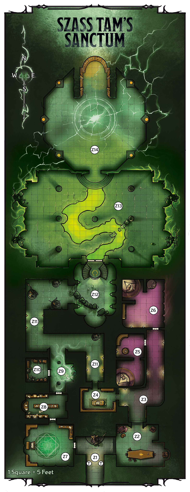

<!-- Notes MJ : contenu fourni par l’utilisateur, non destiné au partage public. -->

#### Unhallowed Ward

Szass Tam’s evil magic has created a permanent effect similar to that of a [Hallow](https://www.dndbeyond.com/spells/2619138-hallow) spell, but it affects the whole sanctum. Celestials can’t willingly enter the sanctum, and Humanoids have Vulnerability to Necrotic damage here. The effect is suppressed for any creature in the area of an [Antimagic Field](https://www.dndbeyond.com/spells/2618860-antimagic-field) spell. The effect can’t be dispelled.

### Sanctum Locations

The following locations are keyed to map 7.1.

#### Z1: Entryway

An ancient statue of a serpentine warrior wielding a polearm stands against the far wall. Green light flickers off its carved armor and scales.

The statue depicts a hero of the long-lost sarrukh empire. A character can take the [Study](https://www.dndbeyond.com/sources/dnd/free-rules/rules-glossary#StudyAction) action to examine the statue and make a DC 15 Intelligence ([History](https://www.dndbeyond.com/sources/dnd/free-rules/playing-the-game#Skills)) check. On a success, the character recalls the lore about sarrukhs described in “[Underground Ambush](../chapter.md#UndergroundAmbush).”

***Poisoned Dart Traps.*** The traps marked by the letter *T* on the map are poisoned dart traps, as described in the [Dungeon Master’s Guide](https://www.dndbeyond.com/sources/dnd/dmg-2024/dms-toolbox#PoisonedDarts), except the darts—sarrukh fangs dripping with poison—deal 24 (7d6) Poison damage each.

#### Z2: Communal Hall

Two serpentine figures near a long table argue in a hissing, guttural tongue. Both have the heads and lower bodies of snakes but torsos like those of humanoids, albeit scaly. One is bulkier than the other and has glowing green eyes; black rot mottles its desiccated scales.

The bulky creature is Ssarthe ([Arisen Sarrukh](https://www.dndbeyond.com/monsters/6719630-arisen-sarrukh)), who achieved undeath long ago. Ssarthe argues in Draconic with Vartheeth ([Sarrukh Tyrant](https://www.dndbeyond.com/monsters/6719632-sarrukh-tyrant)).

The sarrukhs fight the characters on noticing them. Ssarthe fights to the death, but if Ssarthe is killed or Vartheeth is [Bloodied](https://www.dndbeyond.com/sources/dnd/free-rules/rules-glossary#Bloodied), Vartheeth surrenders. Vartheeth reveals the following if the characters agree to let her flee:

Gerralt Landman

Map 7.1: Szass Tam’s Sanctum [View Player Version](https://media-stg.dndbeyond.com/compendium-images/aud/aqZhSuV5QislqWyN/map-07-01.szass-tams-sanctum-player.png)

- **Return to Glory.** Szass Tam has promised this sarrukh clan he’ll help them conquer the other peoples under Thaymount once his ritual is complete. Vartheeth is skeptical, as the lich ignored their earlier requests for such help for centuries.
- **Ritual Chamber Guardians.** An undead dragon with glowing green eyes guards the lich’s ritual chamber. The dragon is joined by undead sarrukhs named Vorsoth and Xileesh, the stronghold’s leaders, whom the lich has promised to install as emperors in the future sarrukh empire. Szass Tam has also promised the dragon something valuable in exchange for his service, but Vartheeth doesn’t know the details. Vartheeth suspects Szass Tam is lying about everything.
- **Sarrukh Superiority.** Like all sarrukhs, Vartheeth believes sarrukhs are superior to everyone else.
- **Undead Aspirations.** Like most sarrukhs, Vartheeth wants to become undead to ensure she’ll witness the resurgence of the sarrukh empire.
