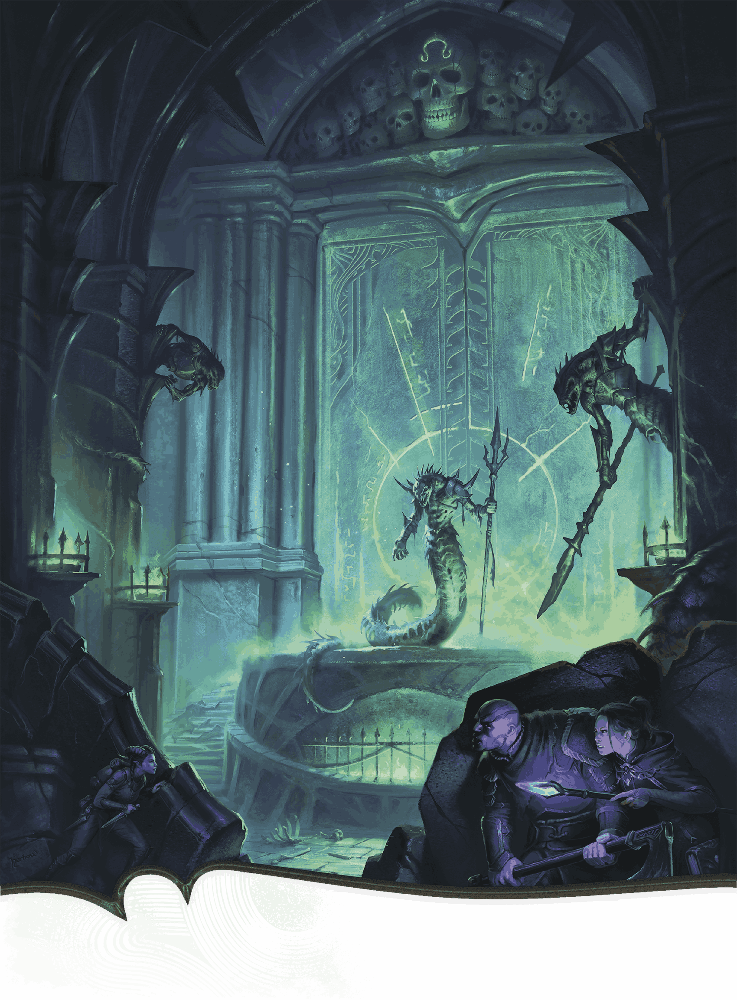

<!-- Notes MJ : contenu fourni par l’utilisateur, non destiné au partage public. -->

#### Z12: Antechamber of Skulls

JORDAN KERBOW

Heroes prepare to confront the sarrukhs who guard an antechamber in Szass Tam’s sanctum.

Two curved stairways rise five feet to a double door guarded by two serpentine warriors, one wielding a fauchard and the other a trident.

The guards are an [Arisen Sarrukh](https://www.dndbeyond.com/monsters/6719630-arisen-sarrukh) and [Sarrukh Tyrant](https://www.dndbeyond.com/monsters/6719632-sarrukh-tyrant) (see appendix B for both), who fight the characters on noticing them.

***Explosive Glyph.*** A nearly imperceptible glyph is scribed on the center of the double door (see area Z13). Noticing the glyph requires a successful DC 21 Wisdom ([Perception](https://www.dndbeyond.com/sources/dnd/free-rules/playing-the-game#Skills)) check.

The glyph triggers when a creature touches the double door. When triggered, the glyph erupts with magical energy in a 30-foot [Cone](https://www.dndbeyond.com/sources/dnd/free-rules/rules-glossary#ConeAreaofEffect) originating from the center of the door. Each creature in that area makes a Dexterity saving throw. A creature takes 22 (5d8) Acid damage on a failed save or half as much damage on a successful one.
