# Les Cavernes du Chaos

##### Une aventure dans les marches de Gauros pour des personnages de niveau 3

{{wide
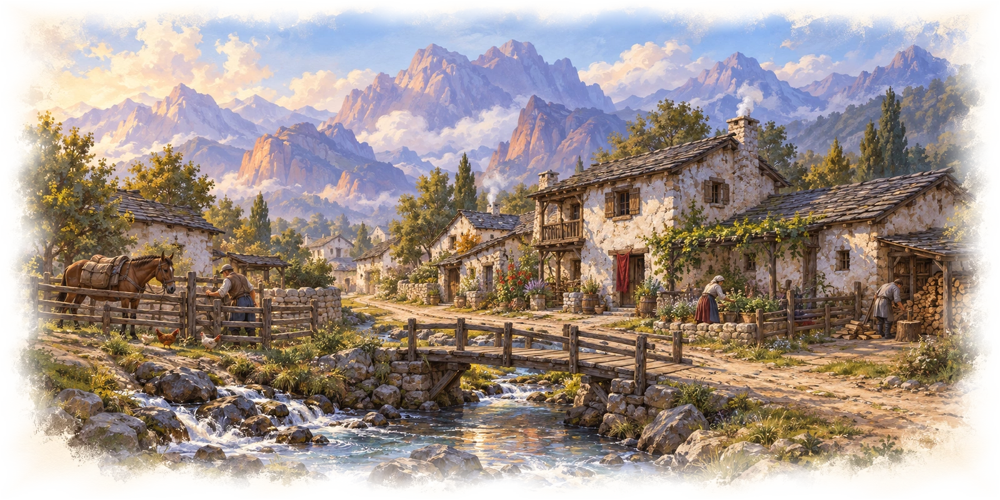
}}

{{note
##### À l’attention du maître du jeu
Ce prélude transpose les Caves of Chaos à Thay. Il est destiné au MJ et contient les secrets de l’aventure. Son cadre local et son commanditaire sont proposés pour la campagne ; les situations et les monstres du ravin proviennent de l’aventure originale. Le groupe conserve le même niveau pendant cette mission.
}}

## Aux portes des montagnes

Des bandes de pillards attaquent les convois qui ravitaillent les villages de Gauros. Les premières attaques n’ont surpris personne : les montagnes du Levant abritent depuis longtemps des prédateurs, des gnolls et des brigands. Mais les voyageurs parlent maintenant d’un même ravin, où des créatures qui se disputeraient normalement un territoire se rassemblent en nombre. Des habitants manquent à l’appel. Des feux apparaissent la nuit sous les falaises.

Fort Gar protège les voies principales. Les hameaux les plus éloignés doivent compter sur leurs chasseurs et sur les aventuriers qu’ils peuvent payer. La Mage Rouge **Yelena Voss** possède une demeure dans l’un de ces hameaux. Elle a envoyé une éclaireuse, **Vinx**, reconnaître les repaires des assaillants. Vinx n’est pas revenue.

Yelena engage les personnages pour la retrouver et découvrir ce qui attire tant de monstres dans le ravin. Si les pillards préparent une attaque, elle veut pouvoir les arrêter avant qu’ils ne descendent sur les habitations. Elle demande un résultat, non la mort de chaque créature rencontrée.

## Ce que sait le MJ

Au fond du ravin, un culte vénérant les puissances de la destruction a investi un ancien sanctuaire souterrain. **Ivlis**, sa dirigeante, était autrefois officiant dans une chapelle des marches. Elle en a été chassée après avoir tenté de convertir plusieurs malades à son culte. Son assistant **Narthus** dirige les cérémonies pendant qu’elle recrute de nouveaux fidèles et traite avec les habitants des cavernes.

Le culte possède une relique de fer noir : la **cloche du Chaos**. Son influence attire progressivement des monstres vers le ravin. À proximité de l’autel où elle est suspendue, sa sonnerie peut faire se relever des ossements. Ivlis compte sur les pillards pour terroriser les campagnes, puis offrir un refuge et une puissance nouvelle à ceux que la peur lui aura livrés. Elle ne commande pourtant ni aux gnolls, ni au minotaure, ni aux dragons. Les rivalités qui divisent les cavernes sont réelles et peuvent se retourner contre elle.

Les gobelours préparent une attaque contre le hameau qui abrite Yelena. Ils espèrent obtenir le concours d’un ogre mercenaire. Cet ogre, **Oggdug**, refuse d’approcher le sanctuaire : les cultistes ont relevé le cadavre de son frère **Zurf**, tué par un ours-hibou. Les hobgobelins ont perdu leur capitaine et la plupart de leurs compagnons ; ils cherchent à conserver leur dernier repaire plutôt qu’à se faire tuer pour Ivlis. Les gobelins, moins préoccupés par la guerre, célèbrent l’anniversaire de leur cheffe et négligent leur prisonnière.

Vinx est précisément cette prisonnière. Elle a reconnu une tenture familiale parmi des biens volés et s’est aventurée dans le repaire des gobelins pour la reprendre. Capturée avant d’avoir pu repartir, elle ignore encore la véritable nature du sanctuaire.

## Aperçu de l’aventure

La mission commence chez Yelena. Les personnages suivent la piste de Vinx jusqu’au ravin, puis choisissent leurs moyens d’approche. Les cris d’un dragonnet, les chants des gobelins et les fortifications des hobgobelins rendent les différents repaires reconnaissables avant même d’y entrer.

Retrouver Vinx permet d’obtenir un premier témoin et de découvrir le projet des gobelours. D’autres rencontres peuvent fournir un allié, un passage ou une explication : Oggdug connaît le sort des victimes du culte ; une ancienne magicienne devenue nothic possède un livre sur la cloche ; les cultistes logés près de la tanière de l’ours-hibou fréquentent le sanctuaire. Ces informations se recoupent sans imposer une route unique.

L’aventure s’achève lorsque le groupe a réglé la menace qu’il a choisie d’affronter et revient rendre compte à Yelena. Les personnages peuvent sauver Vinx, empêcher une attaque, déjouer le culte ou retirer sa relique. Ils n’ont pas besoin d’explorer chaque galerie pour accomplir une mission significative.

# Une commande de la Mage Rouge

La demeure de Yelena domine une rue de maisons basses et d’enclos. Deux gardes filtrent les visiteurs. Des villageois attendent des nouvelles de disparus ; un charretier montre une flèche arrachée à la porte de son chariot.

{{descriptive
Une femme au crâne rasé attend près d’une fenêtre ouverte. Des tatouages sombres couvrent son crâne, ses tempes et le dos de ses mains. Sa robe rouge tranche sur les murs blanchis à la chaux. Sur la table sont posés une flèche brisée, un sac de voyage et un morceau de tissu taché de boue.

Elle écarte le sac pour faire place aux visiteurs. « L’éclaireuse qui portait cela s’appelle Vinx. Elle devait revenir il y a trois jours. Asseyez-vous. »
}}

{{block
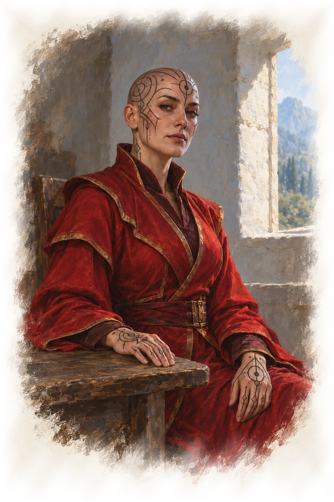
}}

Yelena est méthodique et peu démonstrative. Elle considère la protection des villages comme son devoir, mais aussi comme la condition de sa propre influence. Elle n’exige pas de flatteries et préfère une question précise à une promesse grandiose. Les personnages ne sont pas ses serviteurs à vie parce qu’ils acceptent son offre.

**Sa demande.** Retrouver Vinx, vivante si possible ; reconnaître les repaires qui menacent le hameau ; empêcher une attaque imminente si le groupe découvre qu’elle se prépare. Yelena ne demande pas de rapport administratif : un témoignage crédible, un prisonnier consentant à parler ou des traces matérielles peuvent lui suffire.

**Pourquoi elle n’y va pas.** Les familles comptent sur sa présence pour éviter que la peur ne vide le hameau. Elle refuse de quitter sa demeure avec ses gardes et d’offrir une cible sans défense aux pillards. Son influence ne lui donne pas le contrôle des soldats de Fort Gar, déjà occupés à protéger d’autres routes.

**Son offre.** Une récompense collective de 300 po, le gîte et les repas au retour. Si Vinx est retrouvée, Yelena paie le travail même si les personnages jugent le sanctuaire trop dangereux. Si le groupe arrête les attaques, elle lui accordera volontiers son appui pour une recommandation ou une rencontre dans Gauros ; elle ne promet pas l’oreille du Conseil des zulkirs.

**Ce qu’elle fournit.** Le sac de Vinx a été retrouvé à l’endroit où l’éclaireuse a quitté la piste. Yelena indique ce chemin et décrit la naine : manteau de laine brun, cheveux nattés, coutelas court, tempérament impatient. Elle sait que des gobelins et des gobelours utilisent le ravin. Elle ignore la présence de la cloche, l’identité d’Ivlis et le sort de Zurf.

Si un personnage s’intéresse à la raison personnelle de Vinx, Yelena explique que l’éclaireuse cherchait également une tenture volée à sa famille. Elle ne dissimule pas cette affaire, mais pense qu’elle ne justifiait pas une absence aussi longue.

## Une raison de travailler ensemble

La commande convient à un Mage Rouge, à son protecteur ou à un disciple, sans réserver la réussite à l’un d’entre eux. Yelena s’adresse à tous les membres du groupe et entend leurs objections. Un mage peut chercher une première occasion de faire ses preuves ; un chevalier protéger des gens exposés ; un disciple découvrir le prix d’un ordre mal compris. Ces raisons ne sont retenues que si leurs joueurs les choisissent.

Si les personnages ont déjà un employeur, Yelena peut passer par lui pour les rencontrer. Elle ne leur attribue pas une ancienne amitié ni un engagement antérieur qu’ils n’ont pas accepté.

# Le ravin

{{wide
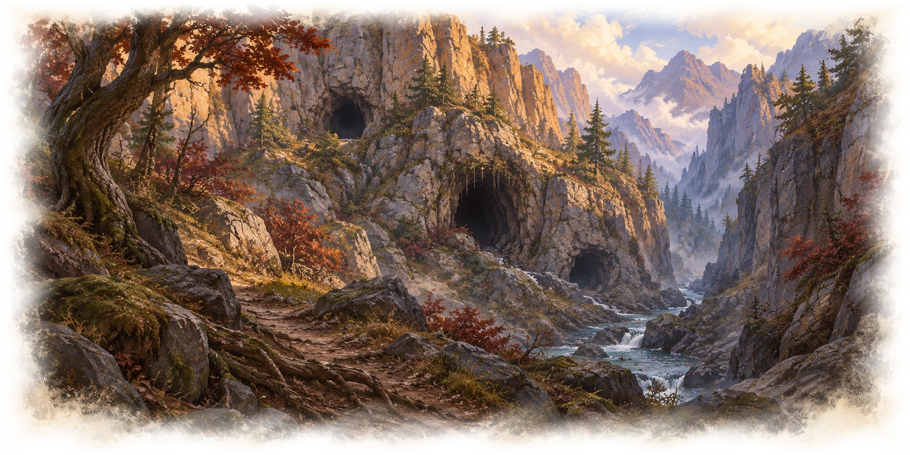
}}

La piste suit un cours d’eau, puis s’enfonce entre des arbres noueux. Les empreintes de Vinx se mêlent à celles de petites créatures chaussées et de lourdes bottes. Les dernières traces lisibles conduisent au ravin ; les découvrir à l’endroit indiqué ne nécessite pas un jet dont l’échec empêcherait de commencer l’aventure.

{{descriptive
Les arbres s’écartent devant une entaille profonde dans la montagne. Des ouvertures sombres percent les falaises à différentes hauteurs. Au pied de la roche, des os blanchis se mêlent aux branches mortes.

Une plainte aiguë monte d’une galerie basse. Plus loin, une chanson criarde s’achève dans des éclats de rire. Au-dessus d’une porte renforcée, des crânes ont été rangés dans les anfractuosités de la pierre.
}}

Le ravin est situé dans les contreforts de Gauros, à l’écart des grandes voies. Son emplacement précis n’est pas fixé sur la carte régionale. Les cavernes mêlent galeries naturelles et vestiges d’occupations anciennes : chambres taillées, salles de garde, chapelles et cryptes. Elles n’ont pas été construites par un propriétaire unique.

Les repères entre parenthèses renvoient aux plans de l’aventure. Ils servent au MJ ; les personnages découvrent des lieux, pas des secteurs nommés par une lettre. Les connexions souterraines permettent de contourner certaines entrées : le repaire des gobelins communique avec celui d’Oggdug et avec le poste hobgobelin ; les logements du culte rejoignent son sanctuaire ; une porte secrète relie les gobelours aux galeries du minotaure.

## Ce qui circule dans les cavernes

Les gobelins échangent des vivres et des objets volés contre la protection occasionnelle d’Oggdug. Le dragonnet rouge de l’ogre réclame sa part de ces paiements. Les gobelours veulent acheter leurs services pour le prochain raid, mais se disputent encore la manière d’attaquer.

Les hobgobelins surveillent les autres pillards avec méfiance. Leurs anciennes pertes expliquent leur bluff sur leurs effectifs ; ils n’attendent pas des renforts cachés à la disposition du MJ. La nothic s’est isolée dans son laboratoire et redoute le charognard qui bloque son couloir. Les kobolds hésitent sur le sort d’un dragonnet qu’ils ne savent pas élever. Les gnolls fouillent un sanctuaire abandonné. Aucun de ces groupes n’a besoin de connaître les plans d’Ivlis pour contribuer au danger du ravin.

Les cultistes se distinguent par des robes sombres et une broche grossière montrant un crâne fendu. Ils évitent le rouge réservé aux Mages Rouges. Ce signe sert à leurs gardiens morts-vivants pour reconnaître les visiteurs autorisés ; la robe rouge d’un personnage n’est pas un laissez-passer du culte.

## Éclairage des repaires

Les galeries des kobolds, le poste inondé, le laboratoire de la nothic, le poste hobgobelin, le repaire des gobelours, le labyrinthe du minotaure et le sanctuaire des gnolls sont plongés dans l’obscurité. Les descriptions supposent que les personnages disposent d’une lumière ou d’un moyen de voir dans le noir. Les scarabées de feu du labyrinthe éclairent leur entourage selon leur profil.

Des torches éclairent vivement les cavernes des gobelins. Chez Oggdug et Dent-de-Braise, la lumière naturelle donne une lumière faible le jour ; la nuit, les lieux sont obscurs. Les galeries de l’ours-hibou sont obscures, à l’exception des logements des cultistes, éclairés par des torches. Le sanctuaire du culte est vivement éclairé par des appliques à flammes rouges, sauf son vestibule sombre.

## Repos, alertes et retraites

Les personnages peuvent quitter le ravin et revenir. Un repos dans une caverne occupée dépend de l’accord ou de l’élimination de ses habitants ; un repos long exige un refuge réellement sûr. Il n’est pas interdit par une règle universelle propre aux souterrains. Le hameau constitue le refuge le plus simple.

Le bruit d’une bataille ne réveille pas tout le ravin. Appliquer les renforts indiqués dans chaque repaire. Les occupants n’ont pas de moyen de communication instantané entre des cavernes séparées. Un ennemi qui s’échappe peut avertir ceux qu’il rejoint ; il ne transmet pas automatiquement le plan des personnages à Ivlis.

Une retraite réussie n’efface pas les choix précédents : un captif libéré ne réapparaît pas dans ses liens, un accord n’est pas annulé sans cause et les monstres tués ne sont pas remplacés pour remplir de nouveau le donjon. Si le groupe tarde, les gobelours peuvent avancer leurs préparatifs, mais leur attaque n’a lieu qu’après des signes permettant de la prévoir.

# Les habitants des premières galeries

## Les kobolds et l’œuf volé

Les kobolds ont emporté un œuf de dragon pour le manger. Quand il a éclos, leur repas est devenu un dragonnet de cuivre affamé et inconsolable. Ils lui offrent des poignées de pièces pour le faire taire et se disputent : faut-il le ramener près de son nid ou tenter de l’élever ? La présence d’un véritable dragon les remplit autant de fierté que de crainte.

{{descriptive
Des voix aiguës se coupent la parole derrière l’entrée. Une plainte plus forte les couvre aussitôt. L’air sent la terre humide, la paille sale et la viande séchée.
}}

### L’entrée piégée (A1)

Un tunnel de terre battue conduit aux logements. Une toile sale dissimule une fosse profonde de 3 mètres. Un personnage qui examine le passage remarque son camouflage grossier ; il est alors possible de longer la fosse. Une chute inflige 1d6 dégâts contondants. Les prises des parois permettent d’en sortir sans difficulté particulière.

Le bruit d’une chute attire la sentinelle. Elle s’approche, triomphante, et demande aux intrus ce qu’ils veulent avant de comprendre qu’ils peuvent encore se défendre.

### La sentinelle kobold (A2)

Un **guerrier kobold** monte une garde distraite. Son attitude initiale est indifférente. Il veut surtout éviter de porter seul la responsabilité du dragonnet. Une explication pacifique, une plaisanterie ou une chanson peuvent le disposer favorablement : un test de Charisme (Persuasion, Tromperie ou Représentation) DD 10 convient selon l’approche.

En cas de réussite, il prévient les personnages que les « nombreuses-pattes » occupent la galerie voisine. En cas d’échec menaçant, il fuit vers ses compagnons en criant. Il n’attaque pas d’emblée un groupe qui lui parle sans le menacer.

### Le dépotoir aux mille-pattes (A3)

Deux **mille-pattes géants** fouillent les déchets. Ils attaquent les créatures qui entrent dans leur réduit. Les kobolds les redoutent. Si les personnages les débarrassent de cette menace, ils obtiennent un accueil favorable auprès des occupants du repaire, même si les premières paroles ont été maladroites.

### Les couchages en désordre (A4)

Cinq **guerriers kobolds** discutent devant leurs lits de paille. Ils sont indifférents, sauf si le groupe a tué leur sentinelle. L’un veut rapporter le petit dragon ; un autre soutient qu’un dragon adulte fera d’eux les maîtres du ravin. Aucun ne sait combien de temps il faudrait attendre.

La discussion peut renseigner les personnages : les kobolds ont vu une naine traînée vers les cavernes où l’on entend chanter. Ils ignorent son nom. Dans le bric-à-brac des couchages se trouvent 25 po et le petit trésor magique indiqué dans l’annexe des récompenses.

### Le dragonnet dans le garde-manger (A5)

{{wide
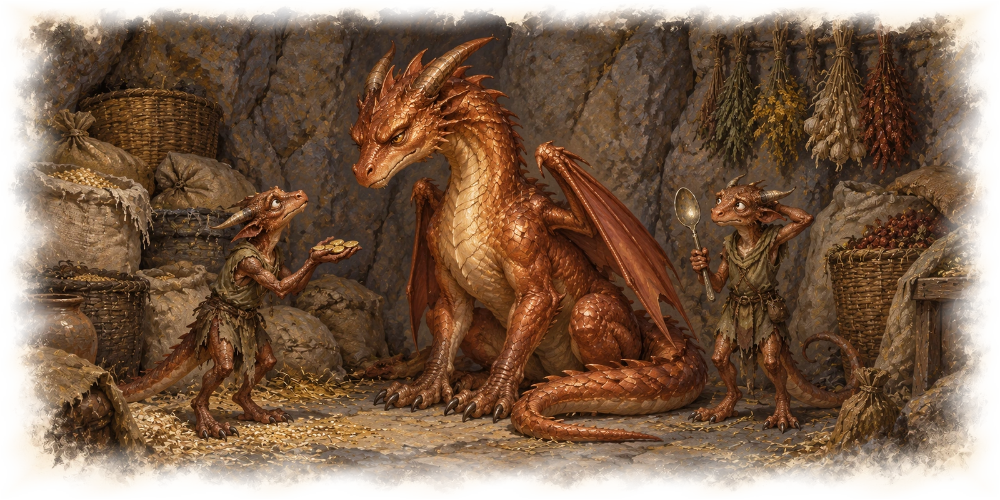
}}

Un **dragonnet de cuivre** est assis entre des sacs de grains et des viandes salées. Deux **guerriers kobolds** lui présentent des débris brillants. Le dragonnet connaît assez son état pour savoir qu’il n’est pas chez lui, mais ne sait pas retrouver son nid. Il n’a pas encore de nom.

Un personnage peut l’apaiser par un test de Charisme (Persuasion, Tromperie ou Représentation) DD 10. Offrir au moins 10 po donne l’Avantage au test. S’il est calmé, le dragonnet demande de l’aide pour décider s’il doit rester ou repartir. Les kobolds acceptent sa décision. Les personnages n’ont pas à lui promettre une adoption pour obtenir un renseignement.

En cas d’échec du test d’apaisement, ou si les personnages tentent de voler son maigre trésor, le dragonnet attaque. Il se défend également si on l’attaque ; les kobolds se tiennent à l’écart du combat. Si le dragonnet vainc tous les personnages, ceux-ci se réveillent une heure plus tard à l’extérieur de la caverne, avec 1 point de vie chacun. Son tas contient 25 po et un objet magique. Une solution pacifique peut faire du repaire un endroit où reprendre souffle, sans transformer le dragonnet en compagnon de combat automatique.

## Le poste inondé

Des murs maçonnés et des chambres abandonnées bordent une source souterraine. Trois **méphites de vapeur** s’y divertissent aux dépens des visiteurs. Deux **maraudeurs kuo-toa** ont investi l’ancien dortoir. Ils ne sont pas des agents d’Ivlis : les eaux du ravin leur ont simplement offert une cache.

### La meurtrière (B1)

Une fente verticale surveille l’entrée. Si les personnages avancent bruyamment ou avec une lumière vive, un filet de vapeur en sort : le méphite du poste voisin vient regarder. La fente lui procure un abri aux trois quarts.

### Le guetteur de vapeur (B2)

Le méphite est indifférent et s’ennuie. Il siffle pour attirer un visage près de la fente, puis souffle une vapeur inoffensive en riant. Si on le rejoint par l’intérieur, il feint la bonne volonté et propose de montrer « les trésors des anciens soldats » dans le dortoir occupé par les kuo-toa. Il espère assister à une bagarre.

### Les cellules ouvertes (B3)

Quatre cellules vides occupent le mur. Deux contiennent des restes sous des vêtements en lambeaux. Les portes ne sont pas verrouillées. Les kuo-toa comptent y enfermer leurs prises ; aucune trace ne permet de croire que Vinx est passée ici.

### L’armurerie rouillée (B4)

Des armes et des armures inutilisables gisent parmi les toiles. Les râteliers anciens montrent que le poste accueillait autrefois des défenseurs.

### Le bassin chaud (B5)

Un méphite poursuit une grenouille au-dessus d’une nappe d’eau tiède profonde d’une trentaine de centimètres. Le bassin est un terrain difficile. Le méphite reste indifférent tant que personne ne gâche son jeu ; s’il se bat, les méphites des postes voisins le rejoignent.

### L’ancien dortoir (B6)

Deux maraudeurs kuo-toa gravent des signes sur les murs. Hostiles, ils cherchent à maîtriser les intrus pour les enfermer, puis se disputent déjà ce qu’ils en feront. Les méphites leur apportent parfois des visiteurs sans que les deux groupes soient de véritables alliés.

### La fontaine rompue (B7)

{{block
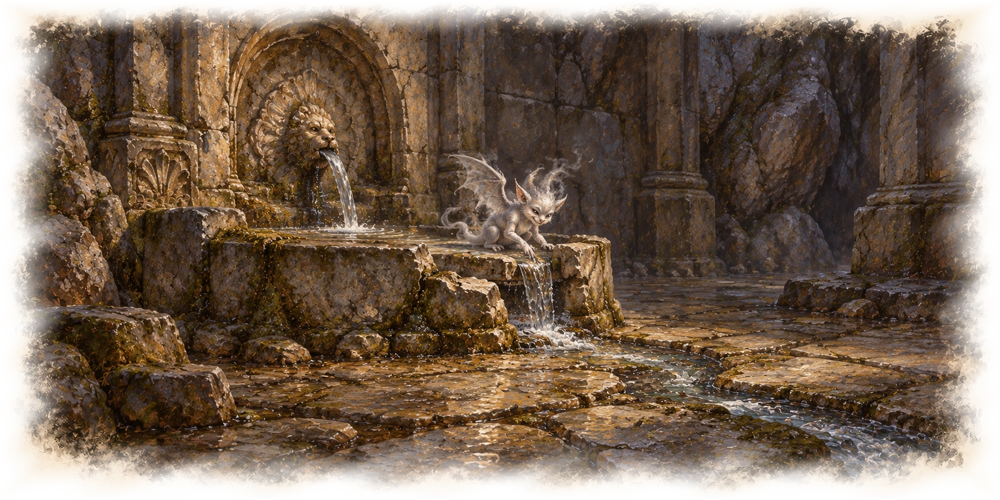
}}

La source jaillit d’une fontaine brisée et coule vers le bassin. Le troisième méphite écoute le bruit de l’eau. Il attaque s’il est rudement dérangé et appelle alors les autres. Les personnages peuvent aussi l’observer, passer discrètement ou profiter d’une diversion.

### Les coffres de la réserve (B8)

Une porte fermée mais non verrouillée donne sur deux coffres. L’un est une **mimique**, qui attaque lorsqu’une créature s’approche à 1,50 mètre. Le véritable coffre contient 150 po et un objet magique.

## La magicienne devenue nothic

Une magicienne a mené ici des recherches interdites. Un rituel l’a changée en **nothic** et a détruit sa mémoire. Elle continue d’étudier, persuadée que davantage de savoir lui rendra ce qu’elle a perdu. Un **charognard rampant** s’est introduit dans le passage qui mène à ses livres. Elle n’ose plus sortir de son laboratoire.

### Les runes interrompues (C1)

Des motifs géométriques couvrent la pierre. Un test d’Intelligence (Arcanes) DD 13 permet d’y reconnaître des défenses inachevées contre l’observation magique. Elles n’ont aucun effet : elles ne bloquent pas les sorts des personnages.

### Le cercle calciné (C2)

Des bougies noires entourent une figure tracée à la craie. L’intérieur du cercle porte des marques de brûlure. Un test d’Intelligence (Arcanes) DD 13 indique qu’un rituel s’est terminé de manière désastreuse.

### La bibliothèque humide (C3)

Les livres traitent d’alchimie, de géométrie et de métallurgie. Sur une table, un volume à couverture renforcée de fer est ouvert sur une gravure de cloche. Le passage lisible décrit la cloche du Chaos : elle attire les monstres et peut réveiller les morts. Il indique qu’une source consacrée peut détruire son pouvoir.

Le texte fournit cette information à quiconque prend le temps de le lire. Une annotation décrit un petit bassin sous des aulnes, en contrebas du chemin d’approche. Yelena et les habitants connaissent ce lieu comme la **source des Aulnes**, un ancien lieu de dévotion à Chauntéa. Ce renseignement donne une issue possible sans révéler d’emblée la position du sanctuaire.

### Le couloir du charognard (C4)

Le charognard rampant se déplace au plafond et attaque les autres créatures à vue. Il cherche à se nourrir ; ses attaques et leurs effets sont ceux de son profil. Les personnages peuvent chercher à l’attirer hors du passage plutôt que de combattre dans la galerie.

### Le laboratoire isolé (C5)

{{block
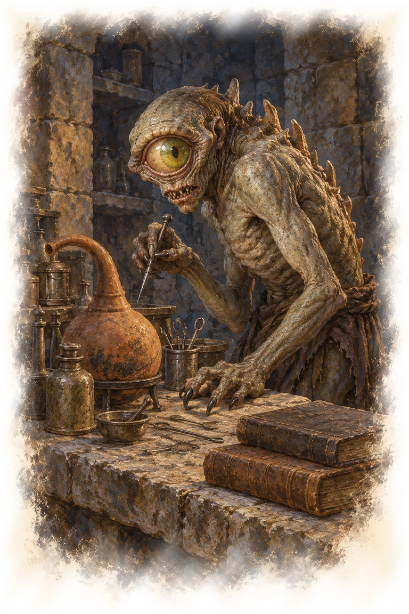
}}

La nothic tourne entre ses paillasses, suivie d’une **épée volante animée**. Les deux sont d’abord indifférentes. La créature demande aux visiteurs de tuer le charognard afin de pouvoir reprendre ses recherches.

En échange, elle offre les possessions du mort de sa cellule. Elle connaît les cultistes, qui lui ont proposé de les rejoindre ; elle les a chassés parce qu’ils voulaient emporter un livre. Si l’on évoque une cloche, elle désigne sa bibliothèque et prévient que les « chanteurs aux os » habitent derrière les galeries de l’ours-hibou. Elle ne connaît pas tous les corridors du sanctuaire.

La clé de la réserve est sur une table. La voler sans être remarquée nécessite un test de Dextérité (Escamotage) DD 14. Une tentative découverte déclenche la colère de la nothic et de sa garde. Si les personnages lui parlent de son ancienne forme, elle oscille entre avidité et peur ; elle ne retrouve pas miraculeusement ses souvenirs à la première conversation.

### La cellule du malheureux explorateur (C6)

Le corps d’un nain repose derrière des barreaux non verrouillés. Il cherchait des richesses et a été tué par la nothic dix jours auparavant. Un test de Sagesse (Médecine) DD 10 révèle les traces de dégâts nécrotiques. Ses effets comprennent 60 po et un objet magique. La nothic ne cache pas son meurtre si on la questionne ; elle présente l’intrusion du nain comme une offense impardonnable.

### La réserve de recherche (C7)

La porte verrouillée s’ouvre avec la clé du laboratoire. Un test de Dextérité (Escamotage) DD 15 avec des outils de voleur permet de crocheter la serrure ; un test de Force (Athlétisme) DD 15 permet de forcer la porte. Un coffre ouvert renferme 100 po et un objet magique.

# Les pillards et leurs voisins

## Une fête chez les gobelins

C’est l’anniversaire de la cheffe des gobelins. Elle exige des cadeaux, des chansons et la meilleure part de ce que ses gens ont volé. La musique et la boisson offrent aux personnages une occasion d’approcher sans affronter aussitôt toute la bande.

{{descriptive
Des torches éclairent une caverne jonchée de chiffons et de restes de repas. Au fond, plusieurs voix s’efforcent de chanter ensemble et échouent bruyamment. Une note de mirliton dépasse les autres, suivie d’une ovation.
}}

### L’entrée décorée (D1)

Des gobelins coiffés de bonnets pointus ont été peints sur la paroi. Une inscription mal orthographiée souhaite un bon anniversaire à la cheffe. Les traces d’une petite troupe chaussée conduisent à l’intérieur ; les gardes se sont joints à la fête.

### Vinx dans l’impasse (D2)

{{block
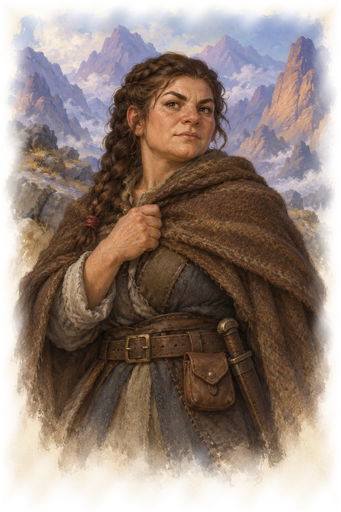
}}

La naine est ligotée près de vieux tonneaux. La libérer demande une action et aucun test. Elle est soulagée de reconnaître que Yelena a envoyé du secours, mais sa colère revient dès qu’on évoque la tenture volée. Vinx sait que la tenture se trouve dans la chambre de la cheffe.

Vinx peut raconter ce qu’elle a vu : des gobelours ont demandé des lances et parlé d’une attaque prochaine ; l’un voulait engager l’ogre ; des silhouettes en robes sombres traversent parfois le ravin sans être inquiétées par les pillards. Elle ne sait pas ce qu’elles font dans le sanctuaire. Si le groupe souhaite poursuivre, elle peut l’accompagner et montrer les entrées qu’elle a reconnues ; si les joueurs préfèrent la ramener, elle peut accepter de récupérer plus tard son bien familial.

Avant sa capture, elle a caché un objet magique dans un tonneau. Si les personnages l’aident à retrouver la tenture, elle leur remet ce bien en remerciement.

### La salle des présents (D3)

Des cadeaux maladroitement emballés s’accumulent près d’un gâteau écrasé. On y trouve une dent particulièrement longue, une viande déjà mâchée et un champignon à l’odeur infecte. Les personnages peuvent réutiliser ces présents ou se servir de la salle pour mettre au point une entrée en scène.

### Le trône d’anniversaire (D4)

{{wide
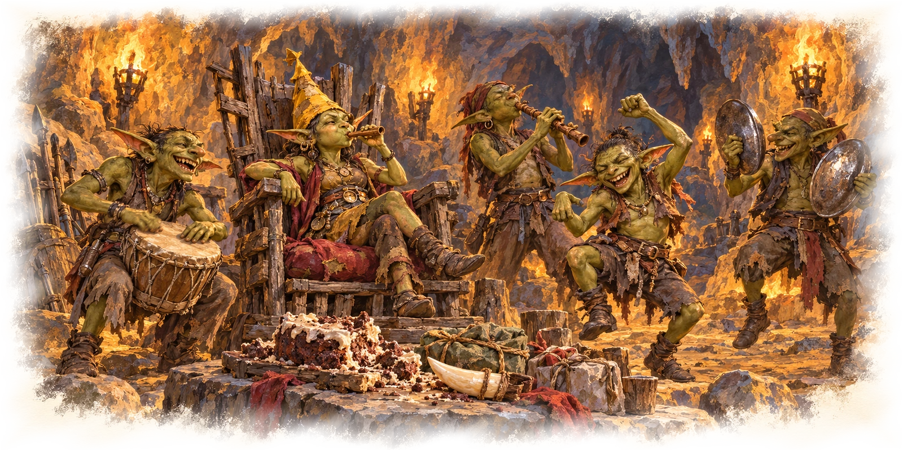
}}

Une **cheffe gobeline** et quatre **guerriers gobelins** dansent autour d’un siège bancal. La cheffe porte un chapeau de fête et souffle dans un mirliton. En voyant des intrus, elle exige de savoir qui les a invités.

Les gobelins sont hostiles, mais un test de Charisme (Persuasion) DD 13 peut désamorcer la rencontre. Un présent impressionnant, un objet magique ou un cadeau préparé dans la salle voisine obtient le même résultat sans test ; une offrande d’au moins 10 po convient également. La cheffe admet alors les nouveaux venus à sa fête, ce qui permet de négocier la libération de Vinx et la restitution de sa tenture. Elle n’est pas obligée de rendre les deux gratuitement. En cas d’échec du test, les gobelins attaquent les intrus.

La tenture, d’une valeur de 90 po, et un objet magique sont cachés sous le coussin du trône. Si Vinx apprend que les personnages veulent conserver la tenture, elle exige qu’ils lui rendent son héritage et les combat s’ils refusent. Un passage à l’ouest rejoint le poste des hobgobelins ; la fête n’en fait pas des alliés sûrs des visiteurs.

### Le passage entoilé (D5)

Une **araignée géante** se cache dans le tunnel méridional. Elle attaque les créatures non gobelines qui entrent dans son territoire. Les toiles gênent le déplacement sans immobiliser : ce sont des terrains difficiles. Une masse de toile de 3 mètres de côté a une CA de 10 et 5 points de vie ; elle est vulnérable au feu et insensible aux dégâts contondants, perforants, de poison et psychiques.

Une porte secrète, repérable par un test de Sagesse (Perception) DD 15 lors d’une recherche, rejoint la réserve d’Oggdug. Les gobelins connaissent ce chemin et l’évitent lorsqu’ils entendent le dragonnet rouge de l’autre côté.

## Oggdug et Dent-de-Braise

Oggdug loue sa force aux autres habitants du ravin. Il partage sa caverne avec **Dent-de-Braise**, un dragonnet rouge qui tolère sa compagnie tant qu’il reçoit de l’or et des objets volés. L’ogre l’appelle son « petit » ; le dragon considère déjà l’ogre comme un serviteur dont il saura se passer un jour.

### Le collet à charogne (E1)

Une carcasse pourrissante masque un collet. Un test de Sagesse (Perception) DD 13 le repère. Le désarmer exige un test de Dextérité (Escamotage) DD 13 ; un échec le déclenche. Une créature qui touche ou déplace la carcasse doit réussir un jet de sauvegarde de Dextérité DD 12 ou se retrouver suspendue, entravée, à 1,50 mètre du sol. Couper la corde ou réussir un test de Dextérité (Acrobaties) DD 15 permet de se libérer. Le bruit attire l’ogre.

### Le mercenaire sur ses fourrures (E2)

{{block
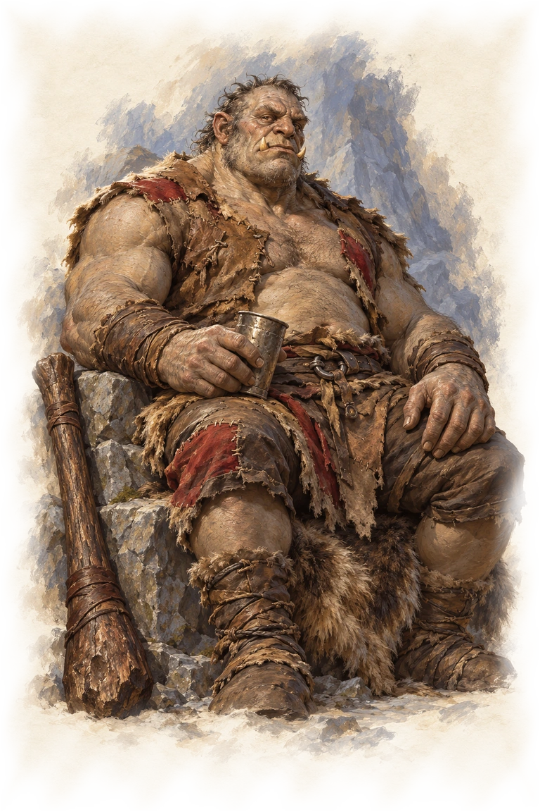
}}

Un **ogre** est allongé sur des peaux d’ours et se cure les dents avec une épée rouillée. Son premier accueil est hostile : il exige un paiement ou ordonne aux intrus de partir. Un personnage peut l’amuser, le tromper ou l’apaiser par un test de Charisme approprié DD 10. En cas d’échec ou de tentative pour réduire son prix, il attaque. En cas de violence, Oggdug appelle Dent-de-Braise lorsqu’il perd la moitié de ses points de vie.

**Engager Oggdug.** Il réclame 25 po aux nouveaux clients pour un combat, puis 50 po pour chaque engagement suivant. Le dragon reçoit la moitié de ses gains. L’ogre accepte de combattre dans le ravin, sauf près de l’ours-hibou et dans le sanctuaire. Il ne devient pas une recrue permanente du groupe.

**Son frère.** Si on lui demande pourquoi, Oggdug cesse de fanfaronner. Zurf, son frère aîné, a été tué par l’ours-hibou. Les cultistes ont emporté les restes et les ont relevés. Oggdug a vu son frère garder leur couloir ; il ne veut plus le revoir ainsi. Il peut indiquer l’entrée du sanctuaire sans demander aux personnages de venger Zurf. S’ils proposent de mettre fin à cette servitude, cela lui donne une raison personnelle de leur parler, mais ne supprime pas sa peur.

Sous les peaux sont cachés 60 po, du fromage et de l’eau-de-vie. Oggdug défend ces modestes richesses si quelqu’un essaie de les prendre.

### Le perchoir du dragonnet (E3)

{{block
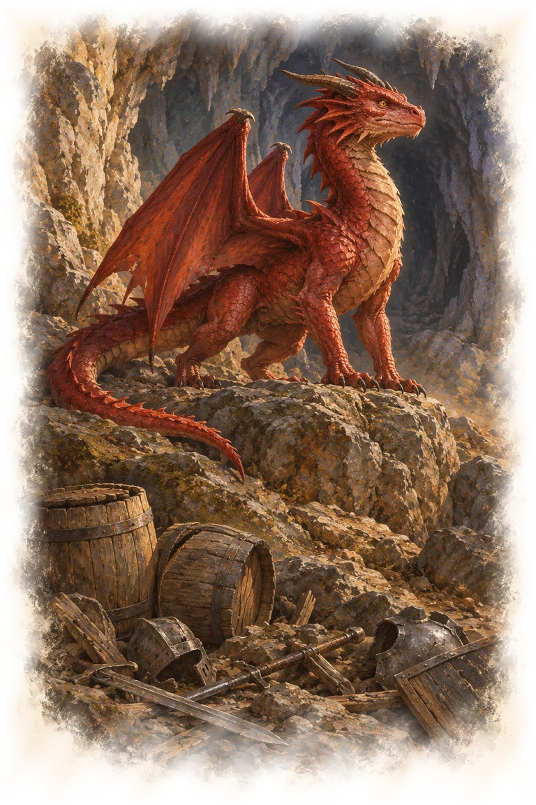
}}

Dent-de-Braise, **dragonnet rouge**, domine la pièce depuis une corniche haute de 3 mètres. Il réclame 10 po par personnage pour ne pas les brûler. Un test de Charisme (Persuasion) DD 13 peut éviter ce tribut ; flatter sa grandeur donne l’Avantage. Un paiement ou une réussite lui fait ordonner aux personnages de quitter la caverne tant qu’ils le peuvent : ils peuvent repartir sans combat, pas explorer librement son antre. En cas d’échec du test ou s’ils refusent de partir, il attaque.

S’il est combattu, Oggdug vient voir ce qui se passe. Selon la relation nouée auparavant, l’ogre peut défendre son associé ou profiter du conflit pour se débarrasser d’un partenaire trop exigeant. Le trésor du dragon comprend 50 po et un objet magique parmi des armes et provisions abîmées. La porte secrète vers les gobelins est trop étroite pour l’ogre et donne sur le territoire de l’araignée.

## Les derniers hobgobelins

Quatre **guerriers hobgobelins** ont survécu à la perte de leur compagnie. Ils ont fermé leur caverne et installé un cube gélatineux dans un circuit de galeries. Ils prétendent être encore trente pour tenir les pillards à distance. Leur existence rappelle les dangers des marches, sans les transformer en soldats placés sous les ordres directs des autorités thayennes.

### La barricade et le bluff (F1)

Une sentinelle se tient derrière deux barricades de lances. Elle somme les visiteurs de décliner leur intention et invoque les trente guerriers de sa garnison. Un test de Sagesse (Intuition) DD 13 révèle son bluff. Un test de Charisme (Persuasion) DD 14 peut la rendre indifférente ; avoir décelé son mensonge donne l’Avantage. Elle prévient alors le groupe de l’arrivée du cube, sans lui ouvrir librement le poste.

Une barricade constitue un terrain difficile et inflige 1d6 dégâts perforants à une créature qui la traverse. Elle procure un abri partiel. Elle possède une CA de 15, 4 points de vie et l’immunité aux dégâts de poison et psychiques. Si la sentinelle est débordée, elle sonne du cor et se replie vers le dortoir.

### Le circuit du cube (F2)

Un **cube gélatineux** parcourt les galeries dans le sens inverse des aiguilles d’une montre. Il accomplit un tour en une minute environ et s’écarte parfois vers le passage des gobelins. Les barricades le maintiennent hors des pièces habitées. Une troupe attentive peut l’attirer vers l’entrée et refermer la porte derrière lui.

Le cube n’est pas dressé au point de reconnaître des alliés. Il menace toute créature qu’il peut engloutir, y compris les hobgobelins imprudents.

### Le réfectoire protégé (F3)

Les barricades tiennent le cube à l’écart des tables. Des couverts trop nombreux pour quatre soldats rendent la faiblesse du groupe perceptible. Les occupants ne tiennent pas de réunion secrète avec le culte ; leurs préoccupations sont la nourriture, leurs armes et la sécurité du poste.

### Le dernier coffre (F4)

Un hobgobelin défend un coffre près de douze couchettes, dont quatre seulement ont servi récemment. Si le cor a retenti, les deux archers le rejoignent. Il refuse de livrer les derniers biens de sa compagnie et combat les intrus qui tentent de les prendre.

Le coffre contient des fourrures valant 75 po, 20 po et un objet magique. Un accord conclu avec la sentinelle peut éviter d’arriver ici comme des assaillants ; il ne transforme pas le gardien en hôte généreux.

### La salle d’exercice (F5)

Deux hobgobelins tirent sur des cibles de paille. S’ils n’ont pas été avertis d’une trêve et n’ont pas rejoint le dortoir, ils attaquent les intrus. Le râtelier vidé montre les pertes de la compagnie. Une conversation peut apprendre que des cultistes tentent parfois de recruter des guerriers pour « la vie d’après », proposition qu’ils méprisent.

# Derrière les repaires

## Les galeries de l’ours-hibou

La moitié naturelle de cette caverne abrite un **ours-hibou** territorial. Au-delà d’un ressaut, des chambres anciennes servent aux cultistes. Les deux occupants ne cohabitent pas volontairement : les humains profitent d’un accès que la bête ne peut pas emprunter.

### Les os de l’entrée (G1)

Des os rongés se mêlent aux restes d’animaux, de monstres et de voyageurs. Les traces de bec permettent de comprendre que le responsable n’est pas une bande de pillards.

### Le bassin trouble (G2)

Deux **vases grises** se cachent dans un bassin profond d’une soixantaine de centimètres, qui constitue un terrain difficile. Elles attaquent à moins de 1,50 mètre. L’eau contient une coupe sertie de pierres valant 100 po et un objet magique. Ce qui brille n’est pas un indice nécessaire au culte : les personnages peuvent refuser ce risque.

### L’étroiture (G3)

Une fissure ne laisse passer que les créatures de taille M ou inférieure. Un explorateur y est mort contre une stalagmite. L’ours-hibou ne peut pas entrer ; il finit par abandonner une proie qui s’y réfugie. L’étroiture est un refuge utile, non une nouvelle route vers une région absente du plan.

### Les reliefs de la tanière (G4)

Les restes de repas, les carcasses et de grosses pelotes de poils annoncent la proximité de la bête. Les personnages disposent ainsi d’un avertissement avant de déboucher dans son espace. Ils peuvent choisir un leurre ou une diversion ; rien ne garantit que quelques rations suffisent à l’apprivoiser.

### La tanière et le ressaut (G5)

{{wide
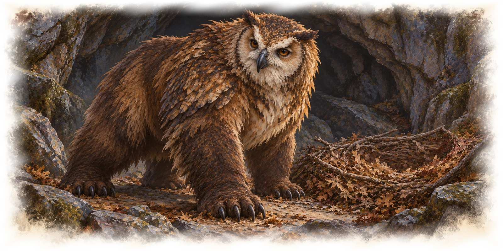
}}

L’ours-hibou tourne entre des nids de feuilles et de branches. Hostile, il attaque les autres créatures à vue. À l’extrémité méridionale, un passage se trouve à 3 mètres au-dessus du sol. Gravir la paroi glissante exige un test de Force (Athlétisme) DD 15. La bête ne poursuit pas les intrus au-delà de ce ressaut.

### Les logements des fidèles (G6)

Quatre **cultistes** se reposent sur des lits, sous des tentures montrant des créatures et des cérémonies sinistres. Ils portent les robes sombres et les broches du crâne fendu. Leur conversation suffit à comprendre qu’ils ne sont pas de simples voyageurs.

Ils sont hostiles aux étrangers, mais un test de Charisme (Tromperie ou Persuasion) DD 13 peut éviter le combat ; une tenue du culte donne l’Avantage. Un faux novice peut obtenir une invitation à rencontrer Narthus dans le sanctuaire, à condition de ne pas prétendre déjà le connaître. Les cultistes savent comment contourner l’ours-hibou et où mène l’escalier du fond. Leurs coffres de lit contiennent chacun 5 po et des effets personnels.

### La crypte de l’ancien prêtre (G7)

Un **nécrophage buveur de vie (Wight Lifedrinker)** repose dans un sarcophage. Cet ancien chef du culte s’est relevé après sa mort ; ouvrir sa sépulture le réveille et déclenche son attaque. Un objet magique a été enfermé avec lui.

## Les gobelours préparent leur raid

Trois **guerriers gobelours** ont soumis des gobelins et s’imaginent déjà piller le hameau de Yelena. Leur chef promet la richesse, mais ses lieutenants se disputent l’approche. Cette querelle offre aux personnages des informations et une occasion de diviser les assaillants.

### Le tunnel masqué (H1)

L’entrée est dissimulée par des buissons. Deux grosses voix discutent à l’intérieur. Un personnage qui s’arrête pour écouter n’apprend pas encore le plan entier, mais sait que des habitants sont éveillés avant de se montrer.

### La table de guerre (H2)

Deux gobelours se penchent sur un plan grossier du hameau. L’un veut se glisser dans les enclos et ouvrir les portes ; l’autre veut une attaque de face avec Oggdug. Des marques entourent le grenier et les logements des gardes. Ce dessin permet d’avertir Yelena de cibles concrètes.

Les deux combattants sont hostiles et répondent à une intrusion découverte par la violence. Ils ne connaissent ni le pouvoir exact de la cloche ni un projet de conquête de Thay. Si l’un s’échappe, il cherche ses compagnons dans ce repaire.

### L’escalier au rondin (H3)

Deux **guerriers gobelins** gardent un escalier. Un rondin de 3 mètres de long est retenu au sommet. À la détection d’un intrus au sud, lancez l’initiative. À leur tour, les gobelins tentent de gagner le sommet. Une créature à 1,50 mètre ou moins du rondin immobile peut le pousser dans l’escalier au prix d’une action. Toutes les créatures sur sa trajectoire effectuent un jet de sauvegarde de Dextérité DD 13. Un échec inflige 2d6 dégâts contondants et renverse la créature ; une réussite réduit les dégâts de moitié sans la renverser.

Le dispositif est visible avant son déclenchement. Les personnages peuvent arrêter les gardes, éviter l’axe ou employer leurs propres moyens pour immobiliser le bois.

### La salle des trophées (H4)

Des têtes de bêtes et de victimes sont exposées sur les murs. Plusieurs supports sont encore vides. Les restes confirment la brutalité des pillards ; le MJ adapte la précision de leur description aux limites de la table. Une bourse de 10 po est dissimulée dans les crânes.

### Le chef et ses deux souffre-douleur (H5)

Le troisième gobelours réprimande **Gargle et Yams**, deux guerriers gobelins qui se sont endormis. Il leur ordonne d’attaquer les personnages et les rejoint. Les deux subalternes sont indifférents et ne l’aiment pas.

Un personnage peut les convaincre qu’ils n’ont rien à gagner à mourir pour lui : test de Charisme (Tromperie ou Persuasion) DD 10, ou Charisme (Intimidation) DD 11. Le test s’effectue avec l’Avantage si le chef est déjà vaincu. Si leur attitude devient favorable, une offre d’au moins 2 po peut les décider à aider contre les autres gobelours et à révéler la porte secrète. Ils ignorent ce qui vit de l’autre côté.

La porte se découvre également par un test de Sagesse (Perception) DD 15 lors d’une recherche. Elle mène aux galeries du minotaure. Dans les fourrures se trouvent 25 po et un objet magique.

### La chambre du chef (H6)

Une autre couche de fourrures cache 25 po et un objet magique. Les possessions du chef montrent qu’il compte surtout s’enrichir. Si les personnages se retirent en emportant le plan du raid, ils ont déjà de quoi protéger le hameau, même si des pillards restent en vie.

## Le minotaure du labyrinthe

Un **minotaure de Baphomet** occupe ces galeries. Il chasse tout ce qui y entre, sans distinguer pillards et aventuriers. Son culte du seigneur démon explique sa cruauté ; il n’est pas un animal de garde docile d’Ivlis. Les autres habitants évitent son domaine.

### L’entrée piétinée (I1)

Des os ont été enfoncés dans le sol par des sabots lourds. Un test de Sagesse (Survie) DD 11 permet d’identifier les traces d’une créature bipède de grande taille et de suivre sa piste vers l’ouest.

### Les striges endormies (I2)

Trois **striges** pendent au plafond parmi les dépouilles desséchées de petits animaux. Elles s’éveillent sous une lumière vive ou au moindre bruit dépassant un murmure. Les personnages peuvent voir la faible lueur des scarabées voisins sans que celle-ci réveille les parasites.

### Les scarabées lumineux (I3)

Deux **scarabées de feu géants** cherchent des larves au pied de vieux murs. Ils sont indifférents et se défendent si on les attaque. Un test de Sagesse (Dressage) DD 12 permet de gagner la confiance de l’un d’eux ; agiter une lumière donne l’Avantage. Un scarabée favorable suit le personnage dans ces galeries et éclaire les lieux. Sa lumière lui donne l’Avantage pour remarquer les portes secrètes, comme dans l’aventure d’origine. Il ne quitte pas ce domaine.

La porte vers le repaire des gobelours et celle qui donne sur la cache du labyrinthe se découvrent par une recherche et un test de Sagesse (Perception) DD 15, si aucune autre approche ne les a déjà révélées.

### Le labyrinthe de terre et de brique (I4)

{{wide
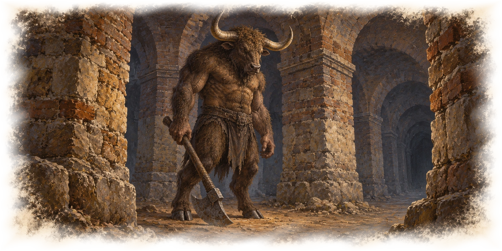
}}

Le minotaure rôde entre des piliers épais. Les marques de cornes et les traces de sabots permettent de suivre ses déplacements. Il attaque à vue et ne répond pas aux supplications. Une diversion, une fuite ou un contournement peuvent néanmoins réussir ; la victoire n’exige pas forcément de le tuer.

### La cache des bandits (I5)

Un coffre a été laissé par des bandits que le minotaure a tués. Il contient 120 po et un objet magique.

## Les gnolls du sanctuaire oublié

Quatre **guerriers gnolls** fouillent un ancien lieu de culte, attirés par la rumeur d’un trésor dissimulé dans la bouche d’un diable rieur. Une illusion a déjoué leurs recherches.

### Les portes à ferraille (J1)

Des armes rouillées et des débris d’armure sont empilés au-dessus d’une double porte entrouverte. Un test de Sagesse (Perception) DD 13 repère l’alarme. La démonter nécessite un test de Dextérité (Escamotage) DD 13 ; un échec fait tomber les débris. Se glisser dans l’ouverture exige un test de Dextérité (Acrobaties) DD 13. Le fracas alerte les quatre gnolls.

### Le tas de débris (J2)

Les gnolls ont rassemblé des chandeliers cassés, des vêtements pourris et des instruments cérémoniels pour les examiner plus tard. La pièce peut offrir une cache ou des objets à lancer pour détourner l’attention, mais ne contient pas d’ennemi ajouté par défaut.

### La chapelle vide (J3)

Deux gnolls examinent les murs. Ils attaquent les intrus et attirent les deux autres. Si les personnages ne laissent qu’un survivant, celui-ci peut se rendre. Un test de Charisme (Intimidation) DD 13 lui fait révéler ce qu’il cherchait : « un trésor dans la bouche du rieur ». S’il prend la fuite sans parler, les lieux permettent toujours de découvrir l’illusion.

### Le diable qui rit (J4)

Une mosaïque noire et rouge montre un diable au-dessus d’une estrade. Deux gnolls se trouvent ici s’ils n’ont pas rejoint le combat voisin. Le visage est un mur illusoire : le toucher révèle immédiatement qu’il n’a aucune substance. Un test d’Intelligence (Investigation) DD 15 peut aussi identifier l’illusion.

### La crypte cachée (J5)

Quatre sarcophages entourent un coffre. Chacun contient un **zombie**, ancien explorateur animé par le magicien qui protégeait ce trésor. Toucher le coffre ou un sarcophage réveille les gardiens. Les restes d’un voleur portent 15 po et une pierre valant 100 po ; le coffre contient un objet magique.

Les fresques démoniaques et les morts-vivants témoignent de la longue histoire du lieu.

# Le sanctuaire du culte

Le culte occupe les chambres les plus profondes. Les fidèles entrent par la grande galerie ou par les logements situés au-delà de la tanière de l’ours-hibou. Ils y amènent leurs recrues et les dépouilles dont Narthus a besoin. Leur sécurité repose sur la peur, les déguisements qu’ils reconnaissent et des gardiens morts-vivants, non sur une défense magique universelle.

{{descriptive
Des flammes rouges éclairent les murs. Sous la pierre taillée courent des veines noires, épaisses comme des racines. Une odeur de chair pourrie descend d’un couloir ; plus loin, une voix récite une litanie sur un rythme lent.
}}

## Approcher le cœur du culte

Les personnages peuvent entrer en force, se faire passer pour des recrues, suivre un cultiste ou employer les passages connus d’un habitant. Une broche et une robe peuvent tromper certains gardiens. Narthus connaît toutefois les membres du culte : un déguisement ne dispense pas de répondre à ses questions.

Oggdug peut prévenir de la présence de son frère dans le couloir. Le volume de la nothic indique le danger de la cloche et son moyen de destruction. Les conversations des cultistes montrent où se tient leur maître de cérémonie. Ces découvertes facilitent l’approche, mais les personnages peuvent aussi comprendre la situation en atteignant le sanctuaire directement.

### Le vestibule sombre (K1)

La première chambre est laissée dans la pénombre. Le chant de Narthus et l’odeur de Zurf fournissent deux avertissements différents. Les personnages peuvent s’arrêter pour observer sans déclencher automatiquement tout le sanctuaire.

### Zurf le gardien (K2)

Un **zombie ogre** se tient dans le couloir. Il s’agit de Zurf, reconnaissable par Oggdug ou par une description donnée par son frère. Il laisse passer ceux qui portent les vêtements du culte et attaque les autres.

Les personnages peuvent tromper le gardien, le contourner ou le détruire. Si Oggdug les a accompagnés jusque-là, il reconnaît Zurf, mais n’ose pas s’en approcher.

### La chapelle des novices (K3)

Quatre piliers soutiennent une voûte au-dessus d’une salle vide. Des marques au sol indiquent les places où les fidèles s’agenouillent. Cette pièce donne de l’espace pour une discussion, une diversion ou une retraite.

### Les morts dans l’attente (K4)

Quatre **zombies** errent dans une pièce nue. Ils attaquent les vivants qui ne portent pas la tenue du culte. Lorsque la cloche sonne, ils rejoignent l’autel s’ils peuvent encore s’y rendre. Une porte bloquée ou une diversion réellement mise en place peut les retarder ; leurs renforts ne traversent pas la pierre.

### L’autel et la cloche (K5)

{{wide
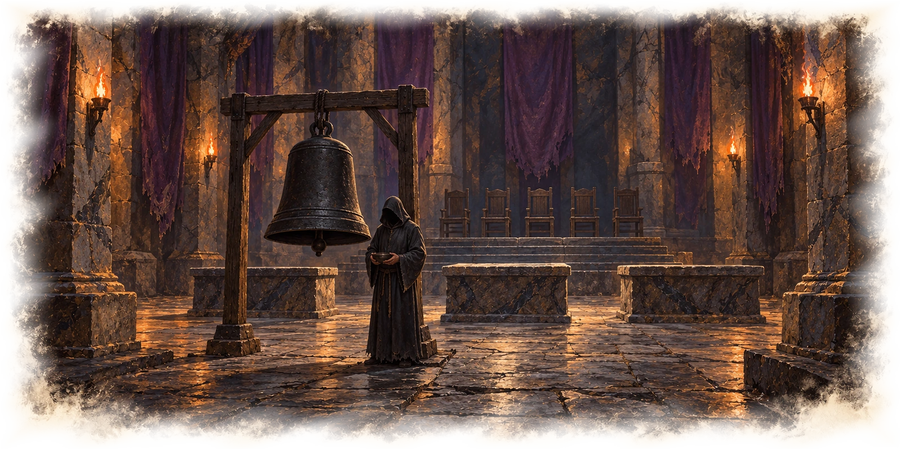
}}

Trois autels font face à une estrade garnie de cinq sièges. Des tentures violettes pendent aux murs. Au centre de la salle, une cloche de fer noir est suspendue à un support. Narthus projette du sang sur des amas d’ossements en récitant ses litanies.

Narthus est hostile aux personnages, même s’ils portent une tenue volée. Il peut les prendre pour des candidats venus se soumettre, mais les questionne avant de les laisser approcher. S’il est interrompu ou démasque une menace, il appelle les intrus des blasphémateurs et tente de sonner la cloche.

**La sonnerie.** Une créature à 1,50 mètre ou moins peut sonner la cloche au prix d’une action Bonus. Les quatre amas d’os de cette salle se relèvent alors en **squelettes** hostiles ; les zombies de la pièce voisine accourent. Les morts-vivants suivent les ordres de Narthus. Les quatre amas ne fournissent pas une réserve infinie de nouveaux squelettes à chaque sonnerie.

Les personnages peuvent empêcher le geste, éloigner le battant avec leurs moyens, isoler les renforts ou viser l’officiant. Narthus n’obtient pas une action gratuite entre deux tours parce que le récit veut qu’il termine sa cérémonie. Son profil particulier doit être disponible au MJ avant le combat.

**Retirer la relique.** La cloche est presque indestructible. La détacher et l’emporter met la relique hors de portée de Narthus, mais ne la détruit pas. Prévoir les moyens de décrocher et de transporter cette pièce de fer. Immergée dans la source consacrée décrite plus loin, elle perd définitivement sa puissance.

### La salle des visiteurs (K6)

Des sièges confortables entourent une table basse. Ivlis y reçoit ceux qu’elle espère convertir. Les personnages peuvent l’utiliser pour demander une audience ou y découvrir des vêtements réservés aux nouveaux membres.

### Ivlis devant son trophée (K7)

{{block
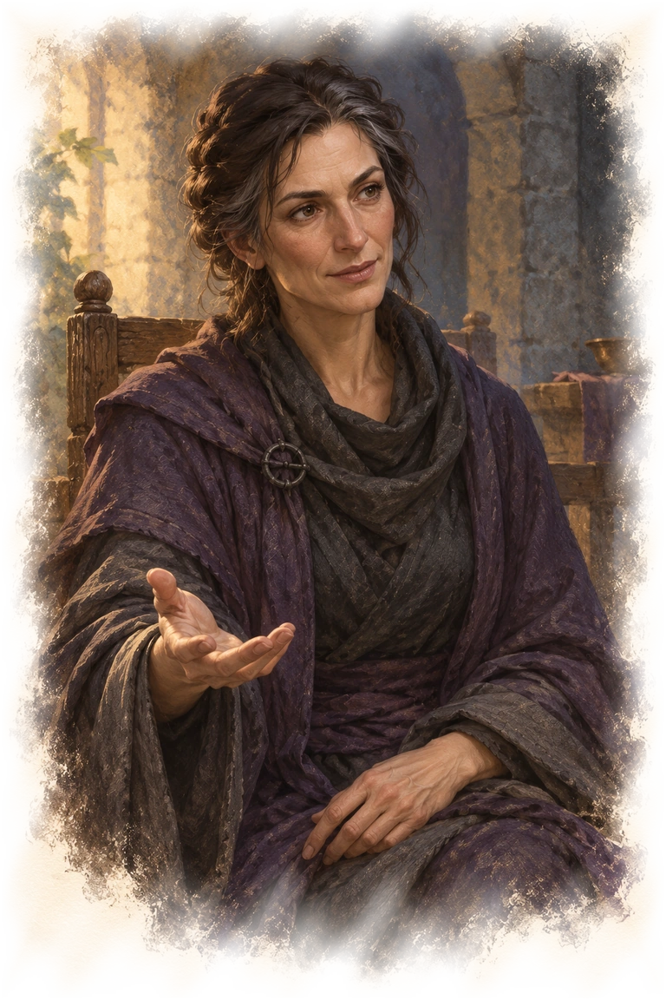
}}

Dans une chambre richement meublée, Ivlis s’agenouille devant une tête de démon fixée au mur. Elle s’adresse à son trophée lorsqu’elle se croit seule. La tête ne répond pas par un pouvoir nouveau.

Ivlis tente d’abord de séduire les personnages par des promesses de puissance, de richesses et d’immortalité. Elle leur demande de se soumettre au culte et d’accepter de devenir des morts-vivants. À un Mage Rouge, elle présente son culte comme une voie qu’aucun zulkir ne lui a offerte. À un guerrier, elle promet de ne plus craindre la mort. Elle n’a aucune raison de raconter tout son passé avant qu’on puisse l’interrompre.

« Vos maîtres vous féliciteront tant que vous leur serez utiles. Ici, vous pourriez cesser de demander leur permission. »

Ces paroles ouvrent une décision, pas une soumission automatique. Si les personnages refusent ou attaquent, Ivlis combat. Lorsque ses points de vie tombent à 15 ou moins, elle tente de fuir par la porte secrète pour reconstituer son culte ailleurs. Si elle s’échappe, elle emporte ce qu’elle peut réellement atteindre ; elle ne récupère pas la cloche à distance.

La tête de démon pivote et révèle 100 po, un grenat de 100 po et deux objets magiques. Parmi les effets d’Ivlis se trouve aussi un brouillon non envoyé : elle y propose une relique capable de relever des morts à un intermédiaire du zulkir de nécromancie. Ce papier est un raccord discret possible avec la campagne, non la preuve que Szass Tam a fondé le culte ou créé la cloche.

### Le faux trésor et la fuite (K8)

Un coffre de fer noir s’ouvre lorsque quelqu’un approche à 1,50 mètre et répand 300 fausses pièces d’or. Un examen sommaire suffit à constater leur nature. Ivlis compte sur la cupidité de ses poursuivants pour gagner du temps. Les portes secrètes se découvrent depuis l’extérieur par un test de Sagesse (Perception) DD 15 lors d’une recherche ; elles sont évidentes depuis la pièce cachée.

# Mettre fin aux attaques

## La source des Aulnes

{{wide
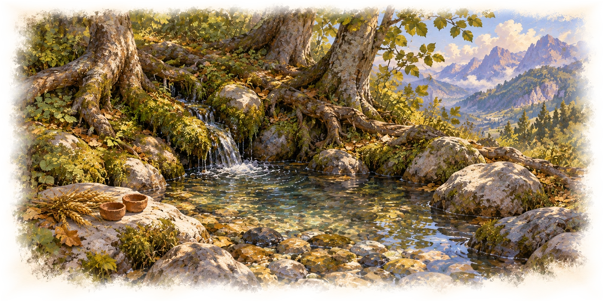
}}

Le petit bassin se trouve en contrebas de la piste, hors des cavernes. Des pierres lisses entourent une eau claire sous les racines de vieux arbres. Des paysans y ont laissé des épis et de simples figurines de terre en offrande à Chauntéa.

Le livre du laboratoire indique comment utiliser cette eau. Yelena peut également reconnaître la description du lieu si les personnages reviennent demander de l’aide. Il n’est pas nécessaire de réussir un second test après avoir trouvé la bonne information.

Immerger complètement la cloche dans cette eau la détruit et met fin à sa magie. La présence des monstres ne s’efface pas avec l’objet : certains quittent le ravin à terme, d’autres ont trouvé un repaire qu’ils veulent conserver. Les pillards encore organisés peuvent toujours être dangereux.

Si les personnages préfèrent remettre la relique à Yelena, elle l’examine sans annoncer qu’elle est inoffensive. Elle peut expliquer les risques et proposer de les accompagner à la source. Elle ne la confisque pas secrètement pour lancer une nouvelle conspiration sans décision du MJ.

## Revenir chez Yelena

Le retour permet de donner un sens aux choix du groupe. Vinx peut témoigner, les possessions d’un disparu peuvent être rendues et le plan du raid peut aider à défendre les maisons.

**Vinx sauvée, menace encore présente.** Yelena paie la mission et demande ce que les personnages ont découvert. Elle peut organiser des guetteurs et prévenir les autorités de Fort Gar. Elle ne les traite pas de lâches parce qu’ils n’ont pas nettoyé chaque caverne.

**Gobelours arrêtés ou désunis.** Le hameau évite une attaque. Les survivants cherchent une autre proie ou un accord ; ils ne se reforment pas automatiquement dès le départ du groupe.

**Culte vaincu, cloche emportée.** Le groupe possède un objet dangereux et une décision à prendre. Si Ivlis a fui, son retour demeure une possibilité, pas une conséquence obligatoire.

**Cloche détruite.** Le culte perd sa relique et sa capacité à attirer de nouvelles menaces par ce moyen. Le ravin reste un lieu à surveiller, mais les habitants du hameau retrouvent une marge de sécurité.

**Accord ou retrait.** Les personnages peuvent sauver des gens sans vaincre tous les adversaires. Yelena évalue ce qui a été accompli et ce qu’elle doit encore faire ; les conséquences découlent de faits précis, pas d’un verdict moral sur les joueurs.

## Une ombre venue de Thaymount

Le brouillon d’Ivlis peut être ignoré sans rendre la conclusion incomplète. Si le groupe le remet à Yelena, elle reconnaît le titre mentionné et explique sobrement qu’il désigne Szass Tam. Elle ne prétend pas prouver que le zulkir était au courant : la lettre n’a pas été envoyée.

« Il a beaucoup de gens qui cherchent à attirer son attention. Cela ne veut pas dire qu’il les écoute. Gardez ce que vous avez vu en mémoire. »

Cette seule trace suffit à préparer une résonance ultérieure. Elle n’annonce ni le nom ni les détails d’Operation Deadfall aux personnages. Le lien éventuel devient un élément de campagne uniquement lorsque le MJ le retient et que la découverte a réellement lieu.

# Annexes du maître du jeu

## Rythme et périmètre

Le livre décrit le ravin entier pour que les personnages puissent choisir leur chemin. Il ne demande pas d’explorer les soixante-quatre lieux ni de vaincre tous leurs habitants. Pour viser deux ou trois séances, recentrer les informations de départ sur Vinx et les attaques, puis laisser les indices déjà présents conduire vers les responsables que le groupe décide d’affronter. Ne pas ajouter des combats aléatoires pour remplir le trajet.

Une première séance peut couvrir la commande, l’approche et la recherche de Vinx. Une deuxième peut traiter les alliances, la découverte du culte et une première approche du sanctuaire. La conclusion peut survenir dans cette séance ou dans une troisième. Ces repères dépendent de la durée réelle des séances, non renseignée, et ne sont pas un ordre de scènes obligatoire. L’exploration exhaustive du ravin est un autre format, plus long.

Le niveau 3 est un choix proposé pour ce prélude. Aucun gain automatique de niveau ne dépend du nombre de repaires visités. Conserver les caractéristiques et les types des monstres ; contrôler séparément la difficulté selon le nombre de personnages et leurs ressources. Un combat qui réunit plusieurs repaires n’est pas réputé équilibré.

## Récompenses magiques

Le texte original renvoie à une table d’objets de son annexe A, absente des fichiers fournis. Les occurrences d’un « objet magique » sont conservées dans ce livre afin de ne pas effacer les trésors, mais leur identité n’est pas prétendue connue. Préparer ces tirages avec le livre avant la partie.

Pour jouer sans cette annexe, le MJ peut choisir à la place quelques récompenses connues de ses règles et réparties entre les caches réellement visitées : potions de soins, parchemins de sorts utilitaires ou un objet permanent adapté au groupe. Cette sélection est une adaptation de récompense, pas une restitution de la table originale. Les valeurs en pièces indiquées dans les salles restent celles de l’aventure ; il n’est pas nécessaire de faire toutes les caches pour recevoir la récompense de Yelena.

## Profils et règles nécessaires

Les noms entre parenthèses ci-dessous permettent de retrouver la VO sans affirmer une traduction officielle indisponible : guerrier kobold (*Kobold Warrior*), mille-pattes géant (*Giant Centipede*), dragonnet de cuivre (*Copper Dragon Wyrmling*), méphite de vapeur (*Steam Mephit*), maraudeur kuo-toa (*Kuo-Toa Marauder*), mimique (*Mimic*), nothic (*Nothic*), charognard rampant (*Carrion Crawler*), épée volante animée (*Animated Flying Sword*), guerrier et chef gobelins (*Goblin Warrior*, *Goblin Boss*), araignée géante (*Giant Spider*), ogre (*Ogre*), dragonnet rouge (*Red Dragon Wyrmling*), guerrier hobgobelin (*Hobgoblin Warrior*), cube gélatineux (*Gelatinous Cube*), ours-hibou (*Owlbear*), vase grise (*Gray Ooze Glob*), cultiste (*Cultist*), *Wight Lifedrinker*, guerrier gobelours (*Bugbear Warrior*), minotaure de Baphomet (*Minotaur of Baphomet*), strige (*Stirge*), scarabée de feu géant (*Giant Fire Beetle*), guerrier gnoll (*Gnoll Warrior*), zombie (*Zombie*), zombie ogre (*Ogre Zombie*) et squelette (*Skeleton*).

Les profils propres à **Vinx, Narthus et Ivlis** ne figurent pas intégralement dans l’HTML des cavernes. Leur présence dans ce récit ne vaut pas fourniture d’un bloc chiffré. Préparer ces profils autorisés avant la partie ; aucune capacité de leur combat n’a été inventée ici pour combler la lacune. Les autres profils sont référencés par le texte importé et doivent également être disponibles au MJ. Les plans et illustrations liés dans l’HTML sont encore absents localement.

Les montants, tests et mécanismes de pièges décrits sont issus de la source, avec conversion descriptive des distances en français. La limitation des squelettes aux quatre amas présents clarifie l’interprétation choisie de la cloche ; elle n’accorde pas une production infinie de morts-vivants. Les repos sont arbitrés selon les règles et la sécurité du lieu, plutôt que présentés comme une interdiction générale des repos longs en souterrain.

## Provenance et modifications de cadre

Source : `sources/chapters/heroes-of-the-borderlands-caves-of-chaos/chapter.txt`. Cadre : `sources/chapters/chapter-01-thay/entities/tharchs/Gauros.md` ; société et patronage : entrées `014-ThayanKnights.md`, `045-Laws.md`, `050-Religion.md` et `054-RedWizardPatronage.md`.

Yelena Voss, le hameau, son mandat et l’implantation de la source des Aulnes sont des ajouts locaux. Le rôle de Vinx comme éclaireuse lie sa captivité originale à la mission. Le passé local d’Ivlis remplace son lien avec le fort des Borderlands. Les robes sombres évitent de distribuer aux cultistes une couleur réservée aux Mages Rouges. Le brouillon destiné à un intermédiaire de Szass Tam est un raccord de campagne proposé, sans fondement revendiqué dans l’original. Aucun autre habitant du ravin n’est déclaré son agent.

Les passages des plans restent inchangés : D5–E3, D4–F2, G6–K5 et H5–I3. Les titres des salles ont été rédigés pour la lecture ; leurs repères d’origine restent indiqués entre parenthèses pour retrouver les cartes.
